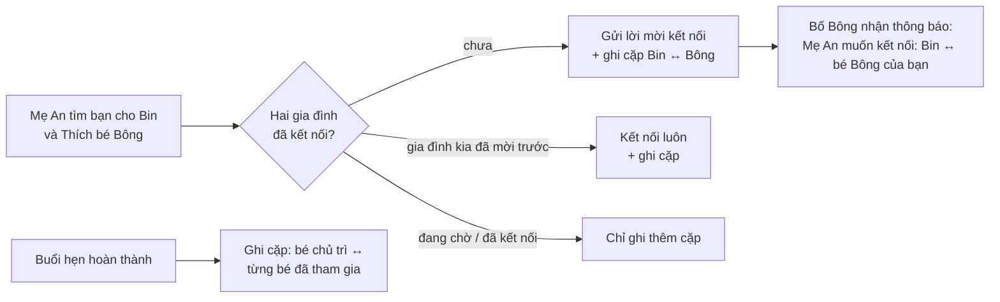
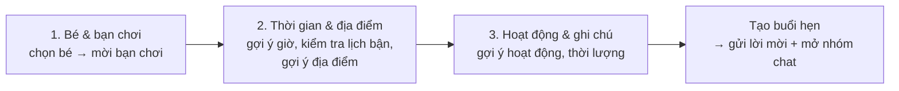

# BUD-48 — Ghép cặp bé & lên kế hoạch Playdate

Tài liệu mô tả **cách BuddyLink hoạt động** sau BUD-48, theo góc nhìn nghiệp vụ: phụ huynh làm gì, hệ thống quyết định thế nào, người dùng thấy gì. Chi tiết kỹ thuật xem trong code và `Back-End/docs/DATABASE_SCHEMA.md`.

> **Tóm tắt:** kết nối vẫn là giữa **hai phụ huynh**, nhưng hệ thống giờ nhớ **bé nào hợp với bé nào**. Mọi buổi hẹn bắt đầu từ **bé**: hệ thống gợi ý bạn chơi, giờ, địa điểm, hoạt động, báo trùng lịch ngay khi chọn và nhắc lịch trước buổi hẹn.

---

## 1. Tìm bạn cho từng bé (Discovery)

- Phụ huynh có nhiều bé chọn bé đang tìm bạn ở mục **"Đang tìm bạn cho…"**. Phụ huynh chỉ có 1 bé thì hệ thống tự chọn bé đó.
- Mỗi lượt **Thích / Bỏ qua** được ghi cho **bé đang chọn**:
  - Có thể Thích cùng một bé cho từng con của mình (ví dụ Bé Na hợp với cả Bin lẫn Bông).
  - Thẻ đã vuốt cho Bin vẫn hiện khi tìm bạn cho Bông.
- **Thích một bé = gửi lời mời kết nối** tới phụ huynh của bé đó (như trước), kèm thông tin **cặp bé**.

## 2. Kết nối và các cặp bé

- Một kết nối có thể có **nhiều cặp bé**. Một cặp chỉ được ghi một lần, dù Thích lại hay hai bên cùng Thích nhau.
- Cặp có hai nguồn: **ghép từ Khám phá** (Thích) và **đã chơi cùng** (đã đi chung một buổi hẹn hoàn thành).
- Thẻ kết nối hiện **"Bông (5 tuổi) ↔ Bin"**; lời mời đến thì hiện **"Muốn kết nối: Bông (5 tuổi) ↔ bé Bin của bạn"**. Chỉ hiện tuổi, không bao giờ hiện ngày sinh.
- Ghi cặp **không tốn lượt** kết nối của gói Free; chỉ tạo kết nối mới mới tốn lượt như trước.
- Nút **"Mời bé hẹn chơi"** trên thẻ kết nối mở form tạo buổi hẹn, chọn sẵn bé của mình và gia đình đó.

## 3. Mức độ phù hợp

Hệ thống chấm điểm 0–100 cho mỗi cặp bé:

| Tiêu chí | Điểm tối đa | Ý nghĩa |
| --- | --- | --- |
| Tuổi | 30 | Bé kia nằm trong độ tuổi phụ huynh mong muốn |
| Sở thích chung | 35 | Hai bé có cùng sở thích, hoạt động yêu thích |
| Khoảng cách | 20 | Hai nhà càng gần càng cao (trong 15 km) |
| Lịch & địa điểm ưa thích | 15 | Hai phụ huynh hợp ngày, khung giờ, loại địa điểm |

Điểm này dùng để xếp hạng thẻ ở Khám phá và danh sách bạn chơi khi tạo buổi hẹn.

## 4. Tạo buổi hẹn — 3 bước

**Bước 1 — Bé & bạn chơi**

- Chọn bé của mình trước; mọi gợi ý bên dưới đều tính theo bé này.
- Danh sách bạn chơi chia 2 nhóm, mỗi nhóm xếp theo điểm phù hợp (hiện 4 bé, còn lại trong "Xem thêm"):
  - **Bạn chơi của bé**: các bé đã được ghép đôi với bé đang chọn.
  - **Các bé khác trong gia đình bạn bè.**
- Hai bé lệch **hơn 3 tuổi** thì hiện nhắc nhở màu vàng, nhưng vẫn mời được.

**Bước 2 — Thời gian & địa điểm**

- **Gợi ý giờ:** các khung sáng 9:00, chiều 15:00, tối 18:00 trong 7 ngày tới.
  - Khung hợp với ngày và giờ ưa thích của nhiều gia đình nhất xếp trước.
  - Không gợi ý giờ đã qua, hay giờ mà một trong các bé đã có hẹn khác.
  - Nếu chưa ai đặt lịch ưa thích thì ưu tiên sáng cuối tuần.
- **Kiểm tra lịch bận:** xem [mục 5](#5-trùng-lịch).
- **Thời lượng:** 30 phút đến 4 giờ (mặc định 2 giờ); hệ thống tự tính giờ kết thúc.
- **Gợi ý địa điểm:**
  - Tìm quanh **điểm giữa các nhà**, ưu tiên loại địa điểm mà mọi phụ huynh cùng thích (ví dụ công viên).
  - Bỏ các nơi chưa hợp tuổi bé nhỏ nhất (trung tâm thể thao, workshop cần từ 4 tuổi).
  - Mỗi địa điểm ghi khoảng cách tới từng nhà, ví dụ "Cách Nhà bạn 1,2 km · Mẹ Lan 2,4 km"; có nút **Chi tiết** và **Google Maps**.
  - Vẫn có thể tìm địa điểm khác trên bản đồ hoặc nhập tay.

**Bước 3 — Hoạt động & ghi chú**

- Ô hoạt động: chọn trong danh sách toàn bộ hoạt động (hoạt động bé yêu thích lên đầu) hoặc tự gõ tên.
- **Gợi ý hoạt động** theo sở thích chung của các bé, kèm lý do:
  - "Cả hai bé đều thích xếp hình lego";
  - "Na và Bin thích âm nhạc & ca hát".
- Chọn một gợi ý thì **thời lượng tự đổi** theo thời lượng thường gặp của hoạt động, rút ngắn cho bé nhỏ (dưới 3 tuổi tối đa 1,5 giờ, dưới 5 tuổi tối đa 2 giờ). Nếu phụ huynh đã tự chọn thời lượng thì hệ thống chỉ gợi ý, không tự đổi.

**Sau khi tạo:** các gia đình được mời nhận thông báo. Nhóm chat bắt đầu với người tổ chức; ai nhận lời thì được vào nhóm.

## 5. Trùng lịch

Nguyên tắc: **một bé không thể ở hai buổi hẹn cùng lúc.** Hai buổi nối tiếp nhau thì không tính là trùng (ví dụ 10:00–12:00 rồi 12:00–14:00).

Hệ thống báo ngay khi phụ huynh chọn ngày và giờ, **không đợi tới lúc bấm gửi**:

| Tình huống | Người dùng thấy | Có tiếp tục được không |
| --- | --- | --- |
| Chọn ngày | "Lịch bận trong ngày: Bé Bin 09:00–11:00 · Bé Sóc 15:00–17:00", hoặc "Ngày này các bé chưa có hẹn nào khác" | — |
| Giờ chọn trùng lịch **bé của mình** (tạo hẹn, đổi lịch) | Thông báo đỏ + nút **"Chọn 11:00 (giờ trống gần nhất)"** | Không, phải đổi giờ |
| Giờ chọn trùng lịch **bé được mời** | Nhắc vàng: phụ huynh của bé sẽ chưa nhận lời được | Có, vẫn gửi lời mời |
| Được mời nhưng bé của mình đã bận giờ đó | "Bé Sóc đã có hẹn khác 16:00–18:00, trùng giờ này"; nút **Chấp nhận** bị khoá | Chỉ có thể từ chối |
| Có đề xuất đổi lịch sang giờ bé của mình đang bận | Như trên; nút **Đồng ý lịch mới** bị khoá | Chỉ có thể từ chối lịch mới |

Với bé của gia đình khác, hệ thống chỉ cho biết **giờ bận**, không cho biết bé bận với ai hay buổi hẹn nào.

## 6. Nhắc lịch

| Thời điểm | Nội dung |
| --- | --- |
| Trước 24 giờ | "Nhắc lịch Playdate — "Thả diều" diễn ra lúc 07:00 ngày 11/03 tại Công viên Biển Đông." |
| Trước 1 giờ | "Playdate sắp bắt đầu — … Chuẩn bị lên đường nhé!" |

- **Người nhận:** người tổ chức và các gia đình **đã nhận lời**.
- Mỗi lời nhắc chỉ gửi **một lần**.
- Buổi hẹn tạo khi còn dưới 24 giờ thì chỉ có nhắc 1 giờ.
- Đổi lịch thì lời nhắc được tính lại theo giờ mới.

## 7. Danh sách buổi hẹn

- **Tab "Tất cả":**
  - Các buổi **sắp tới** đứng trước, buổi gần nhất ở trên cùng.
  - Sau đó tới các buổi **đã qua** (đã chơi, đã huỷ), buổi mới nhất ở trên.
- **Tab Sắp tới / Chờ phản hồi / Đã xác nhận:** gần nhất trước.
- **Tab Đã chơi / Đã huỷ:** mới nhất trước.
- Thứ tự tính theo **cả ngày lẫn giờ bắt đầu**: hai buổi cùng ngày thì buổi sớm hơn đứng trước.

## 8. Trang chi tiết buổi hẹn

Trang chi tiết hiển thị **giống form tạo**, cùng 3 bước nhưng chỉ để xem:

1. Người tổ chức và các gia đình được mời, kèm trạng thái: đã tham gia / chờ phản hồi / đã từ chối.
2. Ngày, giờ, thời lượng, địa điểm (có link Google Maps).
3. Hoạt động và lời nhắn của người tổ chức.

**Phía trên trang:**
- Lời mời đang chờ trả lời.
- Đề xuất đổi lịch, kèm nút bỏ phiếu.
- Kết quả đổi lịch.
- Thông báo buổi hẹn đã huỷ.

**Bên phải:** các nút hoàn thành, nhóm chat, đổi lịch, huỷ (tuỳ quyền). Khi đổi lịch, người tổ chức chọn được cả thời lượng mới.

## 9. Vị trí và khoảng cách

- Vị trí lưu của mỗi gia đình là **tâm phường/xã** họ khai báo, **không phải địa chỉ nhà**. Khoảng cách ở Khám phá và ở gợi ý địa điểm đều tính từ điểm này.
- Dùng **đơn vị phường mới sau sáp nhập 07/2025** (ví dụ Phường Hội An Đông, Phường Hải Châu). Phụ huynh còn ghi tên phường cũ thì hệ thống tự quy về phường mới (ví dụ Phước Mỹ → An Hải).
- Không tìm được phường thì hệ thống dùng tâm thành phố, khi đó khoảng cách chỉ là ước lượng.
- Ngày 24/10/2026 đã cập nhật lại vị trí của toàn bộ 52 phụ huynh trên dữ liệu dev. Có 4 người trước đó bị đặt nhầm ở tâm thành phố (lệch tới 26 km).

## 10. Chưa làm / giới hạn

- Chưa có **đánh giá sao từ Google** cho địa điểm: OpenStreetMap không có dữ liệu này, muốn có phải dùng Google Places API (trả phí).
- Chưa có **bình chọn giờ** (đưa 2–3 khung giờ cho các gia đình chọn); sẽ làm ở ticket riêng.
- Các lượt vuốt cũ của phụ huynh có nhiều bé (trước BUD-48) không xác định được dành cho bé nào, nên được tính là đã vuốt cho mọi bé.
- Phường cũ bị tách thành nhiều phường mới thì chỉ quy về được một phường.

---

### Phụ lục cho dev

| Việc | Ở đâu |
| --- | --- |
| Quy tắc chấm điểm | `Back-End/src/modules/discovery/matching.rules.js` |
| Quy tắc gợi ý giờ, địa điểm, hoạt động | `Back-End/src/modules/playdate/playdate-suggestion.rules.js`, danh mục hoạt động `playdate.activities.js` |
| Trùng lịch, nhắc lịch | `playdate.service.js` (`getBusyIntervals`, `sendDueReminders`), job `jobs/playdate-reminder.job.js` |
| Geocode phường | `Back-End/src/integrations/maps/geocoding.adapter.js` |
| Trang tạo / chi tiết | `Front-End/src/modules/playdate/pages/PlaydateFormPage.jsx` |
| API mới | `GET /playdates/suggestions/{time-slots,places,activities}`, `GET /playdates/busy-times` |
| Script (đã chạy trên dev 24/10/2026) | `npm run migrate:bud48 -- --apply` (tạo 28 cặp bé từ dữ liệu cũ), `npm run geocode:parents -- --apply` |
| Postman | `Back-End/test/postman/BuddyLink-BUD48-Child-Pairing-Planning.postman_collection.json` |
