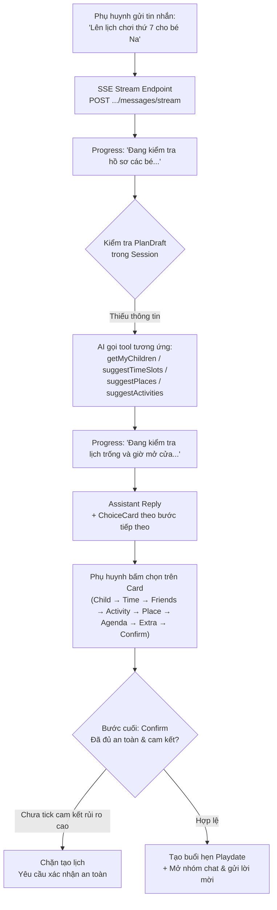
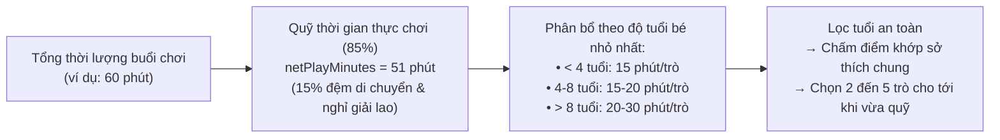
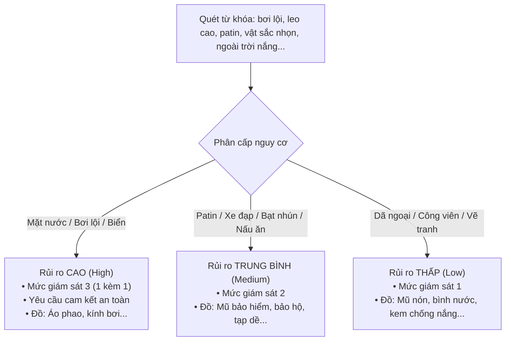

# BUD-49 — Nâng cấp Trợ lý AI & Hệ thống An toàn Lên kế hoạch Playdate

Tài liệu mô tả **cách BuddyLink hoạt động** sau khi triển khai **BUD-49**, theo góc nhìn nghiệp vụ lẫn kỹ thuật: phụ huynh thao tác thế nào, hệ thống AI tính toán và bảo vệ an toàn ra sao, người dùng nhìn thấy gì trên giao diện. Chi tiết kỹ thuật đối chiếu trực tiếp với mã nguồn và kiến trúc của hệ thống.

> **Tóm tắt:** BuddyLink nâng cấp Trợ lý AI lên một tầm cao mới: không chỉ là chatbot gợi ý thông thường mà trở thành một **Trợ lý điều phối Playdate toàn diện (Full-lifecycle AI Assistant & Safety Engine)**. Hệ thống tự động cân đối lịch trình theo lứa tuổi và sở thích của tất cả các bé trong nhóm, tìm kiếm trò chơi thực tế có kiểm chứng từ Google Search Grounding (chống ảo giác), kích hoạt cơ chế giám sát an toàn nghiêm ngặt (cảnh báo nguy cơ, phân công người lớn đi kèm, cam kết rủi ro), gom toàn bộ quy tắc vào bộ đánh giá cảnh báo 3 cấp độ (`block`, `warn`, `info`), kiểm tra giờ mở cửa chính xác bằng `opening_hours`, hỗ trợ quản lý lịch hẹn (xem, dời, hủy) qua chat, phản hồi tiến trình trực tiếp theo thời gian thực (SSE), tích hợp dự báo thời tiết Open-Meteo và tính năng bình chọn giờ chơi (Poll) trong group chat.

---

## Mục lục

1. [Luồng lên kế hoạch với Trợ lý AI (Plan Draft & SSE Streaming)](#1-luồng-lên-kế-hoạch-với-trợ-lý-ai-plan-draft--sse-streaming)
2. [Phần A — Lịch trình thông minh & Xác thực (Smart Agenda & Catalog)](#2-phần-a--lịch-trình-thông-minh--xác-thực-smart-agenda--catalog)
   - [A1. Lịch trình theo cả nhóm bé](#a1-lịch-trình-theo-cả-nhóm-bé)
   - [A2. Thuật toán cân đối thời lượng (`pickAttractions`)](#a2-thuật-toán-cân-đối-thời-lượng-pickattractions)
   - [A3. Phân loại tìm kiếm trò chơi theo địa điểm (`shouldSearchAttractions`)](#a3-phân-loại-tìm-kiếm-trò-chơi-theo-địa-điểm-shouldsearchattractions)
   - [A4. Tra cứu trò chơi thực tế có nguồn dẫn (Google Search Grounding & Cache 30 ngày)](#a4-tra-cứu-trò-chơi-thực-tế-có-nguồn-dẫn-google-search-grounding--cache-30-ngày)
   - [A5. Nút "Tìm trò chơi tại đây" trên thẻ Agenda](#a5-nút-tìm-trò-chơi-tại-đây-trên-thẻ-agenda)
   - [A6. Chống ảo giác AI (Anti-Hallucination Guard)](#a6-chống-ảo-giác-ai-anti-hallucination-guard)
3. [Phần B — Hệ thống An toàn & Giám sát (Safety Engine)](#3-phần-b--hệ-thống-an-toàn--giám-sát-safety-engine)
   - [B1. Đánh giá rủi ro an toàn & Cấu trúc Note mới 3 phần](#b1-đánh-giá-rủi-ro-an-toàn--cấu-trúc-note-mới-3-phần)
   - [B2. Xác nhận cam kết rủi ro cao (`safetyAcknowledged`)](#b2-xác-nhận-cam-kết-rủi-ro-cao-safetyacknowledged)
   - [B3. Ma trận gợi ý đồ dùng mang theo](#b3-ma-trận-gợi-ý-đồ-dùng-mang-theo)
   - [B4. Nhắc lịch 24 giờ kèm thông tin an toàn](#b4-nhắc-lịch-24-giờ-kèm-thông-tin-an-toàn)
   - [B5. Điều phối người lớn đi kèm (Chaperone Management)](#b5-điều-phối-người-lớn-đi-kèm-chaperone-management)
4. [Phần C — Bộ quy tắc cảnh báo tập trung (`evaluateDraftWarnings`)](#4-phần-c--bộ-quy-tắc-cảnh-báo-tập-trung-evaluatedraftwarnings)
   - [Ma trận cảnh báo 3 cấp độ](#ma-trận-cảnh-báo-3-cấp-độ)
   - [Tích hợp thư viện `opening_hours` ở 3 vị trí trọng yếu](#tích-hợp-thư-viện-opening_hours-ở-3-vị-trí-trọng-yếu)
5. [Phần D — Mở rộng năng lực AI Chat & Realtime](#5-phần-d--mở-rộng-năng-lực-ai-chat--realtime)
   - [D1. Quản lý lịch hẹn qua hội thoại (Xem / Dời / Hủy / Trả lời mời)](#d1-quản-lý-lịch-hẹn-qua-hội-thoại-xem--dời--hủy--trả-lời-mời)
   - [D2. Tích hợp thời tiết Open-Meteo & Cảnh báo `BAD_WEATHER`](#d2-tích-hợp-thời-tiết-open-meteo--cảnh-báo-bad_weather)
   - [D3. Streaming tiến trình thực thi (Server-Sent Events)](#d3-streaming-tiến-trình-thực-thi-server-sent-events)
   - [D4. Đề xuất tái hẹn duy trì chuỗi gặp gỡ (Streak Reconnect)](#d4-đề-xuất-tái-hẹn-duy-trì-chuỗi-gặp-gỡ-streak-reconnect)
   - [D5. Bình chọn giờ trong Group Chat (Poll Message)](#d5-bình-chọn-giờ-trong-group-chat-poll-message)
6. [Phụ lục kỹ thuật cho Nhà phát triển (Developer Appendix)](#6-phụ-lục-kỹ-thuật-cho-nhà-phát-triển-developer-appendix)

---

## 1. Luồng lên kế hoạch với Trợ lý AI (Plan Draft & SSE Streaming)

Quá trình lên lịch hẹn với AI Assistant hoạt động dưới dạng **hội thoại tương tác hai chiều** (vừa gõ text tự nhiên, vừa bấm chọn trực tiếp trên các `ChoiceCard`).



- **Quản lý phiên (`ai_sessions`):** Bản nháp `planDraft` gắn liền với phiên chat.
- **Tiến trình mượt mà (Progress Streaming):** Thay vì spinner tĩnh khiến người dùng tưởng ứng dụng treo khi AI chạy Function Calling đa vòng (30-60 giây), hệ thống phát sự kiện Server-Sent Events (SSE) hiển thị trạng thái công việc AI đang xử lý theo thời gian thực.
- **Tuần tự các bước (`AI_STEPS`):** `child` ➔ `time` ➔ `playmates` ➔ `activity` ➔ `place` ➔ `agenda` ➔ `extra` ➔ `confirm`.

---

## 2. Phần A — Lịch trình thông minh & Xác thực (Smart Agenda & Catalog)

### A1. Lịch trình theo cả nhóm bé
- **Trước BUD-49:** Trợ lý AI chỉ sinh ra các trò chơi chung chung hoặc chỉ dựa vào bé chủ trì (`hostChild`), dẫn đến lịch trình có thể quá khó với bé nhỏ hơn hoặc nhàm chán với bé lớn hơn.
- **Sau BUD-49:**
  - Tại bước `AI_STEPS.AGENDA`, hệ thống tổng hợp thông tin của toàn bộ nhóm trẻ: `hostChild` và danh sách `participants` (tên hiển thị, tuổi, sở thích, hoạt động yêu thích).
  - Đưa danh sách này vào tham số `next` của kết quả `plan-steps.js`.
  - Prompt hướng dẫn AI ưu tiên chọn các hoạt động có độ giao thoa sở thích cao nhất từ catalog chuẩn `playdate.activities.js`.

### A2. Thuật toán cân đối thời lượng (`pickAttractions`)
Hàm thuần `pickAttractions` trong `playdate.activities.js` phân bổ thời lượng thông minh:



- **Số lượng trò:** Khống chế tối thiểu 2 trò, tối đa 5 trò (ví dụ: buổi 60 phút có 3-4 trò, không nhồi nhét quá nhiều).
- **Tránh trò sáo rỗng:** Tự động loại bỏ các mục không phải trò chơi cụ thể (như "chào hỏi làm quen", "khởi động nhẹ", "tạm biệt ra về").

### A3. Phân loại tìm kiếm trò chơi theo địa điểm (`shouldSearchAttractions`)
Hàm `shouldSearchAttractions(place)` trong `playdate-suggestion.rules.js` phân loại địa điểm thành 3 nhóm:

| Trạng thái trả về | Loại địa điểm | Cách xử lý trò chơi |
| :--- | :--- | :--- |
| `'no'` | `park`, `library`, nhà riêng (`home`) | Địa điểm tự do: Dùng mẫu trò chơi tương tác từ catalog theo sở thích của các bé. Không gọi Google Search. |
| `'yes'` | `kids_cafe` hoặc `sports_center` có khu vui chơi dịch vụ (bạt nhún, leo núi, bowling, trượt băng, công viên nước...) | Tự động kích hoạt tìm kiếm tiện ích & trò chơi thực tế có tại địa điểm qua Google Search Grounding. |
| `'uncertain'` | Trung tâm văn hóa, nhà thiếu nhi, câu lạc bộ, tổ hợp giải trí hỗn hợp | Hiển thị nút bấm để phụ huynh chủ động lựa chọn có tìm kiếm hay không. |

### A4. Tra cứu trò chơi thực tế có nguồn dẫn (Google Search Grounding & Cache 30 ngày)
Khi địa điểm thuộc nhóm `'yes'` hoặc khi phụ huynh nhấn nút tìm kiếm:
1. **Google Search Grounding:** Gọi Gemini thông qua `geminiAdapter.searchPlaceAttractions` với cấu hình:
   `tools: [{ googleSearch: {} }]`
2. **Trích xuất nguồn:** Bóc tách danh sách trò chơi từ `groundingMetadata.groundingChunks`.
3. **Định dạng hiển thị:** Trong lịch trình ghi rõ:  
   `"Theo thông tin trên mạng về {tên địa điểm}: {tên trò chơi} ({sourceUrl})"`
4. **Bộ nhớ đệm (`places_cache`):** Lưu danh sách `attractions` và `attractionsFetchedAt` vào MongoDB với thời gian sống (TTL) **30 ngày**. Nếu địa điểm không có thông tin trên mạng, lưu kết quả rỗng `[]` để không gọi Google lặp lại gây tốn chi phí.

### A5. Nút "Tìm trò chơi tại đây" trên thẻ Agenda
- Khi `shouldSearchAttractions(place)` trả về `'uncertain'`:
  - Thẻ `ChoiceCard` tại bước `AGENDA` xuất hiện nút bấm: **`[🔍 Tìm trò chơi tại đây]`**.
  - Phụ huynh nhấn nút mới kích hoạt tiến trình tra cứu Google Search Grounding, giúp phụ huynh hoàn toàn làm chủ việc tìm kiếm.

### A6. Chống ảo giác AI (Anti-Hallucination Guard)
- Tại `propose-playdate.tool.js`, trước khi lưu vào `draft.agenda`, hệ thống đối chiếu từng mục do AI sinh ra với:
  - Danh mục hoạt động tiêu chuẩn (`PLAYDATE_ACTIVITIES` và `GENERIC_GAMES`).
  - Danh sách `attractions` thực tế đã cache của địa điểm.
- Nếu AI tự ý bịa ra trò chơi không khả thi ở địa điểm đó, hệ thống tự động thay thế bằng trò chơi hợp lệ từ danh sách dự phòng của `pickAttractions`.
- Phụ huynh vẫn giữ toàn quyền gõ chỉnh sửa hoặc thêm/xóa tự do trên giao diện.

---

## 3. Phần B — Hệ thống An toàn & Giám sát (Safety Engine)

### B1. Đánh giá rủi ro an toàn & Cấu trúc Note mới 3 phần
Hàm thuần `evaluateSafetyRules` trong `safety-rules.js` quét từ khóa hoạt động, agenda, địa điểm và độ tuổi bé nhỏ nhất:



Trường `note` của buổi hẹn được chuẩn hóa thành **3 phần độc lập**:
```text
Hoạt động chính (gợi ý bởi BuddyLink AI):
1. Trò chơi 1
2. Trò chơi 2

Lưu ý an toàn:
- Luôn giám sát trực tiếp 1-1 khi trẻ gần khu vực nước, mặc áo phao đạt chuẩn.

Lưu ý thêm / Đồ mang theo:
- Gợi ý đồ mang theo: Áo phao, Kính bơi, Khăn tắm, Quần áo khô dự phòng.
- Lời nhắn riêng của phụ huynh (nếu có)...
```
Hàm tự động tính toán lại mục an toàn mỗi khi phụ huynh chỉnh sửa nội dung agenda.

### B2. Xác nhận cam kết rủi ro cao (`safetyAcknowledged`)
- Khi buổi chơi có hoạt động rủi ro cao (ví dụ: bơi lội, chơi nước):
  - Thẻ `PlaydateDraftCard` hiển thị hộp cảnh báo màu đỏ/hổ phách kèm checkbox:
    `[ ] Tôi đã đọc và cam kết tuân thủ các lưu ý an toàn cho các bé trong suốt buổi hẹn chơi`
  - Nếu phụ huynh **chưa tick chọn**, nút *[Xác nhận tạo lịch hẹn]* bị vô hiệu hóa.
  - Phía backend: `choice-handler.js` kiểm tra cờ `draft.safetyAcknowledged`. Nếu có nguy cơ cao mà chưa xác nhận, API chặn tạo lịch và trả về lỗi `SAFETY_ACKNOWLEDGE_REQUIRED` (400).

### B3. Ma trận gợi ý đồ dùng mang theo
Hệ thống tự động bóc tách và hiển thị dưới dạng các thẻ chip đồ dùng trực quan trên thẻ tóm tắt:
- **Chơi nước / Bơi:** Áo phao, kính bơi, khăn tắm, quần áo khô dự phòng.
- **Patin / Xe đạp / Trượt ván:** Mũ bảo hiểm đạt chuẩn, băng bảo vệ đầu gối và khuỷu tay.
- **Bạt nhún / Leo núi:** Tất chống trượt, quần áo co giãn.
- **Làm bánh / Thủ công:** Tạp dề, khăn lau ướt.
- **Công viên ngoài trời:** Mũ nón, bình nước cá nhân, kem chống nắng, xịt chống muỗi.

### B4. Nhắc lịch 24 giờ kèm thông tin an toàn
Tại mốc 24h trước khi buổi hẹn diễn ra, `playdate-reminder.job.js` và `notification.listener.js`:
1. Trích xuất tự động mục "Lưu ý an toàn" và "Đồ mang theo" từ trường `note`.
2. Đưa nội dung cảnh báo vào thông báo đẩy (push notification) gửi tới các phụ huynh đã nhận lời.
3. Tự động gửi một tin nhắn hệ thống vào nhóm chat của buổi hẹn:  
   `"⏰ Nhắc lịch hẹn: "[Tên hoạt động]" diễn ra lúc [Giờ] ngày [Ngày]... Lưu ý an toàn: ... Đồ mang theo: ..."`

### B5. Điều phối người lớn đi kèm (Chaperone Management)
- **Công thức tính tỷ lệ an toàn:**
  - Hoạt động nguy cơ cao (dưới nước): Tối thiểu **1 người lớn kèm 1 bé**.
  - Trẻ nhỏ dưới 5 tuổi: Tối thiểu **1 người lớn kèm 2 bé**.
  - Trẻ từ 5 tuổi trở lên: Tối thiểu **1 người lớn kèm 3 bé**.
- **Tính năng trong Group Chat (`PlaydateEventCollateralPanel.jsx`):**
  - Khung thông tin bên phải hiển thị trạng thái: **`Người lớn đi kèm (X/Y)`**.
  - Nếu chưa đủ số lượng: Hiển thị cảnh báo màu vàng: `⚠️ Cần thêm ít nhất N phụ huynh xác nhận đi kèm`.
  - Phụ huynh bấm nút **`[Tôi sẽ đi kèm cùng các bé]`** ➔ gọi API `POST /api/v1/playdates/:id/chaperone` với `{ action: 'confirm' }`. Bấm lại để hủy đăng ký (`{ action: 'cancel' }`).

---

## 4. Phần C — Bộ quy tắc cảnh báo tập trung (`evaluateDraftWarnings`)

Gom toàn bộ các luật kiểm tra vào một hàm thuần nhất quán `evaluateDraftWarnings(draft, context)` trong `plan-draft.rules.js`. Mỗi cảnh báo chuẩn hóa theo định dạng:
`{ code: string, severity: 'block' | 'warn' | 'info', params: object }`

Trợ lý AI chỉ phát ngôn cảnh báo có mức độ nghiêm trọng cao nhất (`block` > `warn` > `info`) trong đúng 1 câu ngắn gọn, thân thiện.

### Ma trận cảnh báo 3 cấp độ

| Nhóm | Mã Cảnh Báo | Mức | Điều kiện kích hoạt & Hành vi hệ thống |
| :--- | :--- | :--- | :--- |
| **Thời gian** | `PAST_DATE` | `block` | Khung giờ đã qua so với hiện tại. **Chặn tạo lịch.** |
| | `UNUSUAL_HOUR` | `warn` | Bắt đầu trước 07:00 hoặc kết thúc sau 21:00 (với bé < 5 tuổi: kết thúc sau 20:00). |
| | `NAP_TIME` | `warn` | Rơi vào khung 12:00 - 14:00 đối với trẻ nhỏ <= 4 tuổi. |
| | `SCHOOL_HOURS` | `warn` | 07:30 - 11:30 hoặc 13:30 - 16:30 vào ngày trong tuần (T2-T6) cho trẻ trong độ tuổi đi học (>= 6 tuổi). |
| | `TOO_LONG_FOR_AGE` | `warn` | Thời lượng quá dài so với tuổi (> 90 phút cho bé < 3 tuổi; > 180 phút cho bé < 6 tuổi). |
| | `MEAL_TIME` | `info` | Trùng giờ ăn trưa (11:30 - 13:00) hoặc ăn tối (18:00 - 19:30). Nhắc chuẩn bị đồ ăn nhẹ. |
| | `SHORT_NOTICE` | `info` | Lên lịch hẹn diễn ra trong vòng dưới 4 giờ tính từ lúc tạo. |
| | `HOLIDAY` | `info` | Trùng các ngày lễ lớn tại Việt Nam (01/01, 30/04, 01/05, 02/09) - nhắc đông đúc, nên đặt chỗ trước. |
| **Địa điểm** | `PLACE_CLOSED` | `block` | Dùng thư viện `opening_hours` phân tích khoảng [start, end]. Đang đóng cửa: **Chặn xác nhận.** |
| | `PLACE_CLOSES_EARLY` | `warn` | Địa điểm đóng cửa trong vòng 30 phút sau khi buổi chơi kết thúc. |
| | `OUTDOOR_AFTER_DARK` | `warn` | Hoạt động ngoài trời (công viên, sân chơi) sau 18:00 (thiếu sáng, an ninh, muỗi). |
| | `PLACE_AGE` | `warn` | Độ tuổi tối thiểu quy định của địa điểm lớn hơn tuổi của bé nhỏ nhất. |
| | `ACTIVITY_PLACE_MISMATCH` | `warn` | Hoạt động không tương thích với loại địa điểm (ví dụ: bơi lội nhưng địa điểm là thư viện). |
| | `FAR_PLACE` | `warn` | Khoảng cách từ địa điểm tới nhà của **bất kỳ gia đình nào** > 15 km (tính cho mọi gia đình). |
| | `HOURS_UNKNOWN` | `info` | Địa điểm chưa có dữ liệu giờ mở cửa trên OpenStreetMap. |
| **Agenda** | `AGENDA_OVER_TIME` | `warn` | Tổng thời lượng ước tính các trò chơi vượt quá thời gian buổi chơi. |
| | `ITEM_AGE` | `warn` | Có trò chơi trong agenda không phù hợp độ tuổi của một bé trong nhóm. |
| | `ITEM_NOT_AT_PLACE` | `warn` | Trò chơi không thể diễn ra tại loại địa điểm đã chọn. |
| | `SAFETY_HIGH_RISK` | `block` / `warn` | Có rủi ro cao: Mức `block` nếu chưa tick cam kết; chuyển sang mức `warn` sau khi đã tick. |
| | `AGENDA_TOO_THIN` | `info` | Buổi chơi dài (> 90 phút) nhưng chỉ có đúng 1 trò chơi trong lịch trình. |
| **Người tham gia** | `SCHEDULE_CONFLICT` | `block` | Trùng lịch chơi khác đã xác nhận của một trong các bé. **Chặn tạo lịch.** |
| | `INVITEE_NOT_FRIEND` | `block` | Bé được mời không thuộc danh sách kết nối bạn bè hợp lệ. **Chặn tạo lịch.** |
| | `AGE_GAP` | `warn` | Chênh lệch độ tuổi giữa bé lớn nhất và bé nhỏ nhất trong nhóm > 3 tuổi. |
| | `GROUP_TOO_LARGE` | `warn` | Số lượng trẻ tham gia > 6 bé (khó khăn trong quản lý an toàn). |
| | `NOT_PREFERRED_TIME` | `info` | Khung giờ nằm ngoài danh sách khung giờ ưu tiên của một trong các gia đình. |
| | `NO_SHARED_INTEREST` | `info` | Các bé tham gia không có sở thích chung nào được lưu trong hồ sơ. |
| **Thời tiết** | `BAD_WEATHER` | `warn` | Dự báo thời tiết có mưa, bão hoặc xác suất mưa > 50%. Tự động nâng mức giám sát ngoài trời. |

### Tích hợp thư viện `opening_hours` ở 3 vị trí trọng yếu
Hệ thống sử dụng thư viện chuẩn `opening_hours` của cộng đồng OpenStreetMap:
1. **`rankPlaces`:** Đẩy các địa điểm đang đóng cửa vào ngày/giờ đã chọn xuống cuối danh sách gợi ý.
2. **`suggestTimeSlots`:** Tự động loại bỏ hoàn toàn các khung giờ mà địa điểm đã chọn không mở cửa.
3. **`evaluateDraftWarnings`:** Kiểm tra chặn lần cuối trước khi phụ huynh bấm nút xác nhận tạo lịch hẹn.

---

## 5. Phần D — Mở rộng năng lực AI Chat & Realtime

### D1. Quản lý lịch hẹn qua hội thoại (Xem / Dời / Hủy / Trả lời mời)
AI Assistant bổ sung 4 công cụ Function Calling (`manage-playdates.tools.js`) gọi thông qua Domain Service:
1. **`listMyPlaydates`:** Phụ huynh hỏi *"Tuần này bé có hẹn gì?"*, *"Lịch chơi sắp tới"* ➔ AI liệt kê danh sách lịch hẹn gọn gàng kèm thời gian, địa điểm, bạn chơi.
2. **`reschedulePlaydate`:** Phụ huynh nói *"Dời sang 15:00 Chủ nhật"* ➔ AI tạo yêu cầu dời lịch hẹn (`createRescheduleRequest`).
3. **`cancelPlaydate`:** Phụ huynh nói *"Hủy hẹn với bạn Bin"* ➔ AI hiển thị Thẻ xác nhận (`needsConfirmation = true`) với 2 nút: `[Xác nhận hủy hẹn]` và `[Giữ lại lịch hẹn]`. Chỉ hủy khi người dùng xác nhận.
4. **`respondInvitation`:** Phụ huynh nói *"Đồng ý tham gia"* hoặc *"Từ chối lời mời"* ➔ AI ghi nhận phản hồi vào hệ thống.

### D2. Tích hợp thời tiết Open-Meteo & Cảnh báo `BAD_WEATHER`
- Xây dựng module tích hợp `Back-End/src/integrations/weather/open-meteo.adapter.js`:
  - Gọi API Open-Meteo miễn phí (không cần API key): `https://api.open-meteo.com/v1/forecast`.
  - Bộ nhớ đệm in-memory theo tọa độ làm tròn 0.01 độ trong **3 giờ**.
  - Kiểm tra điều kiện mưa: mã thời tiết WMO `>= 51` (mưa phùn, mưa rào, dông bão) hoặc xác suất mưa `>= 50%`.
  - Kích hoạt cảnh báo `BAD_WEATHER`, gợi ý phụ huynh chuyển sang địa điểm trong nhà có mái che.

### D3. Streaming tiến trình thực thi (Server-Sent Events)
- Endpoint `POST /api/v1/ai-assistant/sessions/:id/messages/stream` gửi sự kiện dạng SSE:
  ```text
  event: progress
  data: {"tool": "suggestPlaces", "message": "Đang gợi ý các địa điểm thuận tiện cho các gia đình..."}
  ```
- Component `MessageList.jsx` bắt sự kiện và hiển thị dòng chữ tiến trình động ngay trong bóng chat trạng thái (`TypingIndicator`), tạo cảm giác phản hồi tức thì và chuyên nghiệp.

### D4. Đề xuất tái hẹn duy trì chuỗi gặp gỡ (Streak Reconnect)
- Lắng nghe sự kiện domain khi phụ huynh hoàn tất đánh giá buổi chơi: `RATING_EVENTS.CREATED` trong `rating-feedback.service.js`.
- Nếu đánh giá từ 4 sao trở lên:
  - `notification.listener.js` tự động gửi thông báo gợi ý:  
    `"Gặp lại bạn cũ thôi nào! 🎉 Buổi hẹn chơi vừa qua thật tuyệt vời! Bạn có muốn AI Assistant gợi ý lên lịch tiếp theo để duy trì kết nối cho các bé không?"`
  - Nhấp vào thông báo sẽ mở Trợ lý AI và nạp sẵn bạn chơi để lên lịch nhanh, kết hợp với điểm số duy trì tình bạn (Streak) trong module `gamification`.

### D5. Bình chọn giờ trong Group Chat (Poll Message)
- **Model `Message`:** Bổ sung trường `poll` lưu câu hỏi, các phương án, hạn chót và danh sách `voterParentIds`.
- **Giao diện bình chọn (`PollMessageCard.jsx`):**
  - Hiển thị trực tiếp trong luồng chat nhóm của buổi hẹn.
  - Phụ huynh nhấn vào phương án mong muốn: Cập nhật tỷ lệ phần trăm (%) và số lượng bình chọn ngay tức thì.
  - Đồng bộ thời gian thực cho mọi thành viên trong phòng chat qua socket: `SOCKET_EVENTS.POLL_VOTED`.
- **Tạo khảo sát (`CreatePollModal.jsx`):** Nút biểu đồ cột `[📊]` cạnh ô nhập chat cho phép người tổ chức tạo nhanh khảo sát 2-5 khung giờ.

---

## 6. Phụ lục kỹ thuật cho Nhà phát triển (Developer Appendix)

| Thành phần kỹ thuật | Vị trí mã nguồn | Chức năng chính |
| :--- | :--- | :--- |
| **Quy tắc an toàn & Giám sát** | `Back-End/src/modules/ai-assistant/safety-rules.js` | Hàm thuần `evaluateSafetyRules`, ma trận rủi ro, tỷ lệ người lớn, đồ mang theo |
| **Bộ quy tắc cảnh báo tập trung** | `Back-End/src/modules/ai-assistant/plan-draft.rules.js` | Hàm thuần `evaluateDraftWarnings`, `buildNote`, `refreshDraft` |
| **Thuật toán Agenda & Catalog** | `Back-End/src/modules/playdate/playdate.activities.js` | Hàm `pickAttractions`, catalog `PLAYDATE_ACTIVITIES`, `GENERIC_GAMES` |
| **Phân loại địa điểm & Giờ mở cửa** | `Back-End/src/modules/playdate/playdate-suggestion.rules.js` | Hàm `shouldSearchAttractions`, `checkPlaceOpeningHours` (`opening_hours`) |
| **Tích hợp Google Search Grounding** | `Back-End/src/integrations/ai/gemini.adapter.js` | Gemini gọi Google Search Grounding `tools: [{ googleSearch: {} }]` |
| **Quản lý Cache trò chơi địa điểm** | `Back-End/src/modules/places/place-attractions.service.js` | Cache 30 ngày attractions vào `places_cache.model.js` |
| **Tích hợp Dự báo thời tiết** | `Back-End/src/integrations/weather/open-meteo.adapter.js` | Gọi Open-Meteo API, cache 3h theo tọa độ, cảnh báo mưa |
| **Công cụ Quản lý lịch qua Chat** | `Back-End/src/modules/ai-assistant/tools/manage-playdates.tools.js` | 4 Function Calling tools: xem, dời, hủy, trả lời mời qua `playdateService` |
| **Streaming tiến trình SSE** | `ai-assistant.controller.js` & `ai-assistant.service.js` | Route `POST /sessions/:id/messages/stream`, phát event `progress` |
| **Xử lý cam kết an toàn & Lựa chọn** | `Back-End/src/modules/ai-assistant/tools/choice-handler.js` | Chặn tạo lịch khi thiếu `safetyAcknowledged`, nút tìm trò chơi |
| **Chống ảo giác Agenda** | `Back-End/src/modules/ai-assistant/tools/propose-playdate.tool.js` | Kiểm duyệt đối chiếu agenda AI sinh ra với danh mục thực tế |
| **Điều phối Chaperone (Backend)** | `playdate.model.js`, `playdate.service.js`, `playdate.route.js` | Lưu trường `chaperones`, endpoint `POST /playdates/:id/chaperone` |
| **Bình chọn Poll (Backend & Socket)** | `chat.service.js`, `chat.controller.js`, `chat.broadcast.js` | Schema `message.model.js`, API tạo & vote poll, socket `poll_voted` |
| **Sự kiện Tái hẹn & Streak** | `rating-feedback.events.js`, `notification.listener.js` | Phát `RATING_EVENTS.CREATED`, gửi thông báo duy trì chuỗi gặp gỡ |
| **Thẻ Draft & Cam kết an toàn (UI)**| `Front-End/src/modules/ai-assistant/components/PlaydateDraftCard.jsx` | Hiển thị lưu ý an toàn, đồ mang theo, checkbox cam kết, huy hiệu cảnh báo |
| **Giao diện Chat & Tiến trình (UI)** | `AIChatPanel.jsx`, `MessageList.jsx`, `useAIChat.js` | Hiển thị trạng thái tiến trình SSE động thay cho spinner tĩnh |
| **Nút tìm trò chơi trên Card (UI)** | `Front-End/src/modules/ai-assistant/components/ChoiceCard.jsx` | Nút `[🔍 Tìm trò chơi tại đây]` khi địa điểm là `uncertain` |
| **Khảo sát Poll trong Chat (UI)** | `PollMessageCard.jsx`, `CreatePollModal.jsx`, `MessageItem.jsx` | Thẻ bình chọn trực tiếp và modal tạo khảo sát |
| **Bảng điều phối Chaperone (UI)** | `PlaydateEventCollateralPanel.jsx` | Thẻ tính tỷ lệ an toàn người lớn / trẻ em và nút xác nhận đi kèm |
| **Unit Tests Backend** | `Back-End/test/unit/ai-assistant.rules.test.js` | Bộ 26 unit tests kiểm tra toàn diện an toàn, giờ mở cửa, cảnh báo |
| **Unit & Integration Tests Frontend** | `Front-End/src/test/components/AIAssistantComponents.test.jsx` | Kiểm tra giao diện Draft Card, Choice Card, Chat Panel và tương tác |

