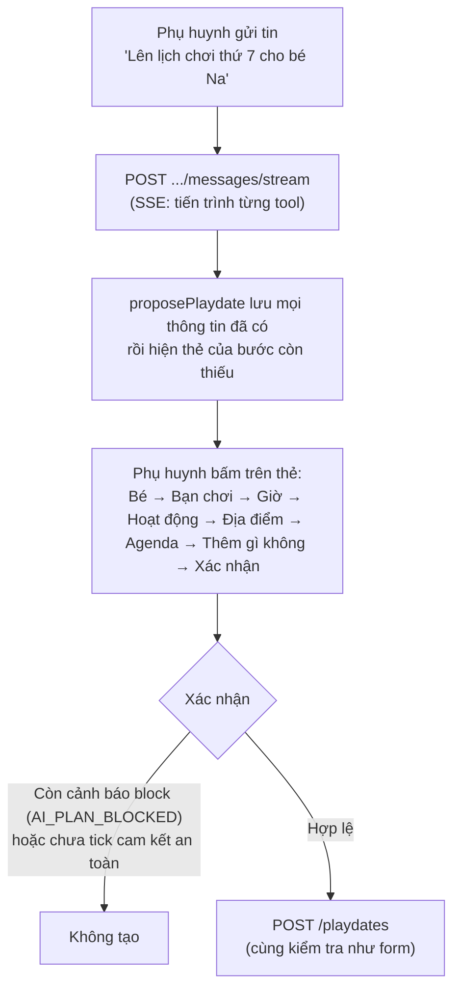

# BUD-49 — Nâng cấp Trợ lý AI & lên kế hoạch Playdate

Tài liệu mô tả **cách hệ thống hoạt động sau BUD-49**, đối chiếu với từng mục của ticket Jira và với mã nguồn. Nếu tài liệu và code khác nhau, code là đúng: hãy sửa lại tài liệu.

---

## Mục lục

1. [Đối chiếu với Jira](#1-đối-chiếu-với-jira)
2. [Luồng lên kế hoạch với Trợ lý AI](#2-luồng-lên-kế-hoạch-với-trợ-lý-ai)
3. [Nhiều bé của chủ trì trong một buổi hẹn](#3-nhiều-bé-của-chủ-trì-trong-một-buổi-hẹn)
4. [A — Agenda (hoạt động chính trong note)](#4-a--agenda-hoạt-động-chính-trong-note)
5. [B — An toàn](#5-b--an-toàn)
6. [C — Luật thời gian, địa điểm và cảnh báo](#6-c--luật-thời-gian-địa-điểm-và-cảnh-báo)
7. [D — Chức năng mới của AI chat](#7-d--chức-năng-mới-của-ai-chat)
8. [Bạn chơi và địa điểm](#8-bạn-chơi-và-địa-điểm)
9. [Dữ liệu và API mới](#9-dữ-liệu-và-api-mới)
10. [Giới hạn đã biết](#10-giới-hạn-đã-biết)
11. [Vị trí mã nguồn và test](#11-vị-trí-mã-nguồn-và-test)

---

## 1. Đối chiếu với Jira

| Mục | Yêu cầu | Trạng thái | Ghi chú |
| :-- | :-- | :-- | :-- |
| A1 | Agenda theo cả nhóm bé | ✅ | Tuổi, sở thích của mọi bé (cả các bé của chủ trì) vào `next` của bước AGENDA |
| A2 | Agenda vừa thời lượng | ✅ | `agendaSizeFor`: 1 tiếng với bé 5 tuổi → 3–4 trò; AI được yêu cầu đúng khoảng đó, code cắt bớt nếu thừa |
| A3 | Trò chơi theo loại địa điểm | ✅ | `shouldSearchAttractions` dùng loại, tên và tag OSM; nơi khác dùng mẫu theo loại (`GENERIC_GAMES.placeTypes`) |
| A4 | Tìm trò chơi thật trên mạng | ✅ | Tavily + Gemini thường (mặc định, free) hoặc Gemini + Google Search (cần billing); không có nguồn thì dùng mẫu; cache 30 ngày kể cả rỗng (lần tìm lỗi như 429 thì không cache); code tự ghi "Theo thông tin trên mạng về …" kèm link |
| A5 | Nút "Tìm trò chơi tại đây" | ✅ | Khi `shouldSearchAttractions` trả `uncertain` |
| A6 | Kiểm tra agenda AI viết | ✅ | `isKnownAgendaItem`; mục bịa được thay hoặc bỏ; phụ huynh vẫn sửa tự do |
| B1 | Lưu ý an toàn | ✅ | Từ khóa + `riskLevel` / `supervisionLevel` của catalog + tuổi + loại địa điểm; ghi mức giám sát; AI chỉ được thêm lưu ý |
| B2 | Xác nhận đã đọc cảnh báo | ✅ | Checkbox trên thẻ tóm tắt, BE chặn nếu chưa tick |
| B3 | Gợi ý đồ mang theo | ✅ | Trong "Lưu ý thêm" |
| B4 | Nhắc lịch kèm an toàn | ✅ | Thông báo và tin trong nhóm chat 24h trước |
| B5 | Phân công người lớn đi kèm | ✅ | Thẻ trong nhóm chat; một công thức duy nhất; tin nhắc báo khi còn thiếu người |
| C | Gom luật, 3 mức, lọc ở bước gợi ý | ✅ | `playdate-time.rules.js` dùng chung cho AI, gợi ý giờ, xếp địa điểm, form và `POST /playdates` |
| C | Giờ mở cửa ở 3 chỗ | ✅ | `rankPlaces`, `suggestTimeSlots`, kiểm tra cuối (AI và form) |
| D1 | Xem / dời / hủy / trả lời qua chat | ✅ | 4 tool, 3 tool hành động luôn qua thẻ xác nhận |
| D2 | Thời tiết | ✅ | Open-Meteo, dự báo 16 ngày, ngày ngoài dự báo coi là chưa rõ; `BAD_WEATHER`; ngày mưa xếp địa điểm trong nhà trước; nâng mức an toàn ngoài trời |
| D3 | Hiện tiến trình | ✅ | SSE theo từng tool |
| D4 | Hẹn lại sau buổi chơi | ✅ | Đánh giá 4–5 sao → kế hoạch AI tạo sẵn + thông báo, nhắc streak |
| D5 | Bình chọn giờ trong nhóm chat | ✅ | Poll; "Gợi ý khung giờ" lấy từ `suggestTimeSlots` (đã áp mọi luật thời gian) |

**Quyết định khác Jira (đã thống nhất):**

- `SCHEDULE_CONFLICT`: bé của chủ trì trùng lịch → **chặn**; bé được mời trùng lịch → **chỉ cảnh báo** (như `PROJECT_OVERVIEW`: phụ huynh của bé đó chưa nhận lời được tới khi hết trùng). `INVITEE_NOT_FRIEND` → cảnh báo, bé đó không được thêm vào kế hoạch.
- D5: nút gợi ý điền tối đa 4 khung giờ, poll có 2–5 lựa chọn.

---

## 2. Luồng lên kế hoạch với Trợ lý AI



- **Thứ tự bước:** `child` → `playmates` → `time` → `activity` → `place` → `agenda` → `extra` → `confirm`. Bạn chơi đi trước giờ để bước giờ tính "hợp lịch ưu tiên" cho mọi gia đình được mời.
- **Thẻ chọn giờ** (giữ như `main`): `T7 15/11 · 09:00` kèm `2 giờ · Hợp lịch ưu tiên của các gia đình` / `Hợp với x/y gia đình` / `Chưa ai đặt lịch ưu tiên`. Các khung giờ đã qua mọi luật thời gian (mục 6).
- **Gửi lại không chạy lại:** mỗi tin kèm `clientMessageId` (id cục bộ của tin). Gửi lại cùng id thì server trả lượt đã lưu (`replayed: true`), tool và lựa chọn đã bấm không chạy hai lần.
- **Lỗi khi stream:** trả về cùng dạng lỗi như API thường (`{ error: { code } }`), FE hiện thông báo tiếng Việt theo mã. Refresh token dùng chung với `apiClient` (một lần refresh cho mọi request đang chờ).

---

## 3. Nhiều bé của chủ trì trong một buổi hẹn

- Phụ huynh chọn **ít nhất 1 bé**, có thể chọn nhiều (tối đa 5). Bé chọn đầu tiên là **bé chính**: danh sách bạn chơi được xếp hạng theo bé này.
- Dữ liệu: `hostChildId` (bé chính) + `hostChildIds` (mọi bé, bé chính đứng đầu). Playdate cũ không có `hostChildIds` được đọc là `[hostChildId]`.
- Mọi bé đều được tính: trùng lịch (tạo và đổi lịch), luật tuổi, gợi ý giờ / địa điểm / hoạt động, số người lớn đi kèm, ghép cặp bé khi hoàn thành, hẹn lại.
- **Form:** bấm để chọn / bỏ từng bé; bỏ hết thì báo "Vui lòng chọn ít nhất 1 bé tham gia của bạn".
- **AI:** thẻ chọn bé cho chọn nhiều ("Xác nhận các bé").
- Bé bị khóa do gói Free không chọn được (Free chỉ dùng 1 bé).
- Hiển thị: thẻ tóm tắt AI, trang chi tiết, thẻ playdate và panel nhóm chat hiện tên mọi bé (`hostChildren`).

---

## 4. A — Agenda (hoạt động chính trong note)

### A1. Theo cả nhóm bé
Bước AGENDA gửi cho AI tên, tuổi và sở thích của mọi bé (bé của chủ trì và bé được mời), kèm trò thật của địa điểm hoặc các mẫu trò hợp loại địa điểm.

### A2. Vừa thời lượng — `agendaSizeFor` (`playdate.activities.js`)
- Thời gian chơi = 85% thời lượng buổi hẹn.
- Một trò dài: 12 phút (bé dưới 4 tuổi), 15 phút (dưới 8 tuổi), 20 phút (lớn hơn).
- Số trò = thời gian chơi / độ dài một trò, trong khoảng 2–5, cho dưới dạng một khoảng (ví dụ **1 tiếng, bé 5 tuổi → 3–4 trò**; 2 tiếng → 4–5 trò).
- AI được yêu cầu đúng khoảng này; code cắt bớt nếu AI viết thừa. `pickAttractions` (danh sách dự phòng) dùng cùng quy tắc.
- Cảnh báo `AGENDA_OVER_TIME` tính mỗi trò theo độ dài trên (không lấy thời lượng cả buổi của catalog).

### A3. Theo loại địa điểm — `shouldSearchAttractions` (`playdate-suggestion.rules.js`)
| Kết quả | Địa điểm | Trò chơi |
| :-- | :-- | :-- |
| `yes` | `kids_cafe`; `sports_center` có tên hoặc tag OSM của khu vui chơi (bạt nhún, leo núi, bowling, trượt băng…) | Tự tìm trò thật trên Google (A4) |
| `uncertain` | `workshop`, `sports_center` khác, tên có "trung tâm", "câu lạc bộ", "khu giải trí", tag `community_centre`… | Nút "Tìm trò chơi tại đây" (A5) |
| `no` | Công viên, thư viện, nhà riêng và các nơi khác | Mẫu trò theo loại địa điểm (`GENERIC_GAMES.placeTypes`) và sở thích của các bé |

Tag OSM chính (`leisure`, `amenity`, `sport`, `tourism`, `indoor`, `shop`, `attraction`) được lưu vào `places_cache.tags` khi đồng bộ (`npm run places:sync`).

### A4. Tìm trò chơi thật trên mạng
Chọn nguồn bằng `ATTRACTION_SEARCH_PROVIDER` trong `.env`:
1. `tavily` (mặc định, chạy được với Gemini free tier): `tavilyAdapter.search("<tên> <địa chỉ> trò chơi cho trẻ em")` lấy tối đa 5 trang. Không có trang nào mà địa điểm có `website` (OSM) thì `tavilyAdapter.extract([website])` đọc trang đó (Tavily tải trang, server không tự mở URL lấy từ dữ liệu bản đồ). Sau đó `geminiAdapter.extractPlaceAttractions` (lời gọi thường) chỉ liệt kê trò có trong các trang; mỗi trò mang link trang nêu nó, trò không chỉ về trang nào bị bỏ. Cần `TAVILY_API_KEY` (free ~1.000 credit/tháng).
2. `google` (cần bật billing cho project Gemini): `geminiAdapter.searchPlaceAttractions` gọi với `tools: [{ googleSearch: {} }]`; link nguồn lấy từ `groundingMetadata`, không có `groundingMetadata` thì không dùng kết quả.
3. Cache `attractions` + `attractionsFetchedAt` trong `places_cache` 30 ngày, kể cả kết quả rỗng. Lần tìm không chạy được (thiếu key Tavily/Gemini, hết quota 429, lỗi mạng) không lưu cache để lần sau tìm lại. Chỉ tìm cho địa điểm có trong cache (tra theo id cache hoặc `osmId`).
4. Mục agenda là một trò thật được **code** ghi lại thành `Theo thông tin trên mạng về {địa điểm}: {trò} ({link})` (`withAttractionSource`), dù AI viết hay phụ huynh bấm nút tìm.

### A5. Nút "Tìm trò chơi tại đây"
Hiện trên thẻ agenda khi `shouldSearchAttractions` trả `uncertain`; chỉ tìm khi phụ huynh bấm, agenda được viết lại từ trò thật tìm được.

### A6. Kiểm tra agenda AI viết — `isKnownAgendaItem`
- Mỗi mục phải nêu một trò của catalog, của địa điểm hoặc hoạt động đã chọn: chứa một tag / tên trò, hoặc trùng ít nhất 2 từ có nghĩa (bỏ dấu, bỏ "chơi", "cùng", "các bé"…). AI được diễn đạt lại ("Vẽ tranh màu nước" cho "Buổi vẽ tranh sáng tạo").
- Mục bịa được thay bằng trò hợp lệ tiếp theo của `pickAttractions`; hết trò thay thế thì bỏ.
- Phụ huynh sửa tự do trên thẻ agenda (mục có link nguồn được dài tới 400 ký tự).

---

## 5. B — An toàn

### B1. Lưu ý an toàn — `evaluateSafetyRules` (`safety-rules.js`)
- Nguồn: từ khóa (nước / bơi, xe đạp / patin, bạt nhún / leo trèo, dao kéo / nấu ăn, ngoài trời), **`riskLevel` / `supervisionLevel` của các trò catalog** mà hoạt động hoặc agenda nhắc tới, tuổi bé nhỏ nhất, loại địa điểm, thời tiết.
- Chỉ ghi các mục có nguy cơ; khi cần giám sát hơn bình thường, note có dòng **"Mức giám sát cần thiết: …"** (người lớn quan sát liên tục, hoặc kèm 1-1).
- AI **chỉ được thêm** lưu ý (`proposePlaydate.safetyNotes`, tối đa 3); lưu ý theo luật luôn được giữ.
- Tính lại mỗi khi agenda, hoạt động, địa điểm hoặc thời tiết đổi.

Note của buổi hẹn:
```text
Hoạt động chính (gợi ý bởi BuddyLink AI):
1. …
2. …

Lưu ý an toàn:
- …
- Mức giám sát cần thiết: …

Lưu ý thêm:
- Gợi ý đồ mang theo: Áo phao, Kính bơi, …
- Lời nhắn riêng của phụ huynh
```

### B2. Xác nhận đã đọc cảnh báo
Có hoạt động nguy cơ cao: thẻ tóm tắt có checkbox, nút xác nhận khóa tới khi tick; BE trả `SAFETY_ACKNOWLEDGE_REQUIRED` nếu chưa tick. Đổi agenda hoặc hoạt động thì phải tick lại.

### B3. Đồ mang theo
Theo cùng bộ luật B1 (áo phao, mũ bảo hiểm, kem chống nắng, ô / áo mưa khi mưa…), hiện dạng chip trên thẻ tóm tắt và ghi vào "Lưu ý thêm".

### B4. Nhắc lịch 24h
Thông báo trong app (kèm socket) và tin hệ thống trong nhóm chat (`type: "system"`, không có người gửi, hiện giữa khung chat) có phần lưu ý an toàn và đồ mang theo lấy từ note.

### B5. Người lớn đi kèm
- **Một công thức** (`calculateChaperoneRequirement`, `playdate.rules.js`): 1 người lớn / 2 bé dưới 5 tuổi, 1 / 3 bé lớn hơn, 1 kèm 1 khi có hoạt động dưới nước. `evaluateSafetyRules.requiredAdults` dùng cùng công thức.
- `computeChaperoneSummary` đếm mọi bé của chủ trì và bé đã nhận lời; API (playdate và nhóm chat) trả `chaperoneSummary { requiredChaperones, confirmedChaperones, missingChaperones, isChaperoneSufficient, isChaperoneConfirmedByMe }`, FE chỉ hiển thị.
- Panel nhóm chat: "Người lớn đi kèm (X/Y)", nút "Tôi sẽ đi kèm cùng các bé" (`POST /playdates/:id/chaperone`, `{ action: 'confirm' | 'cancel' }`).
- **Báo khi chưa đủ:** tin nhắc 24h và 1h ghi "Còn thiếu N người lớn đi kèm…" (thông báo và tin trong nhóm chat).

---

## 6. C — Luật thời gian, địa điểm và cảnh báo

### Một nơi cho luật thời gian — `playdate-time.rules.js`
`evaluateTimeIssues({ date, time, durationMinutes, ages, place })` trả mọi luật bị vi phạm, nặng nhất trước. Được dùng ở:
1. **Cảnh báo kế hoạch AI** (`evaluateDraftWarnings`).
2. **Gợi ý khung giờ** (`suggestTimeSlots`, cho AI, form và poll): khung vi phạm luật `block` / `warn` **không được gợi ý**; khung chỉ có luật `info` xếp sau.
3. **Xếp hạng địa điểm** (`rankPlaces`): ở giờ đã chọn, nơi đóng cửa cuối cùng, nơi đóng cửa sớm / công viên sau 18:00 xếp sau.
4. **Form tạo playdate** (`GET /playdates/suggestions/time-check`): hiện các luật ngay khi chọn giờ; luật `block` chặn gửi form.
5. **`POST /playdates` và đổi lịch:** địa điểm có giờ mở cửa mà đóng cửa → `400 PLACE_CLOSED`.

Giờ mở cửa đọc chuỗi `opening_hours` của OSM theo `APP_TIMEZONE`, kiểm tra **cả khoảng** buổi hẹn (nghỉ trưa giữa buổi cũng là đóng). Địa điểm không có giờ hoặc chuỗi không đọc được thì "chưa rõ", không chặn.

### Bảng cảnh báo — `{ code, severity, params }`
AI chỉ nói cảnh báo nặng nhất, một câu (`highestSeverityWarning`). Khi xác nhận, `createFromPlan` tính lại và chặn mọi cảnh báo `block` (trừ `SAFETY_HIGH_RISK`, xử lý bằng cam kết) với lỗi `AI_PLAN_BLOCKED`.

| Nhóm | Mã | Mức | Điều kiện |
| :-- | :-- | :-- | :-- |
| Thời gian | `PAST_DATE` | block | Giờ đã qua |
| | `UNUSUAL_HOUR` | warn | Trước 07:00 hoặc kết thúc sau 21:00 (bé dưới 5 tuổi: sau 20:00) |
| | `NAP_TIME` | warn | Chạm 12:00–14:00 khi có bé ≤ 4 tuổi |
| | `SCHOOL_HOURS` | warn | Ngày thường, chạm 07:30–11:30 hoặc 13:30–16:30, bé nhỏ nhất ≥ 6 tuổi |
| | `TOO_LONG_FOR_AGE` | warn | > 90 phút (dưới 3 tuổi), > 180 phút (dưới 6 tuổi) — không loại khung giờ |
| | `MEAL_TIME` | info | Chạm 11:30–13:00 hoặc 18:00–19:30 |
| | `SHORT_NOTICE` | info | Bắt đầu trong vòng 4 giờ |
| | `HOLIDAY` | info | 01/01, 30/04, 01/05, 02/09 |
| Địa điểm | `PLACE_CLOSED` | block | Đóng cửa trong khoảng buổi hẹn |
| | `PLACE_CLOSES_EARLY` | warn | Đóng cửa trong 30 phút sau khi kết thúc |
| | `OUTDOOR_AFTER_DARK` | warn | Công viên / sân chơi kết thúc sau 18:00 |
| | `PLACE_AGE` | warn | Bé nhỏ nhất dưới tuổi tối thiểu của loại địa điểm |
| | `ACTIVITY_PLACE_MISMATCH` | warn | Hoạt động không hợp loại địa điểm |
| | `FAR_PLACE` | warn | Xa hơn 15 km với bất kỳ gia đình nào |
| | `HOURS_UNKNOWN` | info | kids_cafe / sports_center / workshop chưa có giờ mở cửa |
| Agenda | `AGENDA_OVER_TIME` | warn | Tổng thời gian các trò vượt thời lượng |
| | `ITEM_AGE` | warn | Trò không hợp tuổi một bé |
| | `ITEM_NOT_AT_PLACE` | warn | Trò không chơi được ở loại địa điểm này |
| | `SAFETY_HIGH_RISK` | block → warn | Nguy cơ cao; thành `warn` khi đã tick cam kết |
| | `AGENDA_TOO_THIN` | info | Hơn 120 phút mà chỉ 1 trò |
| Người tham gia | `SCHEDULE_CONFLICT` | block / warn | Bé của chủ trì trùng lịch: block; bé được mời: warn |
| | `INVITEE_NOT_FRIEND` | warn | Tên gõ không phải bạn bè: không được mời |
| | `AGE_GAP` | warn | Chênh lệch tuổi > 3 |
| | `GROUP_TOO_LARGE` | warn | Hơn 6 bé |
| | `NOT_PREFERRED_TIME` | info | Giờ chỉ hợp lịch ưu tiên của một phần các gia đình có đặt lịch ưu tiên (`getSlotFit`) |
| | `NO_SHARED_INTEREST` | info | Các bé không có sở thích chung |
| Thời tiết | `BAD_WEATHER` | warn | Mưa hoặc xác suất mưa > 50% |

---

## 7. D — Chức năng mới của AI chat

### D1. Xem / dời / hủy / trả lời lời mời
`listMyPlaydates`, `reschedulePlaydate`, `cancelPlaydate`, `respondInvitation` (`manage-playdates.tools.js`). Ba tool hành động **không bao giờ tự chạy**: kiểm tra buổi hẹn thuộc phụ huynh (id do model đưa), rồi hiện thẻ xác nhận (`cancel_confirm`, `reschedule_confirm`, `respond_confirm`). `choice-handler.js` chạy hành động bằng dữ liệu đã lưu trên thẻ khi phụ huynh bấm. Dời lịch vẫn là đề xuất, các gia đình phải đồng ý.

### D2. Thời tiết
- `open-meteo.adapter.js`: dự báo theo ngày (`forecast_days=16`), cache 3 giờ theo tọa độ làm tròn 0,01°. Lỗi hoặc ngày ngoài 16 ngày trả `null` (chưa rõ thời tiết), không coi là ngày khô ráo.
- Lấy dự báo **ngay khi có ngày**: quanh nhà phụ huynh trước khi chọn địa điểm, tại địa điểm sau khi chọn; đổi ngày hoặc đổi điểm thì lấy lại.
- Ngày mưa: bước địa điểm xếp **địa điểm trong nhà** (kids_cafe, thư viện, workshop) lên trước, có dòng "Dự báo ngày này có mưa…"; cảnh báo `BAD_WEATHER`; hoạt động ngoài trời được nâng mức an toàn và thêm "Ô/áo mưa".

### D3. Hiện tiến trình
`POST /ai-assistant/sessions/:id/messages/stream` gửi `progress` theo từng tool (ví dụ "Đang gợi ý các địa điểm thuận tiện cho các gia đình..."), rồi `complete` hoặc `error`. `MessageList` hiện câu này thay cho "đang soạn".

### D4. Hẹn lại sau buổi chơi
Đánh giá 4–5 sao → `prepareRebookingSession` tạo sẵn cuộc trò chuyện AI với cùng các bé (bé của phụ huynh đó và các bé đã tham gia, chỉ bạn bè còn kết nối), hoạt động, địa điểm, thời lượng, mở ở bước chọn giờ. Thông báo `ai_suggestion` "Hẹn lại với Bin nhé?" (kèm nhắc chuỗi tuần nếu có) mở `/ai-assistant?session=<id>`. Chưa tạo playdate, chưa dùng lượt AI cho tới khi phụ huynh trả lời. Không có bạn để mời, bé bị khóa hoặc hết lượt tạo playdate thì không gửi.

### D5. Bình chọn giờ trong nhóm chat
- Tin `type: "poll"` (chỉ trong nhóm chat Playdate), 2–5 lựa chọn, đóng sau 48 giờ hoặc khi mọi thành viên đã bình chọn; phiếu ghi nguyên tử (`$pull` rồi `$addToSet`); socket `poll_voted`.
- "Gợi ý khung giờ" điền tối đa 4 khung từ `suggestTimeSlots` (chủ trì và các gia đình đã nhận lời, mọi luật thời gian), mỗi lựa chọn giữ `date` / `time`.

---

## 8. Bạn chơi và địa điểm

- **Bạn chơi:** chỉ bé có thể mời: không bị xóa, không bị khóa do gói Free, phụ huynh không chặn nhau, **tài khoản phụ huynh không bị khóa / tạm đình chỉ / cấm**. Kiểm tra lại khi tạo playdate và khi mời thêm (`INVALID_PARTICIPANT_CHILD`).
- **Địa điểm chọn tay** ("Tìm địa điểm khác"): FE gửi id cache, `osmId`, loại, giờ mở cửa; server **tra lại cache theo id cache hoặc `osmId`** để lấy đủ loại, giờ mở cửa, link OSM, tag và trò thật (không tin dữ liệu client).
- Nguồn địa điểm là OpenStreetMap (`places_cache`, đồng bộ theo khu vực), giữ như `main`.

---

## 9. Dữ liệu và API mới

| Collection / API | Thay đổi |
| :-- | :-- |
| `playdates` | `hostChildIds`, `chaperones` |
| `messages` | `type: "poll"` + `poll`; `senderId` null với tin `system` |
| `places_cache` | `tags`, `attractions`, `attractionsFetchedAt` |
| `ai_chat_sessions.messages` | `clientMessageId` |
| `notifications` | loại `ai_suggestion`, `data.sessionId` |
| `POST /playdates` | `hostChildIds`; lỗi `PLACE_CLOSED`, `TOO_MANY_HOST_CHILDREN` |
| `POST /playdates/:id/chaperone` | Đăng ký / hủy đi kèm |
| `GET /playdates/suggestions/time-check` | Luật thời gian của một giờ đã chọn |
| `GET /playdates/suggestions/time-slots` | Thêm `placeId`; mỗi khung có `notes` (luật `info`) |
| `GET /playdates/suggestions/places` | Thêm `date`, `time`, `durationMinutes`; mỗi nơi có `timePenalty`, `tags` |
| `POST /chat/conversations/:id/poll`, `POST /chat/messages/:id/poll/vote` | Poll |
| `POST /ai-assistant/sessions/:id/messages/stream` | SSE; body có `clientMessageId` |

Chi tiết schema: `Back-End/docs/DATABASE_SCHEMA.md`.

---

## 10. Giới hạn đã biết

- Dữ liệu giờ mở cửa trên OSM còn ít (nhiều khu vui chơi trong nhà chưa có): khi đó chỉ có `HOURS_UNKNOWN`, không chặn.
- Tag OSM chỉ có ở địa điểm được đồng bộ sau BUD-49: chạy lại `npm run places:sync` cho mỗi khu vực.
- Link nguồn của trò chơi thật là nguồn đầu tiên Google trả về cho cả địa điểm.
- Tết âm lịch chưa có trong danh sách ngày lễ.

---

## 11. Vị trí mã nguồn và test

| Thành phần | Vị trí |
| :-- | :-- |
| Luật thời gian, giờ mở cửa | `Back-End/src/modules/playdate/playdate-time.rules.js` |
| Gợi ý giờ / địa điểm, `shouldSearchAttractions` | `Back-End/src/modules/playdate/playdate-suggestion.rules.js`, `playdate-suggestion.service.js` |
| Catalog, `agendaSizeFor`, `pickAttractions`, `isKnownAgendaItem` | `Back-End/src/modules/playdate/playdate.activities.js` |
| Người đi kèm, nhiều bé của chủ trì | `Back-End/src/modules/playdate/playdate.rules.js` |
| Luật an toàn | `Back-End/src/modules/ai-assistant/safety-rules.js` |
| Cảnh báo kế hoạch, note | `Back-End/src/modules/ai-assistant/plan-draft.rules.js` |
| Các bước AI, thẻ, tool | `Back-End/src/modules/ai-assistant/tools/` |
| Trò chơi thật (Tavily / Google), thời tiết | `Back-End/src/integrations/ai/gemini.adapter.js`, `integrations/search/tavily.adapter.js`, `places/place-attractions.service.js`, `integrations/weather/open-meteo.adapter.js` |
| Hẹn lại, nhắc lịch | `ai-assistant.service.js` (`prepareRebookingSession`), `notification/notification.listener.js` |
| Poll, tin system | `chat.service.js`, `chat.events.js`, `chat.listener.js` |
| Form tạo playdate | `Front-End/src/modules/playdate/hooks/useCreatePlaydate.js`, `useTimeCheck.js`, `components/TimeRuleNotices.jsx` |
| Thẻ AI | `Front-End/src/modules/ai-assistant/components/` (`ChoiceCard`, `AgendaCard`, `PlaydateDraftCard`) |
| Nhóm chat | `Front-End/src/modules/chat/components/` (`PlaydateEventCollateralPanel`, `PollMessageCard`, `CreatePollModal`, `SystemMessage`) |
| Test BE | `Back-End/test/unit/ai-assistant.rules.test.js`, `Back-End/test/integration/ai-assistant-bud49.test.js`, `playdate-reminder.test.js` |
| Test FE | `Front-End/src/test/components/AIAssistantComponents.test.jsx`, `PlaydateFormPage.create.test.jsx`, `PlaceSearchModal.test.jsx`, `src/test/unit/bud49.test.js` |
