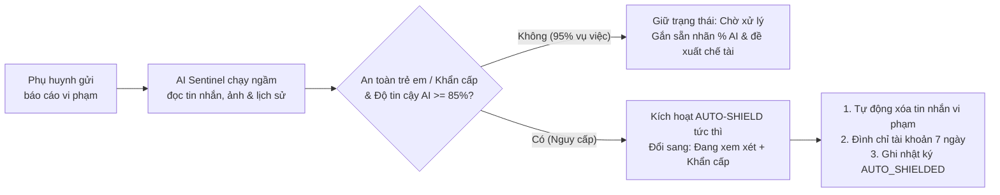
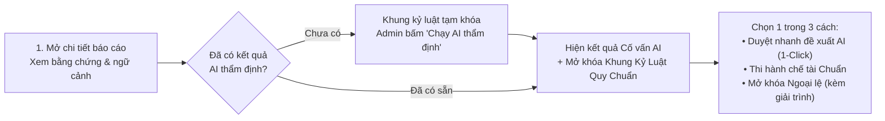

# BUD-50 — Kiểm duyệt An toàn AI (BuddyLink Sentinel) & Khung Kỷ Luật Quy Chuẩn

Tài liệu mô tả **cách BuddyLink hoạt động** sau BUD-50, theo góc nhìn nghiệp vụ: khi phụ huynh gửi báo cáo vi phạm, trợ lý AI Sentinel phân loại và bảo vệ tự động thế nào, Admin điều tra và thi hành chế tài theo khung quy định ra sao, và Super Admin hậu kiểm các trường hợp ngoại lệ thế nào. Chi tiết kỹ thuật xem trong code và `Back-End/docs/DATABASE_SCHEMA.md`.

> **Tóm tắt:** mọi báo cáo vi phạm từ phụ huynh đều được **AI Sentinel thẩm định ngầm ngay lập tức (Zero-Wait Auto-Triage)**. Các vụ việc nguy hại đến an toàn trẻ em được **tự động kích hoạt lá chắn khẩn cấp (Auto-Shield)** trong vài giây mà không cần chờ Admin trực. Khi Admin xử lý, hệ thống áp dụng **Khung Kỷ Luật Quy Chuẩn (Standard Policy Matrix)** dựa trên danh mục, mức độ nghiêm trọng và lịch sử tái phạm (`Strike 1–3`) để chống xử lý cảm tính — mọi quyết định phạt nặng hoặc nhẹ hơn quy định đều bắt buộc mở khóa **Ngoại lệ chính sách (Policy Override)** kèm lý do giải trình tối thiểu 20 ký tự lưu vĩnh viễn vào Nhật ký kiểm toán. Với hàng trăm báo cáo tồn đọng, Admin xử lý hàng loạt qua **Trung tâm Điều phối AI Sentinel** ngay trên trang danh sách.

---

## 1. Tiếp nhận báo cáo & Thẩm định ngầm tức thì (Zero-Wait Auto-Triage)

- Phụ huynh có thể báo cáo 3 loại đối tượng: **Tài khoản phụ huynh (`user`)**, **Tin nhắn chat (`message`)**, hoặc **Cuộc hẹn chơi (`playdate`)**, kèm danh mục vi phạm, mô tả chi tiết và tối đa 5 ảnh chụp màn hình bằng chứng.
- Ngay khi phụ huynh bấm **Gửi báo cáo**, hệ thống trả kết quả thành công tức thì để phụ huynh không phải chờ đợi.
- **Dưới nền (chạy ngầm bất đồng bộ):** trợ lý **BuddyLink Sentinel** (Gemini Multimodal AI) tự động thu thập toàn bộ ngữ cảnh vụ việc để thẩm định:
  - Nội dung tố cáo và các ảnh bằng chứng đính kèm.
  - Ngữ cảnh cuộc trò chuyện (tối đa 15 tin nhắn trước và sau tin nhắn bị báo cáo) hoặc thông tin chi tiết buổi hẹn chơi.
  - Lịch sử kỷ luật trước đó của tài khoản bị báo cáo (`Strike 1`, `Strike 2`, hoặc `Strike 3+`).
- **Phân định trạng thái rõ ràng giữa "Chờ xử lý" và "Đang xem xét":**
  - **95% báo cáo thông thường** (Spam, Bỏ hẹn, Quấy rối nhẹ...): sau khi AI thẩm định ngầm xong, báo cáo **vẫn giữ nguyên trạng thái `Chờ xử lý (pending)`** nhưng đã được đính kèm sẵn nhãn **`% AI`**, bản tóm tắt nhận định, trích xuất bằng chứng và đề xuất chế tài chuẩn để chờ Admin tiếp nhận.
  - **5% báo cáo nguy cấp** (xâm hại/đe dọa trẻ em độ tin cậy cao): hệ thống tự động kích hoạt **Lá chắn khẩn cấp (`Auto-Shield`)** và chuyển thẳng sang **`Đang xem xét (reviewing)`** (xem [mục 2](#2-lá-chắn-khẩn-cấp-tự-động-emergency-auto-shield)).

## 2. Lá chắn khẩn cấp tự động (Emergency Auto-Shield)

- **Điều kiện kích hoạt:** báo cáo thuộc danh mục **An toàn trẻ em (`child_safety`)** hoặc được đánh giá mức độ **Khẩn cấp (`critical`)**, **VÀ** điểm tin cậy AI (`confidenceScore`) đạt **từ 85% trở lên**.
- **Hành động bảo vệ tự động ngay lập tức (kể cả ban đêm khi không có Admin trực):**
  1. Chuyển trạng thái báo cáo từ `Chờ xử lý` sang **`Đang xem xét`** và nâng mức độ nghiêm trọng lên **`Khẩn cấp (critical)`**.
  2. **Tự động xóa/ẩn tin nhắn vi phạm** ngay trong cuộc trò chuyện (nếu đối tượng báo cáo là tin nhắn).
  3. **Tự động tạm đình chỉ 7 ngày** đối với tài khoản bị báo cáo để cách ly ngay lập tức nguồn nguy hiểm khỏi trẻ em và các gia đình khác.
  4. Ghi sự kiện **`AUTO_SHIELDED`** kèm huy hiệu **`🛡️ AUTO-SHIELD ĐÃ KÍCH HOẠT`** vào hồ sơ báo cáo để Admin vào ca sau kiểm tra và ra quyết định khóa vĩnh viễn.

## 3. Trung tâm Điều phối AI Sentinel & Xử lý hàng loạt

Ngay bên dưới 4 ô thống kê (`Chờ tiếp nhận`, `Đang xem xét`, `Quá hạn SLA`, `Đã giải quyết tuần này`) ở trang **Kiểm duyệt An toàn & Báo cáo vi phạm** là **khung điều phối màu xanh Matcha** cùng trợ lý **Bot AI hoạt ảnh động**.

Khung này giúp Admin giải quyết bài toán tồn đọng hàng trăm báo cáo mà không cần mở từng phiếu thủ công:

| Thành phần trên khung | Ý nghĩa & Cách hoạt động |
| --- | --- |
| **Đang mở** | Tổng số báo cáo đang ở trạng thái `Chờ xử lý` hoặc `Đang xem xét` trên trang hiện tại |
| **Chưa quét AI** | Số báo cáo (thường là dữ liệu cũ) chưa có kết quả thẩm định từ AI Sentinel |
| **Đủ chuẩn xử lý tự động** | Số báo cáo đã được AI thẩm định và có độ tin cậy đạt từ ngưỡng Admin chọn trở lên |
| **Ngưỡng tin cậy AI** | Admin chọn mức độ khắt khe trước khi xử lý tự động: **`>= 70%`**, **`>= 80%` (Mặc định)**, hoặc **`>= 90%`** |
| **Nút "Quét AI hàng loạt"** | Tự động chạy AI Sentinel cho toàn bộ báo cáo đang mở nhưng chưa được thẩm định (tối đa 50 báo cáo/lượt) |
| **Nút "Thi hành & Đóng hàng loạt"** | Tự động thực thi chế tài chuẩn theo đề xuất của AI và chuyển trạng thái sang **`Đã giải quyết`** (hoặc **`Bác bỏ`** nếu AI xác định báo cáo sai sự thật) cho mọi báo cáo đạt ngưỡng tin cậy |

## 4. Khung Kỷ Luật Quy Chuẩn (Standard Policy Matrix)

Để **loại bỏ tình trạng xử lý cảm tính** (cùng một lỗi nhưng Admin A chỉ cảnh cáo, Admin B lại khóa vĩnh viễn), hệ thống áp dụng **Ma trận Chế tài Quy chuẩn** dựa trên 3 yếu tố khách quan:
1. **Danh mục & Điều khoản vi phạm (`Rule 1.1` – `Rule 7.1`)**.
2. **Lịch sử tái phạm (`Strike 1`, `Strike 2`, `Strike 3+`)**: hệ thống tự động đếm số lần tài khoản bị báo cáo từng nhận chế tài kỷ luật (`Cảnh cáo`, `Tạm đình chỉ`, `Khóa vĩnh viễn`) trước đó:
   - Chưa từng bị kỷ luật → **Vi phạm lần 1 (`Strike 1/3`)**.
   - Đã bị kỷ luật 1 lần → **Tái phạm lần 2 (`Strike 2/3`)**.
   - Đã bị kỷ luật từ 2 lần trở lên → **Tái phạm nhiều lần (`Strike 3/3`)**.
3. **Loại đối tượng bị báo cáo (`user`, `message`, `playdate`)**.

| Danh mục vi phạm | Điều khoản | Vi phạm lần 1 (`Strike 1/3`) | Tái phạm lần 2 (`Strike 2/3`) | Tái phạm lần 3+ (`Strike 3/3`) |
| --- | --- | --- | --- | --- |
| **An toàn trẻ em** (`child_safety`) | `Rule 1.1` (Không khoan nhượng) | Xóa tin nhắn + **Khóa vĩnh viễn** | Xóa tin nhắn + **Khóa vĩnh viễn** | Xóa tin nhắn + **Khóa vĩnh viễn** |
| **Nâng cấp Khẩn cấp** (`critical`) | `Rule 0.1` (Khẩn cấp) | Xóa tin nhắn + **Khóa vĩnh viễn** | Xóa tin nhắn + **Khóa vĩnh viễn** | Xóa tin nhắn + **Khóa vĩnh viễn** |
| **Quấy rối / Đe dọa** (`harassment`) | `Rule 2.1` | Xóa tin nhắn + **Cảnh cáo** | Xóa tin nhắn + **Đình chỉ 7 ngày** | Xóa tin nhắn + **Khóa vĩnh viễn** |
| **Nội dung phản cảm** (`inappropriate_content`) | `Rule 3.1` | Xóa tin nhắn + **Cảnh cáo** | Xóa tin nhắn + **Đình chỉ 14 ngày** | Xóa tin nhắn + **Khóa vĩnh viễn** |
| **Giả mạo hồ sơ** (`fake_profile`) | `Rule 4.1` | **Cảnh cáo** | **Đình chỉ 7 ngày** | **Khóa vĩnh viễn** |
| **Spam / Quảng cáo** (`spam`) | `Rule 5.1` | Xóa tin nhắn + **Cảnh cáo** | Xóa tin nhắn + **Cảnh cáo** | Xóa tin nhắn + **Đình chỉ 3 ngày** |
| **Bỏ hẹn Playdate** (`no_show`) | `Rule 6.1` | **Cảnh cáo** + Hủy cuộc hẹn | **Cảnh cáo** + Hủy cuộc hẹn | **Đình chỉ 3 ngày** + Hủy cuộc hẹn |
| **Vi phạm khác** (`other`) | `Rule 7.1` | **Cảnh cáo** | **Đình chỉ 7 ngày** | **Đình chỉ 30 ngày** |

- **Tự động lọc theo đối tượng bị báo cáo:**
  - Nếu báo cáo nhắm vào **Tài khoản (`user`)**, hệ thống tự lược bỏ hành động *Xóa tin nhắn* và *Hủy cuộc hẹn*, chỉ giữ lại chế tài cấp tài khoản (`Cảnh cáo`, `Tạm đình chỉ`, `Khóa vĩnh viễn`).
  - Hành động *Xóa tin nhắn vi phạm* chỉ xuất hiện khi đối tượng là **Tin nhắn (`message`)**; hành động *Hủy cuộc hẹn chơi* chỉ xuất hiện khi đối tượng là **Cuộc hẹn (`playdate`)**.

## 5. Điều tra chi tiết: Cố vấn AI Sentinel & Mở khóa Khung kỷ luật

Khi Admin bấm **Chi tiết** vào một báo cáo để mở ngăn điều tra chuyên sâu (Drawer):

1. **Thẻ Cố vấn AI Sentinel (`SentinelCopilotCard`):**
   - Hiển thị rõ điểm tin cậy (`%`), mức độ nghiêm trọng do AI đánh giá, điều khoản áp dụng, bản tóm tắt phân tích khách quan và các trích dẫn bằng chứng cụ thể từ tin nhắn/hồ sơ.
   - Có nút **"Duyệt & Thi hành đề xuất AI" (1-Click Approve)**: chỉ với 1 cú nhấp chuột, hệ thống tự động thực thi toàn bộ chế tài chuẩn do AI đề xuất và đóng báo cáo.
2. **Khung kỷ luật chỉ xuất hiện sau khi đã thẩm định AI:**
   - Nếu báo cáo chưa được AI phân tích, khu vực **Khung kỷ luật & Thi hành chế tài** sẽ ở trạng thái **khóa an toàn**, nhắc Admin bấm **"Chạy AI thẩm định"** ở thẻ phía trên trước.
   - Ngay khi có kết quả thẩm định AI, **Khung Kỷ Luật Quy Chuẩn (Standard Policy Matrix)** mới xuất hiện kèm huy hiệu **`Vi phạm lần X (Strike X/3)`**, điều khoản quy chiếu và các nút chế tài tương ứng.

## 6. Ngoại lệ chính sách (Policy Override) & Hậu kiểm Super Admin

Nguyên tắc: **Admin được phép xử lý linh hoạt trong tình huống đặc biệt, nhưng không được phép làm trái quy định trong im lặng.**

Trên bảng thi hành chế tài:
- Các nút chế tài nằm trong khung quy định của Ma trận được gắn nhãn xanh **`Chuẩn`** và bấm thi hành được ngay.
- Các nút chế tài nằm ngoài khung quy định (phạt nặng hơn hoặc nhẹ hơn mức chuẩn của Strike hiện tại) bị gắn nhãn đỏ/cam **`🔒 Ngoại lệ`** và **mặc định bị khóa**.

| Tình huống Admin thao tác | Người dùng thấy trên giao diện | Có thực thi được không |
| --- | --- | --- |
| Bấm nút chế tài gắn nhãn **`Chuẩn`** | Mở hộp thoại xác nhận thi hành ngay | **Có**, tuân thủ đúng Ma trận quy chuẩn |
| Muốn bấm nút gắn nhãn **`🔒 Ngoại lệ`** khi chưa tích chọn Ngoại lệ | Nút bị khóa mờ (`disabled`), hiện chú giải yêu cầu tích chọn *Áp dụng ngoại lệ chính sách* | **Không** |
| Đã tích chọn **Áp dụng ngoại lệ chính sách** nhưng nhập lý do **dưới 20 ký tự** | Hiện ô nhập lý do màu cam kèm bộ đếm `X/20 ký tự tối thiểu`; các nút `Ngoại lệ` vẫn khóa | **Không** (chặn ở cả giao diện lẫn Backend trả lỗi `OVERRIDE_REASON_REQUIRED`) |
| Đã tích chọn **Áp dụng ngoại lệ chính sách** và nhập lý do **từ 20 ký tự trở lên** | Đổi nhãn sang **`Ngoại lệ (Đã mở khóa)`**, cho phép bấm thi hành chế tài | **Có**, lưu vĩnh viễn vào Nhật ký kiểm toán |

**Lưu vết bất biến trong Nhật ký kiểm toán (`ReportAuditLog`):**
- Mỗi khi Admin thi hành một chế tài ngoại lệ, hệ thống tự động ghi nhận sự kiện **`Áp dụng ngoại lệ chính sách (POLICY_OVERRIDDEN)`** vào dòng thời gian kiểm toán.
- Bản ghi hiển thị rõ tên Admin thực hiện, huy hiệu cảnh báo **`⚠️ Ngoại lệ chính sách (Policy Override)`**, điều khoản gốc bị vượt qua (`policyClause`) và **nguyên văn lời giải trình của Admin** để Super Admin kiểm tra định kỳ, không thể xóa hay sửa.

## 7. Tự động gom & đóng báo cáo trùng lặp (Auto-Merge Duplicate Reports)

- Khi một người dùng có hành vi xấu (ví dụ gửi spam hoặc quấy rối nhiều gia đình), hệ thống thường nhận được nhiều báo cáo khác nhau cùng nhắm vào một tài khoản.
- Ngay khi Admin (hoặc AI Sentinel) thi hành chế tài cấp tài khoản (**Tạm đình chỉ** hoặc **Khóa vĩnh viễn**) và đóng một báo cáo, hệ thống sẽ **tự động tìm toàn bộ các báo cáo đang mở khác của cùng người bị báo cáo đó** để chuyển sang **`Đã giải quyết`** kèm ghi chú tham chiếu tới mã báo cáo đã xử lý chính.
- Nhờ vậy, Admin không bao giờ phải mở và phạt lặp lại nhiều lần cho cùng một đối tượng vi phạm.

---

### Phụ lục cho dev

| Việc | Ở đâu |
| --- | --- |
| Ma trận Chế tài Quy chuẩn & tính Strike | `Back-End/src/modules/safety/moderation-policy.rules.js` (`SANCTION_POLICY_MATRIX`, `calculatePolicySanction`, `checkActionPolicyCompliance`) |
| Dịch vụ AI Sentinel, Auto-Triage & Auto-Shield | `Back-End/src/modules/safety/sentinel.service.js` (`assessReport`, `_executeAutoShield`) |
| Kích hoạt ngầm khi phụ huynh gửi báo cáo | `Back-End/src/modules/safety/safety.service.js` (`createReport`), `safety.repository.js` (`countUserPriorSanctions`) |
| Xử lý chế tài, bắt buộc Override & gom báo cáo trùng | `Back-End/src/modules/admin/admin.service.js` (`applyReportAction`, `assessReportWithSentinel`, `applySentinelRecommendation`, `batchScanReportsWithSentinel`, `batchApplySentinelRecommendations`) |
| Schema lưu trữ kết quả AI & cờ Override | `Back-End/src/modules/safety/report.model.js` (`sentinelAssessment`, `actions[].isPolicyOverride`, `overrideReason`, `policyClause`) |
| Trung tâm Điều phối AI & Bot hoạt ảnh động | `Front-End/src/modules/admin/components/reports/SentinelBatchCommandBar.jsx` |
| Thẻ Cố vấn AI trong Drawer điều tra | `Front-End/src/modules/admin/components/reports/SentinelCopilotCard.jsx` |
| Khung kỷ luật, khóa trước thẩm định & Policy Override | `Front-End/src/modules/admin/components/reports/ReportSanctionPanel.jsx` |
| Hiển thị vết Ngoại lệ trong Nhật ký kiểm toán | `Front-End/src/modules/admin/components/reports/ReportAuditLog.jsx` |
| API mới | `POST /api/v1/admin/reports/:id/sentinel-assess`, `POST /api/v1/admin/reports/:id/sentinel-apply`, `POST /api/v1/admin/reports/sentinel-batch-scan`, `POST /api/v1/admin/reports/sentinel-batch-apply` |
| Hướng dẫn test & bộ ảnh chụp màn hình thực tế | `Front-End/docs/SENTINEL_TESTING_GUIDE.md`, thư mục ảnh `Front-End/AdminReport-Pic/` |
