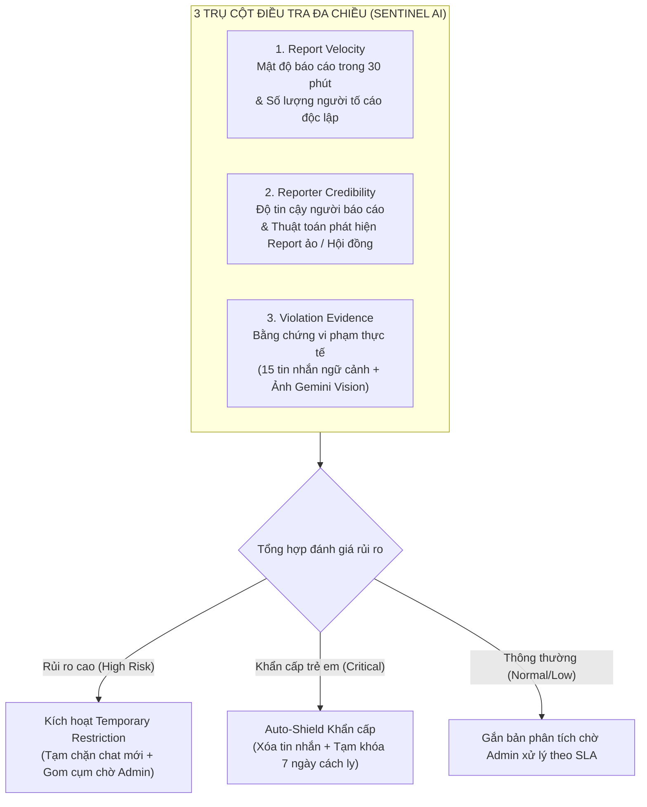
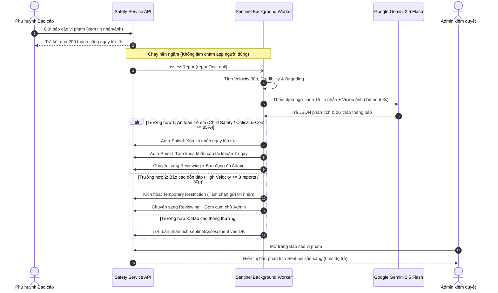
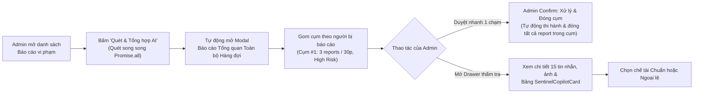
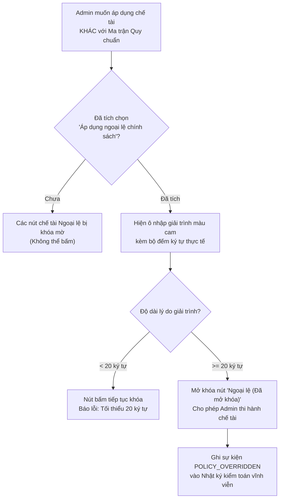

# BUD-50 — Hệ thống Thực thi Tự động AI (BuddyLink Sentinel) & Khung Kỷ Luật Quy Chuẩn

Tài liệu đặc tả **toàn bộ nghiệp vụ an toàn và kiểm duyệt** của nền tảng BuddyLink sau BUD-50: từ lúc phụ huynh gửi báo cáo vi phạm, tiến trình ngầm AI Sentinel đo lường đa chiều và kích hoạt hạn chế tạm thời, cho đến quy chuẩn Ma trận kỷ luật khách quan, quy trình Admin duyệt (Human-in-the-Loop) và cơ chế giải trình Ngoại lệ chính sách (Policy Override).

> **Tóm tắt cốt lõi:** Thay vì kiểm duyệt thủ công chậm trễ hoặc để AI tự ý khóa vĩnh viễn gây phạt oan, BuddyLink vận hành **Hệ thống Thực thi 2 Tầng (2-Tier Enforcement System)** do **AI Sentinel** điều phối dựa trên **3 yếu tố định lượng: `Report velocity` (Mật độ 30 phút) • `Reporter credibility` (Chống report ảo) • `Violation evidence` (Bằng chứng ngữ cảnh)**:
> - **Tầng 1 — AI Auto-Resolve (Tự động thi hành & giải quyết vi phạm nhẹ/trung bình):** Với các báo cáo có chế tài chuẩn là **Cảnh cáo (`WARN`)**, **Xóa tin nhắn vi phạm (`DELETE_MESSAGE`)**, **Hủy hẹn (`CANCEL_PLAYDATE`)**, hoặc **Tạm đình chỉ tài khoản 3–7 ngày (`SUSPEND 3d/7d`)** đạt độ tự tin cao ($\ge 75\%$) và không có dấu hiệu report giả $\rightarrow$ AI Sentinel tự động thi hành chế tài, gửi thông báo cho hai bên và **tự động đóng báo cáo (`RESOLVED: action_taken`)**.
> - **Tầng 2 — Human-in-the-Loop (Bắt buộc Admin phán quyết đối với vi phạm nặng & nhạy cảm):** Với các vụ việc có chế tài nặng hơn (**Tạm đình chỉ $> 7$ ngày** như 14 ngày/30 ngày, **Khóa tài khoản vĩnh viễn (`BAN`)**, danh mục **An toàn trẻ em (`child_safety`)**, hoặc nghi vấn report phối hợp) $\rightarrow$ AI Sentinel kích hoạt **`Temporary restriction`** (tạm hạn chế quyền gửi tin nhắn), chuyển trạng thái sang `Đang xem xét` và **bắt buộc Admin trực tiếp xem xét, bấm Confirm** theo **Khung Kỷ Luật Quy Chuẩn (`Strike 1–3`)** hoặc mở khóa **Ngoại lệ chính sách (`Policy Override`)** kèm giải trình tối thiểu 20 ký tự.

---

## 1. Ba yếu tố cốt lõi của Hệ thống Thực thi Tự động (Automated Enforcement System)

Kẻ xấu hoặc phụ huynh mâu thuẫn cá nhân có thể lợi dụng việc kéo hội nhóm vào báo cáo cùng một lúc (*brigading / report dập*) để hạ bệ người khác. Ngược lại, nếu chỉ dựa vào 1 báo cáo đơn lẻ thì không phát hiện kịp thời các đối tượng biến thái, lừa đảo nguy hiểm. Vì vậy, Sentinel AI luôn phân tích song song **3 trụ cột dữ liệu**:

---

## 2. Quy tắc đếm Velocity, Cửa sổ thời gian & Chống Report ảo

Hệ thống tính toán tốc độ báo cáo và độ tin cậy theo các công thức và ngưỡng số liệu rõ ràng trong code (`safety.repository.js` & `sentinel.service.js`):

### 2.1. Cửa sổ thời gian & Ngưỡng tốc độ (Report Velocity)

| Chỉ số đo lường | Khung thời gian / Quy tắc tính | Mức độ rủi ro (`riskLevel`) | Hành vi xử lý tự động của hệ thống |
| :--- | :--- | :--- | :--- |
| **Báo cáo dồn dập (`High Velocity`)** | **Từ 3 báo cáo trở lên** nhắm vào cùng 1 phụ huynh trong vòng **30 phút** (`createdAt ± 30 min`) | 🔴 **High risk** (Rủi ro cao) | Tự động kích hoạt **`Temporary restriction`**: chuyển trạng thái từ `Chờ xử lý` sang `Đang xem xét`, tạm hạn chế quyền gửi tin nhắn mới của người bị báo cáo, đẩy cảnh báo lên đầu hàng đợi Admin. |
| **Báo cáo tiếp diễn (`Medium Velocity`)** | **Đúng 2 báo cáo** nhắm vào cùng 1 phụ huynh trong vòng 30 phút hoặc 2 báo cáo đang mở | 🟡 **Medium risk** (Rủi ro trung bình) | Gom nhóm các báo cáo trùng đối tượng, thông báo Admin lưu ý theo dõi tiến triển. |
| **Báo cáo đơn lẻ (`Normal Velocity`)** | **1 báo cáo duy nhất** từ 1 phụ huynh trong khung 30 phút | 🟢 **Low risk** (Thông thường) | Giữ ở hàng đợi xử lý định kỳ theo SLA (trừ khi nội dung vi phạm thuộc diện An toàn trẻ em). |

### 2.2. Quy tắc chống Spam & Giới hạn tần suất báo cáo
- **Nguyên tắc chống spam cá nhân:** Một phụ huynh chỉ được phép báo cáo cùng một người dùng **tối đa 1 lần trong vòng 24 giờ** (`DUPLICATE_WINDOW_MS = 24 * 60 * 60 * 1000`). Nếu gửi lần 2 trong ngày, hệ thống chặn ngay tại API với mã lỗi `429 REPORT_TOO_FREQUENT` (*"Bạn đã gửi báo cáo đối với phụ huynh này gần đây. Đội ngũ kiểm duyệt đang xem xét"*).
- **Quy chuẩn bằng chứng hợp lệ:** Bằng chứng đính kèm bắt buộc phải là ảnh chụp tải lên trực tiếp lưu trữ Cloud Storage của BuddyLink (tối đa **5 ảnh** `MAX_EVIDENCE_URLS = 5`). Hệ thống từ chối mọi đường link bên ngoài (`INVALID_EVIDENCE_URL`) để phòng ngừa mã độc và liên kết lừa đảo.

### 2.3. Thuật toán phân loại độ tin cậy & Phát hiện Report phối hợp (Brigading)
Hệ thống đối chiếu lịch sử của người báo cáo và sự liên quan giữa các báo cáo trong cùng cụm:

| Phân loại độ tin cậy | Điều kiện xác định từ dữ liệu | Hành vi & Khuyến nghị của AI |
| :--- | :--- | :--- |
| **Đáng tin cậy (`High`)** | Lịch sử gửi báo cáo trước đây có tỉ lệ xác nhận đúng cao (`confirmedCount > dismissedCount`), hoặc người dùng chưa từng bị bác bỏ báo cáo. | Đề xuất áp dụng đầy đủ khung chế tài theo quy chuẩn. |
| **Độ tin cậy thấp (`Low`)** | Người báo cáo từng có **từ 2 lần báo cáo bị Admin bác bỏ trở lên** (`reporterDismissedCount >= 2`) và số lần bị bác bỏ nhiều hơn số lần báo cáo đúng. | AI gắn nhãn cảnh báo: *"Độ tin cậy thấp — Người báo cáo từng có X lần báo cáo bị bác bỏ. Cần Admin kiểm tra kỹ động cơ tố cáo"*. |
| **Nghi vấn Report phối hợp (`Brigading / Coordinated False Reports`)** | Có **từ 3 phụ huynh trở lên** cùng report 1 người trong thời gian ngắn NHƯNG: **Không đính kèm tin nhắn đích (`targetMessageId`), không có buổi hẹn đích (`targetPlaydateId`), và không có ảnh chụp bằng chứng**. | AI kích hoạt cờ `coordinatedSuspected = true`, `isIndependentIncidents = false`. AI gắn cảnh báo đỏ: *"Cảnh báo: Ghi nhận X tài khoản cùng report trong thời gian ngắn nhưng thiếu bằng chứng trực tiếp (nghi vấn report hội đồng/báo thù cá nhân)"*. **AI từ chối đề xuất khóa tài khoản tự động**, yêu cầu Admin đối chiếu bằng chứng trước khi ra quyết định. |
| **Báo cáo độc lập chuẩn xác (`Independent Incidents`)** | Nhiều phụ huynh báo cáo cùng 1 người nhưng ở **các phòng chat khác nhau**, các tin nhắn đích khác nhau hoặc có chứng cứ ảnh riêng biệt. | AI xác nhận `isIndependentIncidents = true`: *"Ghi nhận X báo cáo từ Y phụ huynh độc lập với ngữ cảnh tương tác riêng biệt (không phải report giả phối hợp)"*. |

---

## 3. Khung Kỷ Luật Quy Chuẩn (Standard Policy Matrix)

Nhằm loại bỏ hoàn toàn việc xử phạt cảm tính, thiếu nhất quán giữa các Admin trực ca, BuddyLink ban hành **Ma trận Chế tài Chuẩn** tích hợp trực tiếp vào mã nguồn (`moderation-policy.rules.js`). Mọi đề xuất của AI và thao tác của Admin đều được ánh xạ tự động qua 3 tham số:
1. **Danh mục vi phạm (`Category`) & Điều khoản chính sách (`Clause`)**.
2. **Loại đối tượng vi phạm (`TargetType`):** `message` (tin nhắn), `playdate` (buộc hủy cuộc hẹn), hay `user` (hồ sơ cá nhân).
3. **Cấp độ tái phạm (`Strike Level`):** 
   - `Strike 1/3`: Tài khoản chưa từng bị kỷ luật trước đó (`priorSanctionsCount = 0`).
   - `Strike 2/3`: Đã có 1 tiền án kỷ luật được xác nhận (`priorSanctionsCount = 1`).
   - `Strike 3/3`: Đã có từ 2 tiền án kỷ luật trở lên (`priorSanctionsCount >= 2`).

### 3.1. Bảng Ma trận Chế tài chi tiết cho 7 Danh mục Vi phạm

| Danh mục vi phạm (`category`) | Điều khoản & Mô tả hành vi vi phạm thực tế | Mức độ (`Severity`) | Hạn SLA xử lý | Vi phạm lần 1 (`Strike 1/3`) | Tái phạm lần 2 (`Strike 2/3`) | Tái phạm lần 3+ (`Strike 3/3`) |
| :--- | :--- | :---: | :---: | :--- | :--- | :--- |
| **An toàn trẻ em** (`child_safety`) | **Rule 1.1: Không khoan nhượng đối với hành vi xâm hại trẻ em** • Gạ gẫm, dụ dỗ trẻ em tách khỏi cha mẹ • Yêu cầu gửi ảnh riêng tư, nhạy cảm của bé • Dò hỏi địa chỉ nhà riêng, trường học của bé nhằm mục đích xấu • Lôi kéo trẻ em tham gia hoạt động nguy hiểm ngoài nền tảng | **CRITICAL** (Khẩn cấp) | **2 giờ** | • Xóa tin nhắn vi phạm • **Khóa tài khoản vĩnh viễn (`BAN`)** | • Xóa tin nhắn vi phạm • **Khóa tài khoản vĩnh viễn (`BAN`)** | • Xóa tin nhắn vi phạm • **Khóa tài khoản vĩnh viễn (`BAN`)** |
| **Quấy rối & Đe dọa** (`harassment`) | **Rule 2.1: Giao tiếp thù địch, xúc phạm, bắt nạt** • Dùng từ ngữ thô tục, đe dọa vũ lực đối với phụ huynh/trẻ em • Nhắn tin quấy rầy liên tục dù đối phương đã yêu cầu dừng lại • Nhục mạ danh dự, kỳ thị vùng miền, tôn giáo | **HIGH** (Cao) | **24 giờ** | • Xóa tin nhắn vi phạm • **Cảnh cáo vi phạm (`WARN`)** | • Xóa tin nhắn vi phạm • **Đình chỉ tài khoản 7 ngày (`SUSPEND 7d`)** | • Xóa tin nhắn vi phạm • **Khóa tài khoản vĩnh viễn (`BAN`)** |
| **Nội dung phản cảm** (`inappropriate_content`) | **Rule 3.1: Ngôn từ dung tục, hình ảnh không lành mạnh** • Gửi ảnh, sticker hoặc video có yếu tố người lớn, bạo lực • Dùng ngôn từ thô thiển, kích động trong phòng chat hoặc bình luận playdate | **HIGH** (Cao) | **24 giờ** | • Xóa tin nhắn vi phạm • **Cảnh cáo vi phạm (`WARN`)** | • Xóa tin nhắn vi phạm • **Đình chỉ tài khoản 14 ngày (`SUSPEND 14d`)** | • Xóa tin nhắn vi phạm • **Khóa tài khoản vĩnh viễn (`BAN`)** |
| **Giả mạo hồ sơ** (`fake_profile`) | **Rule 4.1: Mạo danh phụ huynh, thông tin trẻ em sai lệch** • Lấy cắp hình ảnh, danh tính của gia đình khác • Cố tình khai gian tuổi, thông tin bé để tiếp cận nhóm trẻ em không phù hợp | **MEDIUM** (Trung bình) | **24 giờ** | • **Cảnh cáo vi phạm (`WARN`)** | • **Đình chỉ tài khoản 7 ngày (`SUSPEND 7d`)** | • **Khóa tài khoản vĩnh viễn (`BAN`)** |
| **Spam / Quảng cáo** (`spam`) | **Rule 5.1: Tin nhắn rác, chào mời thương mại trái phép** • Rải link tiếp thị liên kết, mời chào mua bảo hiểm, đa cấp • Spam tin nhắn hàng loạt vào các nhóm playdate | **LOW** (Thấp) | **24 giờ** | • Xóa tin nhắn vi phạm • **Cảnh cáo vi phạm (`WARN`)** | • Xóa tin nhắn vi phạm • **Cảnh cáo vi phạm lần 2 (`WARN`)** | • Xóa tin nhắn vi phạm • **Đình chỉ tài khoản 3 ngày (`SUSPEND 3d`)** |
| **Bỏ hẹn Playdate** (`no_show`) | **Rule 6.1: Bỏ hẹn đã xác nhận không báo trước** • Đã xác nhận tham gia Playdate nhưng vắng mặt không lý do khiến phụ huynh và bé khác chờ đợi • Hủy hẹn sát giờ nhiều lần gây ảnh hưởng đến cuộc hẹn | **LOW** (Thấp) | **24 giờ** | • Hủy buổi hẹn vi phạm • **Cảnh cáo vi phạm (`WARN`)** | • Hủy buổi hẹn vi phạm • **Cảnh cáo vi phạm lần 2 (`WARN`)** | • Hủy buổi hẹn vi phạm • **Đình chỉ tài khoản 3 ngày (`SUSPEND 3d`)** |
| **Vi phạm khác** (`other`) | **Rule 7.1: Vi phạm Quy chuẩn Cộng đồng chung** • Các hành vi gây mất trật tự, tranh cãi tiêu cực không thuộc 6 danh mục trên | **MEDIUM** (Trung bình) | **24 giờ** | • **Cảnh cáo vi phạm (`WARN`)** | • **Đình chỉ tài khoản 7 ngày (`SUSPEND 7d`)** | • **Đình chỉ tài khoản 30 ngày (`SUSPEND 30d`)** |

### 3.2. Quy tắc Điều khoản Đặc biệt: Nâng cấp Khẩn cấp (`Rule 0.1`)
Nếu một báo cáo thuộc danh mục thông thường (như `other` hoặc `harassment`) nhưng Admin hoặc AI phát hiện tình tiết cực kỳ nghiêm trọng và **chủ động nâng mức độ lên `CRITICAL`**:
- Hệ thống lập tức kích hoạt điều khoản **`Rule 0.1: Critical Severity Emergency Escalate`**.
- Chế tài chuẩn tự động chuyển sang mức cao nhất: **Xóa toàn bộ nội dung vi phạm + Khóa vĩnh viễn tài khoản (`BAN`)** ngay từ lần vi phạm đầu tiên mà không cần chờ tích lũy Strike.

---

## 4. Các kịch bản Chạy nền & Thực thi Tự động của Sentinel AI

Sentinel AI vận hành theo mô hình **Chạy nền bất đồng bộ (Fire-and-forget Background Worker)** ngay tại thời điểm phụ huynh gửi báo cáo vi phạm (`safetyService.createReport`):

### Chi tiết 3 kịch bản xử lý của Sentinel AI:

1. **Kịch bản 1 — AI Auto-Resolve (Tự động thi hành & Đóng vụ việc vi phạm nhẹ/trung bình):**
   - **Điều kiện kích hoạt:**
     - Toàn bộ chế tài đề xuất thuộc tầng nhẹ/trung bình: **Cảnh cáo (`WARN`)**, **Xóa tin nhắn (`DELETE_MESSAGE`)**, **Hủy hẹn (`CANCEL_PLAYDATE`)**, hoặc **Tạm đình chỉ tài khoản 3–7 ngày (`SUSPEND 3d/7d`)**.
     - Độ tự tin AI `confidenceScore >= 75%`.
     - Không có nghi vấn report phối hợp / ảo (`!coordinatedSuspected` & độ tin cậy `normal`/`high`).
     - Không thuộc danh mục An toàn trẻ em (`child_safety`) hay mức Khẩn cấp (`CRITICAL`).
   - **Hành động tự động của hệ thống:**
     - Tự động xóa tin nhắn vi phạm, hủy cuộc hẹn bỏ rơi, hoặc ghi nhận Strike cảnh cáo / đình chỉ tài khoản $\le 7$ ngày.
     - Tự động gửi thông báo giải trình vi phạm cho người bị báo cáo và thông báo kết quả cho người tố cáo.
     - **Tự động đóng báo cáo:** Chuyển trạng thái sang **`Đã giải quyết (RESOLVED)`** kèm `resolution: action_taken` và ghi vĩnh viễn vào lịch sử kiểm toán. Admin không cần tốn thời gian xử lý thủ công các vi phạm cơ bản này.

2. **Kịch bản 2 — Auto-Shield Cách ly Khẩn cấp (`Critical Child Safety`):**
   - **Điều kiện:** Danh mục `child_safety` hoặc mức độ `CRITICAL` và độ tự tin AI `confidenceScore >= 85%`.
   - **Hành động tự động:**
     - Tự động xóa ngay lập tức tin nhắn độc hại (`chatService.adminDeleteMessage`).
     - Tự động tạm khóa tài khoản 7 ngày (`userService.suspendAccount 7 days`) để cô lập nguy cơ đối với các bé.
     - **Bắt buộc Admin Confirm:** Chuyển trạng thái sang `Đang xem xét (reviewing)` để Admin vào xác nhận và thực thi **Khóa vĩnh viễn (`BAN`)**.

3. **Kịch bản 3 — Vi phạm Nặng hoặc Rủi ro cao chờ Admin Phán quyết:**
   - **Điều kiện:** 
     - Chế tài đề xuất nặng: **Tạm đình chỉ $> 7$ ngày** (14 ngày, 30 ngày) hoặc **Khóa vĩnh viễn (`BAN`)**.
     - Hoặc có từ 3 báo cáo trở lên trong 30 phút (`High Velocity`), hoặc nghi vấn report hội đồng / report giả (`coordinatedSuspected = true`), hoặc độ tự tin AI $< 75\%$.
   - **Hành động:**
     - Tự động kích hoạt cờ `Temporary restriction`: hạn chế quyền nhắn tin mới của tài khoản bị báo cáo.
     - Tự động chuyển báo cáo sang `Đang xem xét (reviewing)` và tạo bản phân tích tổng hợp.
     - **Chờ Admin trực tiếp phán quyết:** Admin mở Drawer hoặc Modal Tổng quan để đối chiếu chứng cứ và bấm Confirm.

---

## 5. Quy trình Admin Xem xét, Bấm Confirm & Chế độ Gom Cụm

Admin là người nắm quyền phán quyết cuối cùng (**Human-in-the-Loop**). Giao diện quản trị được thiết kế với cơ chế kiểm soát chặt chẽ:

### 5.1. Khóa an toàn trước thẩm định (Safety Lockout)
- Khi Admin mở chi tiết một báo cáo chưa có bản phân tích AI, toàn bộ các nút xử phạt trong `ReportSanctionPanel` **bị khóa mờ (`disabled`)**.
- Admin chỉ có thể bấm nút **"Chạy AI Điều tra & Tổng hợp"**. Khi AI hoàn tất đối chiếu 3 yếu tố (Velocity, Credibility, Evidence), bảng điều khiển kỷ luật mới mở khóa để đảm bảo Admin luôn đọc kết quả điều tra trước khi ra quyết định.

### 5.2. Chế độ Gom Cụm & Đóng Báo cáo Trùng lặp
- Khi một phụ huynh có nhiều báo cáo đổ về cùng lúc (ví dụ 3 báo cáo trong 30 phút), Modal **Báo cáo Tổng quan Điều tra AI Sentinel** tự động gom lại thành các **Cụm đối tượng** (`Cụm đối tượng #1: Nguyễn Văn A - 3 báo cáo từ 3 phụ huynh`).
- Khi Admin bấm **"Admin Confirm: Xử lý & Đóng cụm"** hoặc thi hành chế tài cấp tài khoản (`Đình chỉ` hoặc `Khóa vĩnh viễn`) trên 1 báo cáo:
  - Hệ thống tự động áp dụng chế tài đó cho tài khoản.
  - Tự động chuyển toàn bộ các báo cáo đang mở còn lại của người đó sang trạng thái **`Đã giải quyết (RESOLVED)`** kèm ghi chú tham chiếu đến mã báo cáo gốc.
  - Admin không phải thao tác lặp lại 3–5 lần cho cùng một sự việc.

---

## 6. Cơ chế Ngoại lệ Chính sách (Policy Override) & Nhật ký Kiểm toán

BuddyLink tôn trọng quyền quyết định của Admin trong các tình huống thực tế phức tạp, nhưng áp dụng nguyên tắc **Trách nhiệm giải trình bắt buộc (Mandatory Accountability)**:

### 6.1. Quy tắc mở khóa Ngoại lệ chính sách
1. **Chế tài Chuẩn (Standard):** Nút thi hành luôn có nhãn `Chuẩn`. Admin bấm vào là áp dụng được ngay mà không cần giải trình thêm.
2. **Chế tài Ngoại lệ (Policy Override):**
   - Nút mang nhãn **`🔒 Ngoại lệ`** và bị vô hiệu hóa mặc định.
   - Muốn sử dụng, Admin bắt buộc phải tích chọn checkbox: *"Áp dụng ngoại lệ chính sách (Policy Override)"*.
   - Hộp nhập văn bản mở ra, yêu cầu nhập lý do giải trình: **tối thiểu 20 ký tự**. Bộ đếm ký tự cập nhật theo thời gian thực (ví dụ: `14/20 ký tự tối thiểu`).
   - Nếu Admin cố tình gửi request qua API mà không có lý do hoặc lý do dưới 20 ký tự, Backend chặn lại với lỗi `400 OVERRIDE_REASON_REQUIRED`.

### 6.2. Nhật ký kiểm toán bất biến (Audit Log)
Mọi quyết định ngoại lệ đều được hệ thống ghi nhận vĩnh viễn vào lịch sử báo cáo:
- Loại sự kiện: **`POLICY_OVERRIDDEN`** & **`ACTION_APPLIED`**.
- Thuộc tính lưu trữ: `actions[].isPolicyOverride = true`, `actions[].overrideReason`, `actions[].policyClause`.
- Trên giao diện `ReportAuditLog`, sự kiện hiển thị nổi bật với **huy hiệu màu cam cảnh báo `⚠️ Ngoại lệ chính sách (Policy Override)`** cùng toàn văn lý do của Admin để Super Admin tiến hành hậu kiểm định kỳ.

---

## 7. Tổng hợp Phụ lục Mã nguồn & Dữ liệu Nghiệp vụ

| Nghiệp vụ / Quy tắc | Vị trí tập tin mã nguồn | Các hàm / Biến cốt lõi |
| :--- | :--- | :--- |
| **Ma trận Chế tài Chuẩn & Quy tắc Strike** | `Back-End/src/modules/safety/moderation-policy.rules.js` | `SANCTION_POLICY_MATRIX`, `calculatePolicySanction`, `checkActionPolicyCompliance`, `toStrikeLevel` |
| **Tính toán Velocity 30p, Credibility & Brigading** | `Back-End/src/modules/safety/safety.repository.js` | `getEnforcementMonitoringMetrics` (tính `reportsIn30MinCount`, `coordinatedSuspected`, `incidentPattern`) |
| **Tiến trình ngầm Sentinel AI & Auto-Shield** | `Back-End/src/modules/safety/sentinel.service.js` | `assessReport` (gọi Gemini Vision, timeout 8s), `_executeAutoShield` (cô lập khẩn cấp) |
| **Xử lý Báo cáo Admin & Gom cụm tự động** | `Back-End/src/modules/admin/admin-report.service.js` | `applyReportAction`, `batchScanReportsWithSentinel`, `applySentinelRecommendation`, `resolveReport` |
| **Đặc tả Schema dữ liệu Báo cáo & Giám sát** | `Back-End/src/modules/safety/report.model.js` | Subdocument `sentinelAssessment.monitoring`, `actions[].isPolicyOverride`, `actions[].overrideReason` |
| **Thanh chỉ huy AI & Nút quét hàng loạt** | `Front-End/src/modules/admin/components/reports/SentinelBatchCommandBar.jsx` | Nút "Quét & Tổng hợp AI hàng loạt", Nút "Xem báo cáo tổng quan AI" |
| **Báo cáo Tổng quan Hàng loạt (All Reports Modal)** | `Front-End/src/modules/admin/components/reports/SentinelBatchOverviewModal.jsx` | Gom cụm theo phụ huynh, hiển thị thẻ `AI Report Monitoring` toàn bộ hàng đợi |
| **Thẻ điều tra chi tiết Sentinel trong Drawer** | `Front-End/src/modules/admin/components/reports/SentinelCopilotCard.jsx` | Hiển thị 3 trụ cột, 5 bước điều tra AI, huy hiệu `Temporary restriction` |
| **Khung kỷ luật, Khóa mờ & Policy Override** | `Front-End/src/modules/admin/components/reports/ReportSanctionPanel.jsx` | Khóa an toàn trước phân tích AI, đếm ký tự giải trình ngoại lệ `>= 20 ký tự` |
| **Nhật ký kiểm toán minh bạch** | `Front-End/src/modules/admin/components/reports/ReportAuditLog.jsx` | Huy hiệu `⚠️ Ngoại lệ chính sách (Policy Override)` và lịch sử thao tác của Admin |
