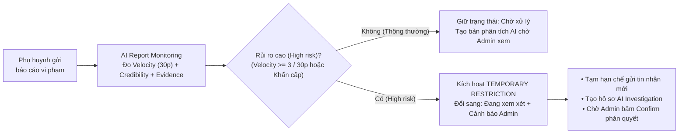
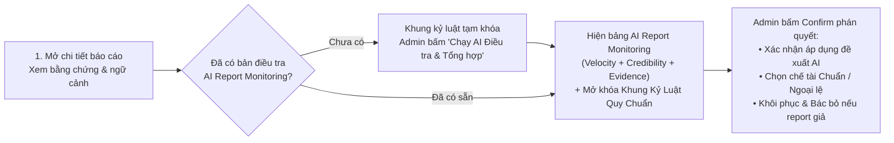

# BUD-50 — Hệ thống Thực thi Tự động AI (BuddyLink Sentinel) & Khung Kỷ Luật Quy Chuẩn

Tài liệu mô tả **cách BuddyLink hoạt động** sau BUD-50, theo góc nhìn nghiệp vụ: khi phụ huynh gửi báo cáo vi phạm, hệ thống **Automated Enforcement System (AI Sentinel)** điều tra tổng hợp đa chiều và hạn chế tạm thời thế nào, Admin xem xét và bấm **Confirm** thi hành chế tài chính thức theo khung quy định ra sao, và Super Admin hậu kiểm các trường hợp ngoại lệ thế nào. Chi tiết kỹ thuật xem trong code và `Back-End/docs/DATABASE_SCHEMA.md`.

> **Tóm tắt:** thay vì chỉ đếm số lượng report hoặc để AI tự ý đóng án dễ gây phạt oan, BuddyLink xây dựng **Automated Enforcement System** dựa trên **3 yếu tố (`Report velocity` • `Reporter credibility` • `Violation evidence`)**. Khi phát hiện rủi ro cao (ví dụ 1 phụ huynh bị nhiều người report trong 30 phút hoặc vi phạm an toàn trẻ em), AI Sentinel tự động kích hoạt **`Temporary restriction` (Hạn chế tạm thời)**, gửi cảnh báo đến Admin và tạo bản phân tích tổng hợp. **AI không bao giờ tự động đóng báo cáo (`Resolved`)** — quyền khôi phục hoặc áp dụng hình phạt chính thức bắt buộc thuộc về **Admin (Human-in-the-Loop)** theo **Khung Kỷ Luật Quy Chuẩn (`Strike 1–3`)** hoặc mở khóa **Ngoại lệ chính sách (`Policy Override`)** kèm giải trình tối thiểu 20 ký tự.

---

## 1. Ba yếu tố cốt lõi của Hệ thống Thực thi Tự động (Automated Enforcement System)

Thay vì chỉ đếm số lượng báo cáo đơn thuần (dễ bị kẻ xấu lợi dụng kéo hội nhóm vào report giả — *brigading*), AI Sentinel tự động điều tra mỗi vụ việc dựa trên **3 trụ cột**:

| Yếu tố đánh giá | Câu hỏi nghiệp vụ | Cách hệ thống tính toán tự động |
| --- | --- | --- |
| **1. Report velocity** (Tốc độ & mật độ report) | Có bao nhiêu report đổ về cùng một phụ huynh trong khoảng thời gian ngắn? | Đếm số lượng báo cáo nhắm vào `reportedUserId` trong khung thời gian **30 phút (`30 min Time window`)** và tổng số báo cáo đang mở |
| **2. Reporter credibility** (Độ tin cậy người báo cáo) | Những người đi report có đáng tin cậy không? Có dấu hiệu nhiều tài khoản phối hợp report giả không? | Đối chiếu lịch sử gửi report của người tố cáo (số lần đúng vs số lần bị bác bỏ `dismissed`), đồng thời phân tích xem các report đến từ **nhiều sự việc/đoạn chat độc lập** hay chỉ là **nhiều tài khoản hùa vào report chung 1 nội dung không có bằng chứng** |
| **3. Violation evidence** (Bằng chứng vi phạm) | Nội dung report và bằng chứng có thực sự cho thấy hành vi vi phạm không? | Đọc 15 tin nhắn ngữ cảnh trước/sau thời điểm vi phạm, thông tin buổi hẹn Playdate và phân tích hình ảnh đính kèm qua Gemini Vision |

## 2. Luồng AI Report Monitoring & Hạn chế tạm thời (`Temporary restriction`)

Giả sử một phụ huynh bị nhiều người dùng report trong vòng **30 phút** vì hành vi nhắn tin không phù hợp:

1. **AI Report Monitoring (`High risk`)**:
   - Ghi nhận trực quan chỉ số **`Reports received`** (Số lượng report nhận được) và **`Time window` (`30 min`)**.
2. **AI investigation (5 bước điều tra tự động)**:
   - Phân loại nội dung report theo danh mục & hành vi.
   - Kiểm tra ngữ cảnh các tin nhắn liên quan.
   - Xác định các report thuộc cùng một sự việc hay là những sự việc độc lập.
   - Kiểm tra lịch sử vi phạm đã được xác nhận trước đó (`Strike 1–3`).
   - Đánh giá khả năng report phối hợp (brigading) hoặc report giả.
3. **AI recommendation (`Temporary restriction`)**:
   - **Tạm hạn chế khả năng gửi tin nhắn mới** (ngăn chặn rủi ro lan rộng ngay lập tức).
   - **Gửi cảnh báo đến Admin** và chuyển trạng thái báo cáo từ `Chờ xử lý` sang **`Đang xem xét`**.
   - **Tạo một bản phân tích tổng hợp** đầy đủ để Admin xem xét.
   - **Nguyên tắc an toàn tuyệt đối:** *Chỉ khôi phục hoặc áp dụng hình phạt chính thức sau khi Admin xác nhận có đủ căn cứ.*

## 3. Trung tâm Giám sát AI Sentinel trên trang danh sách

Ngay bên dưới 4 ô thống kê (`Chờ tiếp nhận`, `Đang xem xét`, `Quá hạn SLA`, `Đã giải quyết tuần này`) là **khung điều phối màu xanh Matcha** cùng trợ lý **Bot AI hoạt ảnh động**:

| Thành phần trên khung | Ý nghĩa & Cách hoạt động |
| --- | --- |
| **3 trụ cột hiển thị trực quan** | Nhắc rõ cơ chế bảo vệ 3 lớp: `1. Report velocity (Mật độ 30p)` • `2. Reporter credibility (Chống report ảo)` • `3. Violation evidence (Đối chiếu tin nhắn)` |
| **Đã tổng hợp AI** | Số lượng báo cáo đang mở trên trang đã có bản điều tra tổng hợp từ AI Sentinel |
| **Temporary restriction (`High risk`)** | Số lượng vụ việc rủi ro cao đang được tạm hạn chế và chờ Admin mở chi tiết để bấm Confirm |
| **Nút "Quét & Tổng hợp AI hàng loạt"** | Chạy điều tra AI hàng loạt cho toàn bộ báo cáo đang mở chưa được phân tích để tính Velocity, Credibility, Evidence và gắn cờ `Temporary restriction` cho các vụ việc `High risk` |

## 4. Khung Kỷ Luật Quy Chuẩn (Standard Policy Matrix)

Để **loại bỏ tình trạng xử lý cảm tính** khi Admin ra quyết định phạt chính thức, hệ thống áp dụng **Ma trận Chế tài Quy chuẩn** dựa trên 3 yếu tố khách quan:
1. **Danh mục & Điều khoản vi phạm (`Rule 1.1` – `Rule 7.1`)**.
2. **Lịch sử tái phạm (`Strike 1`, `Strike 2`, `Strike 3+`)**: hệ thống tự động đếm số lần tài khoản bị báo cáo từng nhận chế tài kỷ luật đã xác nhận trước đó:
   - Chưa từng bị kỷ luật → **Vi phạm lần 1 (`Strike 1/3`)**.
   - Đã bị kỷ luật 1 lần → **Tái phạm lần 2 (`Strike 2/3`)**.
   - Đã bị kỷ luật từ 2 lần trở lên → **Tái phạm nhiều lần (`Strike 3/3`)**.
3. **Loại đối tượng bị báo cáo (`user`, `message`, `playdate`)**.

| Danh mục vi phạm | Điều khoản | Vi phạm lần 1 (`Strike 1/3`) | Tái phạm lần 2 (`Strike 2/3`) | Tái phạm lần 3+ (`Strike 3/3`) |
| --- | --- | --- | --- | --- |
| **An toàn trẻ em** (`child_safety`) | `Rule 1.1` (Không khoan nhượng) | Xóa tin nhắn + **Khóa vĩnh viễn** | Xóa tin nhắn + **Khóa vĩnh viễn** | Xóa tin nhắn + **Khóa vĩnh viễn** |
| **Nâng cấp Khẩn cấp** (`critical`) | `Rule 0.1` (Khẩn cấp) | Xóa tin nhắn + **Khóa vĩnh viễn** | Xóa tin nhắn + **Khóa vĩnh viễn** | Xóa tin nhắn + **Khóa vĩnh viễn** |
| **Quấy rối / Đe dọa** (`harassment`) | `Rule 2.1` | Xóa tin nhắn + **Cảnh cáo** | Xóa tin nhắn + **Đình chỉ 7 ngày** | Xóa tin nhắn + **Khóa vĩnh viễn** |
| **Nội dung phản cảm** (`inappropriate_content`) | `Rule 3.1` | Xóa tin nhắn + **Cảnh cáo** | Xóa tin nhắn + **Đình chỉ 14 ngày** | Xóa tin nhắn + **Khóa vĩnh viễn** |
| **Giả mạo hồ sơ** (`fake_profile`) | `Rule 4.1` | **Cảnh cáo** | **Đình chỉ 7 ngày** | **Khóa vĩnh viễn** |
| **Spam / Quảng cáo** (`spam`) | `Rule 5.1` | Xóa tin nhắn + **Cảnh cáo** | Xóa tin nhắn + **Cảnh cáo** | Xóa tin nhắn + **Đình chỉ 3 ngày** |
| **Bỏ hẹn Playdate** (`no_show`) | `Rule 6.1` | **Cảnh cáo** + Hủy cuộc hẹn | **Cảnh cáo** + Hủy cuộc hẹn | **Đình chỉ 3 ngày** + Hủy cuộc hẹn |
| **Vi phạm khác** (`other`) | `Rule 7.1` | **Cảnh cáo** | **Đình chỉ 7 ngày** | **Đình chỉ 30 ngày** |

## 5. Luồng Admin xem xét & bấm Confirm trong Drawer điều tra

Khi Admin mở ngăn điều tra chi tiết (Drawer):
1. **Bảng `AI Report Monitoring` (`SentinelCopilotCard`):**
   - Hiển thị số lượng **`Reports received`** trong **`30 min Time window`**, nhãn mức độ rủi ro (`High risk` / `Medium risk` / `Low risk`), 3 trụ cột (`Report velocity`, `Reporter credibility`, `Violation evidence`), 5 gạch đầu dòng **`AI investigation`** và khối **`AI recommendation` (`Temporary restriction`)**.
2. **Khung kỷ luật chỉ mở khóa sau khi có bản điều tra AI:**
   - Khi chưa chạy AI thẩm định, khu vực **Khung kỷ luật & Thi hành chế tài** được khóa an toàn để tránh Admin xử phạt mù quáng khi chưa kiểm tra tốc độ report và độ tin cậy người báo cáo.
   - Sau khi có kết quả điều tra AI, Admin là người **bấm Confirm cuối cùng**:
     - Bấm **"Admin Confirm: Xác nhận & Áp dụng hình phạt đề xuất"**, hoặc
     - Chọn từng chế tài trong **Khung Kỷ Luật Quy Chuẩn**, hoặc
     - Chọn **Bác bỏ (`Dismiss`)** để khôi phục hoàn toàn cho phụ huynh nếu phát hiện đây là report giả / report phối hợp.

## 6. Ngoại lệ chính sách (Policy Override) & Hậu kiểm Super Admin

Nguyên tắc: **Admin có quyền quyết định cuối cùng, nhưng nếu phạt nặng hơn hoặc nhẹ hơn Khung quy chuẩn thì bắt buộc phải giải trình.**

| Tình huống Admin thao tác | Người dùng thấy trên giao diện | Có thực thi được không |
| --- | --- | --- |
| Bấm nút chế tài gắn nhãn **`Chuẩn`** | Mở hộp thoại xác nhận thi hành ngay | **Có**, tuân thủ đúng Ma trận quy chuẩn |
| Muốn bấm nút gắn nhãn **`🔒 Ngoại lệ`** khi chưa tích chọn Ngoại lệ | Nút bị khóa mờ (`disabled`), hiện chú giải yêu cầu tích chọn *Áp dụng ngoại lệ chính sách* | **Không** |
| Đã tích chọn **Áp dụng ngoại lệ chính sách** nhưng nhập lý do **dưới 20 ký tự** | Hiện ô nhập lý do màu cam kèm bộ đếm `X/20 ký tự tối thiểu`; các nút `Ngoại lệ` vẫn khóa | **Không** (chặn ở cả giao diện lẫn Backend trả lỗi `OVERRIDE_REASON_REQUIRED`) |
| Đã tích chọn **Áp dụng ngoại lệ chính sách** và nhập lý do **từ 20 ký tự trở lên** | Đổi nhãn sang **`Ngoại lệ (Đã mở khóa)`**, cho phép bấm thi hành chế tài | **Có**, lưu vĩnh viễn vào Nhật ký kiểm toán |

- Mọi quyết định ngoại lệ đều sinh sự kiện **`Áp dụng ngoại lệ chính sách (POLICY_OVERRIDDEN)`** kèm huy hiệu **`⚠️ Ngoại lệ chính sách (Policy Override)`** và nguyên văn lời giải trình trong **`ReportAuditLog`** để Super Admin kiểm tra định kỳ.

## 7. Tự động gom & đóng báo cáo trùng lặp sau khi Admin Confirm

- Khi một phụ huynh bị 8 người report trong 30 phút, ngay khi Admin kiểm tra xong và **bấm Confirm** áp dụng hình phạt cấp tài khoản (**Tạm đình chỉ** hoặc **Khóa vĩnh viễn**) trên một báo cáo, hệ thống sẽ **tự động gom và đóng (`Đã giải quyết`) toàn bộ các báo cáo đang mở còn lại của cùng người bị báo cáo đó** kèm ghi chú tham chiếu tới hồ sơ gốc.
- Nhờ vậy, Admin vẫn giữ 100% quyền phán quyết cuối cùng mà chỉ cần bấm Confirm **1 lần duy nhất** cho cả cụm báo cáo.

---

### Phụ lục cho dev

| Việc | Ở đâu |
| --- | --- |
| Ma trận Chế tài Quy chuẩn & tính Strike | `Back-End/src/modules/safety/moderation-policy.rules.js` (`SANCTION_POLICY_MATRIX`, `calculatePolicySanction`, `checkActionPolicyCompliance`) |
| Tính toán 3 yếu tố (Velocity 30p, Credibility, Pattern) | `Back-End/src/modules/safety/safety.repository.js` (`getEnforcementMonitoringMetrics`) |
| Dịch vụ AI Sentinel, AI Investigation & Temporary Restriction | `Back-End/src/modules/safety/sentinel.service.js` (`assessReport`, `_executeAutoShield`) |
| Xử lý chế tài, bắt buộc Override & gom báo cáo trùng khi Admin Confirm | `Back-End/src/modules/admin/admin.service.js` (`getReportDetail`, `applyReportAction`, `assessReportWithSentinel`, `applySentinelRecommendation`, `batchScanReportsWithSentinel`) |
| Schema lưu trữ `monitoring` & cờ Override | `Back-End/src/modules/safety/report.model.js` (`sentinelAssessment.monitoring`, `actions[].isPolicyOverride`, `overrideReason`, `policyClause`) |
| Trung tâm Giám sát AI Sentinel & Bot hoạt ảnh động | `Front-End/src/modules/admin/components/reports/SentinelBatchCommandBar.jsx` |
| Bảng `AI Report Monitoring` (Velocity, Credibility, Investigation, Temporary restriction) | `Front-End/src/modules/admin/components/reports/SentinelCopilotCard.jsx` |
| Khung kỷ luật, khóa trước thẩm định & Policy Override | `Front-End/src/modules/admin/components/reports/ReportSanctionPanel.jsx` |
| Hiển thị vết Ngoại lệ trong Nhật ký kiểm toán | `Front-End/src/modules/admin/components/reports/ReportAuditLog.jsx` |
| Hướng dẫn test & bộ ảnh chụp màn hình thực tế | `Front-End/docs/SENTINEL_TESTING_GUIDE.md`, thư mục ảnh `Front-End/AdminReport-Pic/` |
