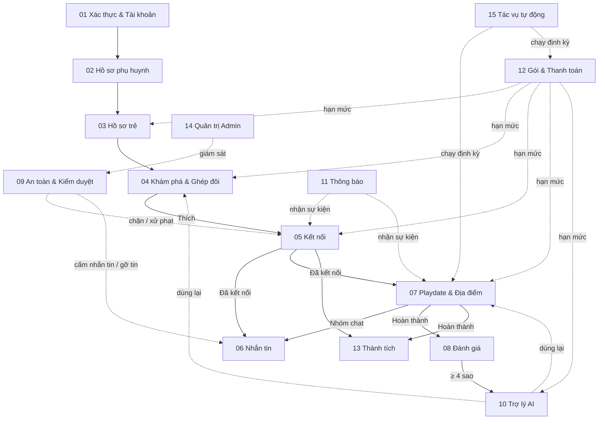
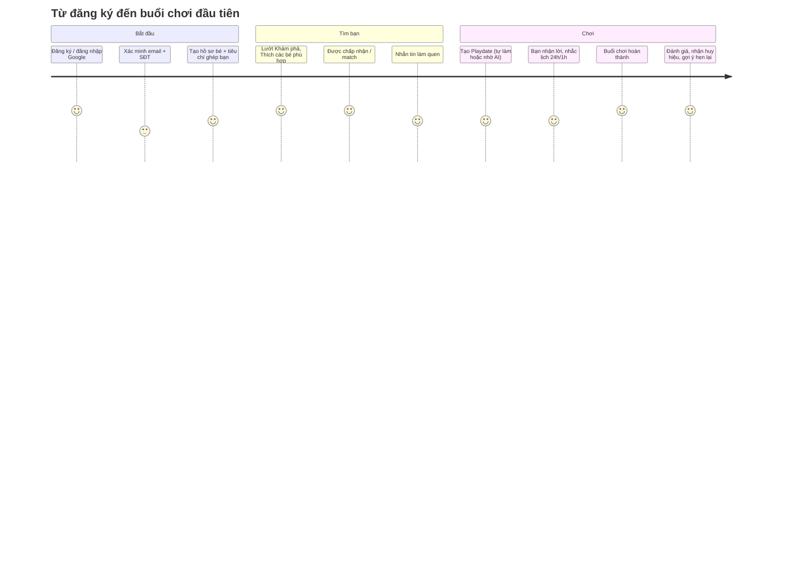

# 00. Tổng quan nghiệp vụ BuddyLink

## Hệ thống là gì
**BuddyLink** giúp phụ huynh tìm bạn chơi phù hợp cho con ở gần nhà, kết nối với các gia đình khác, lên lịch các buổi chơi (Playdate) an toàn, có Trợ lý AI hỗ trợ và cơ chế kiểm duyệt bảo vệ trẻ em.

## Vai trò

| Vai trò | Dùng ở đâu | Làm gì |
|---|---|---|
| Khách | App phụ huynh | Xem trang giới thiệu, bảng giá, đăng ký, đăng nhập |
| Phụ huynh | App phụ huynh | Toàn bộ chức năng cho gia đình (hồ sơ, bé, khám phá, kết nối, chat, playdate, AI, gói…) |
| Admin (duy nhất 1 tài khoản) | Cổng Admin riêng | Giám sát, xử lý vi phạm, quản lý gói & doanh thu |
| Hệ thống | Máy chủ | Tác vụ định kỳ, thông báo, Sentinel AI |

## Bản đồ module

## Hành trình chính của phụ huynh

## Gói dịch vụ tóm tắt

| | Free | Premium (99.000đ/tháng · 990.000đ/năm) |
|---|---|---|
| Hồ sơ trẻ | 1 | Không giới hạn |
| Lượt lướt Khám phá | 5/ngày | Không giới hạn |
| Lời mời kết nối | 5/tháng | Không giới hạn |
| Tạo / Tham gia Playdate | 3 / 3 mỗi tháng | Không giới hạn |
| Phiên Trợ lý AI | 5/tháng | Không giới hạn |

Chi tiết: [12-goi-dich-vu-thanh-toan.md](12-goi-dich-vu-thanh-toan.md)

## Mục lục

| # | Tài liệu | Nội dung |
|---|---|---|
| 01 | [Xác thực & Tài khoản](01-xac-thuc-tai-khoan.md) | Đăng ký, đăng nhập, Google, OTP, mật khẩu, khoá tài khoản |
| 02 | [Hồ sơ phụ huynh](02-ho-so-phu-huynh.md) | Thông tin, vị trí, sở thích, quyền riêng tư |
| 03 | [Hồ sơ trẻ](03-ho-so-tre.md) | Onboarding, thêm/sửa/xoá bé, khoá bé theo gói |
| 04 | [Khám phá & Ghép đôi](04-kham-pha-ghep-doi.md) | Gợi ý bạn chơi, công thức điểm phù hợp, Thích/Bỏ qua |
| 05 | [Kết nối](05-ket-noi.md) | Lời mời, chấp nhận, match, huỷ, cặp bé |
| 06 | [Nhắn tin](06-nhan-tin.md) | Chat 1-1, chat nhóm Playdate, bình chọn |
| 07 | [Playdate & Địa điểm](07-buoi-choi-playdate.md) | Tạo, mời, nhận lời, rời, đổi lịch, gợi ý, quy tắc giờ theo tuổi |
| 08 | [Đánh giá & Phản hồi](08-danh-gia-phan-hoi.md) | Chấm sao sau buổi chơi, gợi ý hẹn lại |
| 09 | [An toàn & Kiểm duyệt](09-an-toan-kiem-duyet.md) | Chặn, báo cáo, Sentinel AI, khung xử phạt |
| 10 | [Trợ lý AI](10-tro-ly-ai.md) | Tìm bạn, lên kế hoạch & quản lý Playdate bằng hội thoại |
| 11 | [Thông báo](11-thong-bao.md) | Sự kiện → thông báo realtime cho phụ huynh |
| 12 | [Gói & Thanh toán](12-goi-dich-vu-thanh-toan.md) | Free/Premium, hạn mức, PayOS |
| 13 | [Thành tích & Huy hiệu](13-thanh-tich-huy-hieu.md) | Chuỗi tuần, 13 huy hiệu |
| 14 | [Quản trị Admin](14-quan-tri-admin.md) | Dashboard, quản lý, xử lý báo cáo, thông báo admin |
| 15 | [Tác vụ tự động](15-tac-vu-tu-dong.md) | Các job định kỳ |

## Dịch vụ bên ngoài

| Dịch vụ | Dùng cho | File |
|---|---|---|
| Google Sign-In | Đăng nhập Google | [google-auth.adapter.js](../../Back-End/src/integrations/google/google-auth.adapter.js) |
| Firebase | Xác minh SĐT qua SMS | [firebase.adapter.js](../../Back-End/src/integrations/firebase/firebase.adapter.js) |
| Email (SMTP) | Mã xác minh, đặt lại mật khẩu | [mail.adapter.js](../../Back-End/src/integrations/mail/mail.adapter.js) |
| Cloudinary | Lưu ảnh (đại diện, chat, bằng chứng) | [storage.adapter.js](../../Back-End/src/integrations/storage/storage.adapter.js) |
| Geocoding | Đổi địa chỉ → toạ độ | [geocoding.adapter.js](../../Back-End/src/integrations/maps/geocoding.adapter.js) |
| OpenStreetMap (Overpass) | Dữ liệu địa điểm vui chơi | [overpass.adapter.js](../../Back-End/src/integrations/maps/overpass.adapter.js) |
| Open-Meteo | Dự báo thời tiết cho kế hoạch | [open-meteo.adapter.js](../../Back-End/src/integrations/weather/open-meteo.adapter.js) |
| Tavily | Tìm thông tin hoạt động thực tế của địa điểm | [tavily.adapter.js](../../Back-End/src/integrations/search/tavily.adapter.js) |
| Google Gemini | Trợ lý AI, Sentinel AI | [gemini.adapter.js](../../Back-End/src/integrations/ai/gemini.adapter.js) |
| PayOS | Thanh toán QR ngân hàng | [payos.adapter.js](../../Back-End/src/integrations/payos/payos.adapter.js) |

## Cấu trúc mã nguồn

| Phần | Vị trí |
|---|---|
| Backend app phụ huynh | [app.js](../../Back-End/src/app.js), [server.js](../../Back-End/src/server.js) |
| Backend cổng Admin | [admin-app.js](../../Back-End/src/admin-app.js), [admin-server.js](../../Back-End/src/admin-server.js) |
| Module nghiệp vụ backend | [Back-End/src/modules/](../../Back-End/src/modules/) (mỗi module: route → controller → service → rules/model) |
| Frontend điều hướng | [appRoutes.jsx](../src/routes/appRoutes.jsx), [ParentRoutes.jsx](../src/routes/ParentRoutes.jsx), [AdminAppRoutes.jsx](../src/routes/AdminAppRoutes.jsx) |
| Module frontend | [Front-End/src/modules/](../src/modules/) |
