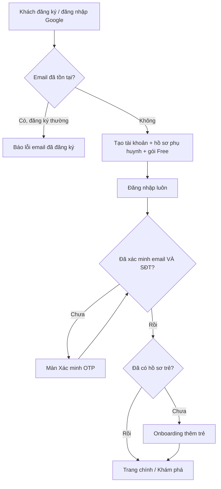
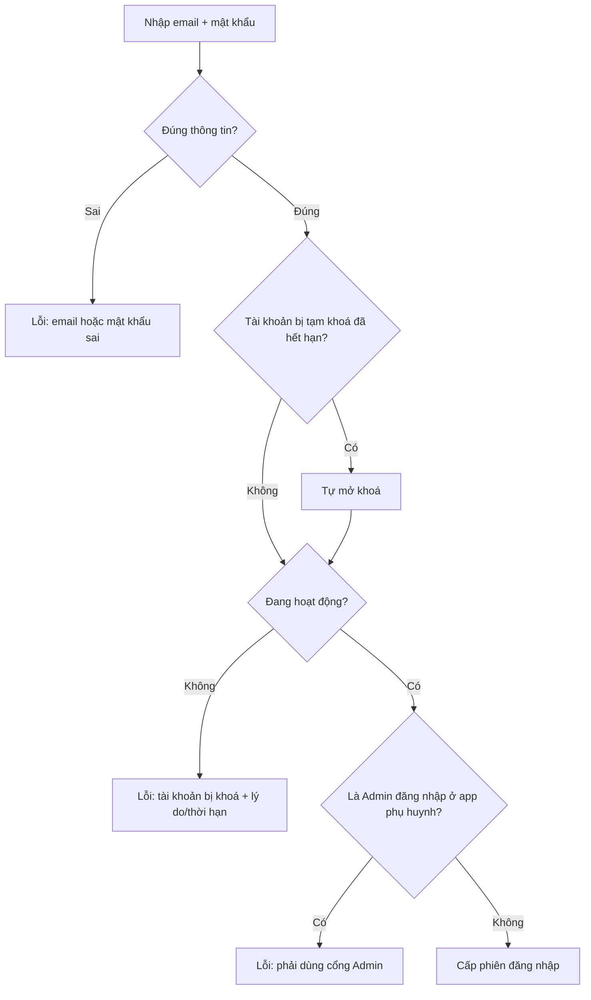
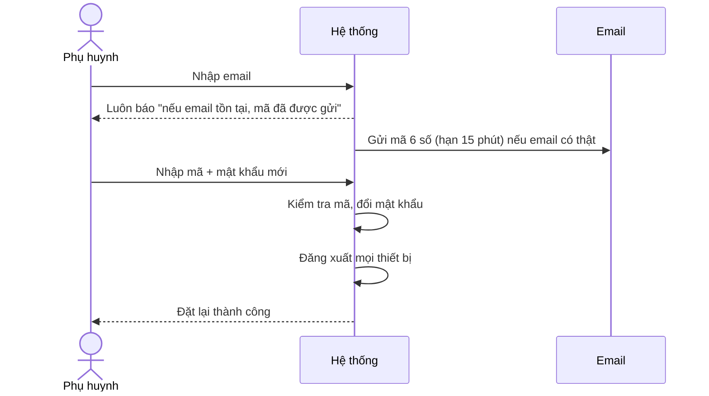
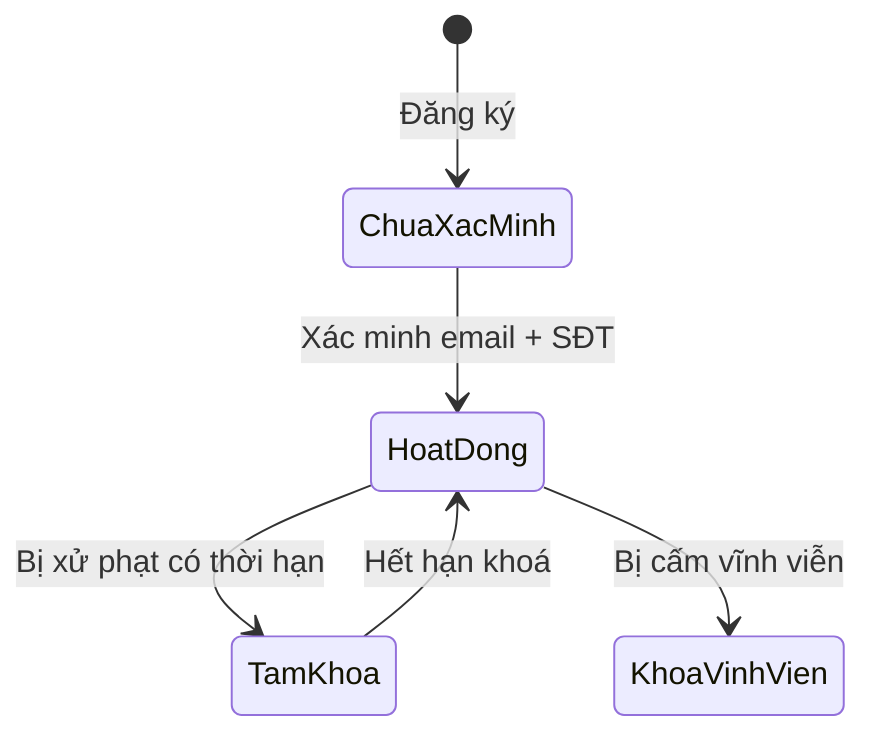

# 01. Xác thực & Tài khoản

## Mục đích
Cho phép phụ huynh tạo tài khoản, đăng nhập, xác minh email + số điện thoại, đổi/quên mật khẩu. Admin đăng nhập qua cổng quản trị riêng.

## Ai dùng

| Vai trò | Được làm gì |
|---|---|
| Khách (chưa đăng nhập) | Đăng ký, đăng nhập (mật khẩu / Google), quên & đặt lại mật khẩu |
| Phụ huynh | Xác minh email + SĐT, đổi mật khẩu, cập nhật SĐT/ảnh đại diện, đăng xuất |
| Admin | Chỉ đăng nhập ở cổng Admin (không đăng nhập được ở app phụ huynh) |

## Chức năng

| Chức năng | Mô tả ngắn | Màn hình | Xử lý |
|---|---|---|---|
| Đăng ký | Nhập họ tên, email, mật khẩu, SĐT (tuỳ chọn). Tự tạo hồ sơ phụ huynh + gói Free | [AuthPage](../src/modules/auth/pages/AuthPage.jsx) | [auth.service.js](../../Back-End/src/modules/auth/auth.service.js) – `register` |
| Đăng nhập Google | Email Google đã xác minh → tạo mới hoặc liên kết tài khoản có sẵn | [GoogleLoginButton](../src/modules/auth/components/GoogleLoginButton.jsx) | `loginWithGoogle` |
| Đăng nhập mật khẩu | Email + mật khẩu | [LoginForm](../src/modules/auth/components/LoginForm.jsx) | `login` |
| Xác minh email | Gửi mã 6 số qua email, nhập mã | [VerifyOtpPage](../src/modules/auth/pages/VerifyOtpPage.jsx) | `sendEmailOtp`, `verifyEmailOtp` |
| Xác minh SĐT | Xác minh SMS qua Firebase (hoặc OTP SMS của hệ thống) | [VerifyOtpPage](../src/modules/auth/pages/VerifyOtpPage.jsx) | `verifyFirebasePhone`, `sendPhoneOtp`, `verifyPhoneOtp` |
| Quên mật khẩu | Gửi mã đặt lại qua email | [ForgotPasswordPage](../src/modules/auth/pages/ForgotPasswordPage.jsx) | `forgotPassword` |
| Đặt lại mật khẩu | Nhập mã + mật khẩu mới | [ResetPasswordPage](../src/modules/auth/pages/ResetPasswordPage.jsx) | `resetPassword` |
| Đổi mật khẩu | Nhập mật khẩu cũ, mới, xác nhận | [ParentProfilePage](../src/modules/parent/pages/ParentProfilePage.jsx) | [user.service.js](../../Back-End/src/modules/user/user.service.js) – `changePassword` |
| Giữ phiên đăng nhập | Tự gia hạn phiên khi hết hạn | (tự động) | `refreshToken` |
| Đăng xuất | Huỷ phiên hiện tại | Menu tài khoản | `logout` |
| Bị khoá khi đang dùng | Nhận thông báo realtime và bị đăng xuất | (tự động) | [useAccountLockSocket](../src/modules/auth/hooks/useAccountLockSocket.js) |

## Luồng chính

### Đăng ký → vào app

### Đăng nhập

### Quên mật khẩu

## Quy tắc nghiệp vụ

| Mã | Quy tắc | Ghi chú |
|---|---|---|
| BR-AUTH-01 | Email là duy nhất, không phân biệt hoa thường | Lỗi `EMAIL_ALREADY_EXISTS` |
| BR-AUTH-02 | SĐT là duy nhất (chuẩn hoá trước khi so sánh), 9–15 chữ số | Lỗi `PHONE_ALREADY_EXISTS` / `PHONE_IN_USE` |
| BR-AUTH-03 | Mật khẩu tối thiểu 6 ký tự; họ tên 2–100 ký tự | [auth.validation.js](../../Back-End/src/modules/auth/auth.validation.js) |
| BR-AUTH-04 | Đăng ký thành công luôn tạo kèm hồ sơ phụ huynh + gói Free. Lỗi giữa chừng thì xoá phần đã tạo | `_createParentAccount` |
| BR-AUTH-05 | Mã OTP 6 số. Hạn: SMS 5 phút, email 10 phút, đặt lại mật khẩu 15 phút | [auth.constants.js](../../Back-End/src/modules/auth/auth.constants.js) |
| BR-AUTH-06 | Chỉ mã mới nhất còn hiệu lực; mỗi mã dùng 1 lần; sai 5 lần thì mã bị huỷ | `_issueOtp`, `_consumeOtp` |
| BR-AUTH-07 | Giới hạn theo IP trong 15 phút: tối đa 5 lần gửi mã, 10 lần nhập mã | [rate-limit.middleware.js](../../Back-End/src/middlewares/rate-limit.middleware.js) |
| BR-AUTH-08 | Phụ huynh phải xác minh **cả email và SĐT** mới dùng được app | [verification.js](../src/modules/auth/utils/verification.js) |
| BR-AUTH-09 | Đăng nhập Google: email Google phải đã xác minh; email được tự đánh dấu đã xác minh | `loginWithGoogle` |
| BR-AUTH-10 | Liên kết Google vào tài khoản cũ chưa xác minh email → xoá mật khẩu cũ và huỷ mọi phiên (chống chiếm tài khoản) | `loginWithGoogle` |
| BR-AUTH-11 | Quên mật khẩu không tiết lộ email có tồn tại hay không | `forgotPassword` |
| BR-AUTH-12 | Đặt lại mật khẩu → đăng xuất mọi thiết bị | `resetPassword` |
| BR-AUTH-13 | Đổi mật khẩu: mật khẩu cũ phải đúng, mới ≠ cũ, xác nhận phải khớp; tài khoản Google (không có mật khẩu) không đổi được | `changePassword` |
| BR-AUTH-14 | Admin chỉ đăng nhập ở cổng Admin; phiên của app nào chỉ dùng cho app đó | `_buildLoginResult`, `refreshToken` |
| BR-AUTH-15 | Mỗi lần gia hạn phiên sẽ huỷ phiên cũ và cấp phiên mới | `refreshToken` |
| BR-AUTH-16 | Tài khoản bị tạm khoá tự mở khi hết hạn (lúc đăng nhập hoặc bởi job định kỳ) | `liftExpiredSuspension`, [suspension-expiry.job.js](../../Back-End/src/jobs/suspension-expiry.job.js) |

## Trạng thái & dữ liệu chính

**Tài khoản (User)**

| Trường | Ý nghĩa |
|---|---|
| email, phone | Định danh đăng nhập (duy nhất) |
| role | `parent` hoặc `admin` |
| isActive | `false` = đang bị khoá |
| strikeCount | Số lần vi phạm (dùng cho xử phạt) |
| suspensionUntil | Thời điểm hết tạm khoá (null = khoá vĩnh viễn nếu `isActive=false`) |
| banReason | Lý do khoá |
| messagingRestrictedUntil | Hạn bị cấm nhắn tin |

**Trạng thái xác minh (trên hồ sơ phụ huynh)**

| Trường | Bật khi |
|---|---|
| isEmailVerified | Nhập đúng mã email, hoặc đăng nhập Google |
| isPhoneVerified | Xác minh SMS thành công |

## Liên quan

| Sự kiện | Ai nhận | Kết quả |
|---|---|---|
| Đăng ký mới | Admin | Thông báo "có người dùng mới" ([admin-notification.listener.js](../../Back-End/src/modules/admin/admin-notification.listener.js)) |
| Đổi trạng thái khoá/mở | Admin, chính người dùng | Thông báo admin; người dùng bị đăng xuất realtime khi bị khoá |
| Đăng ký | Gói dịch vụ | Tạo gói Free ([12-goi-dich-vu-thanh-toan.md](12-goi-dich-vu-thanh-toan.md)) |
| Khoá tài khoản | An toàn | Xem [09-an-toan-kiem-duyet.md](09-an-toan-kiem-duyet.md) |

## File xử lý

| Lớp | File |
|---|---|
| Route | [auth.route.js](../../Back-End/src/modules/auth/auth.route.js), [user.route.js](../../Back-End/src/modules/user/user.route.js) |
| Controller | [auth.controller.js](../../Back-End/src/modules/auth/auth.controller.js), [user.controller.js](../../Back-End/src/modules/user/user.controller.js) |
| Service | [auth.service.js](../../Back-End/src/modules/auth/auth.service.js), [user.service.js](../../Back-End/src/modules/user/user.service.js) |
| Kiểm tra dữ liệu | [auth.validation.js](../../Back-End/src/modules/auth/auth.validation.js), [user.validation.js](../../Back-End/src/modules/user/user.validation.js) |
| Hằng số | [auth.constants.js](../../Back-End/src/modules/auth/auth.constants.js) |
| Model | [user.model.js](../../Back-End/src/modules/user/user.model.js), [auth-token.model.js](../../Back-End/src/modules/auth/auth-token.model.js), [refresh-token.model.js](../../Back-End/src/modules/auth/refresh-token.model.js) |
| Bảo vệ API | [auth.middleware.js](../../Back-End/src/middlewares/auth.middleware.js), [rate-limit.middleware.js](../../Back-End/src/middlewares/rate-limit.middleware.js) |
| Tích hợp ngoài | [google-auth.adapter.js](../../Back-End/src/integrations/google/google-auth.adapter.js), [firebase.adapter.js](../../Back-End/src/integrations/firebase/firebase.adapter.js), [mail.adapter.js](../../Back-End/src/integrations/mail/mail.adapter.js), [sms.adapter.js](../../Back-End/src/integrations/sms/sms.adapter.js) |
| FE màn hình | [AuthPage.jsx](../src/modules/auth/pages/AuthPage.jsx), [VerifyOtpPage.jsx](../src/modules/auth/pages/VerifyOtpPage.jsx), [ForgotPasswordPage.jsx](../src/modules/auth/pages/ForgotPasswordPage.jsx), [ResetPasswordPage.jsx](../src/modules/auth/pages/ResetPasswordPage.jsx) |
| FE điều hướng | [appRoutes.jsx](../src/routes/appRoutes.jsx), [ProtectedRoute.jsx](../src/routes/ProtectedRoute.jsx) |
| FE gọi API | [authApi.js](../src/modules/auth/api/authApi.js) |
