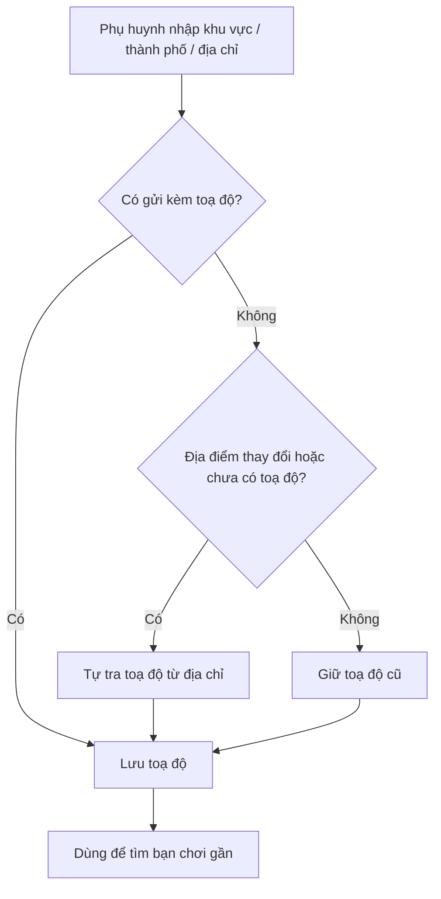
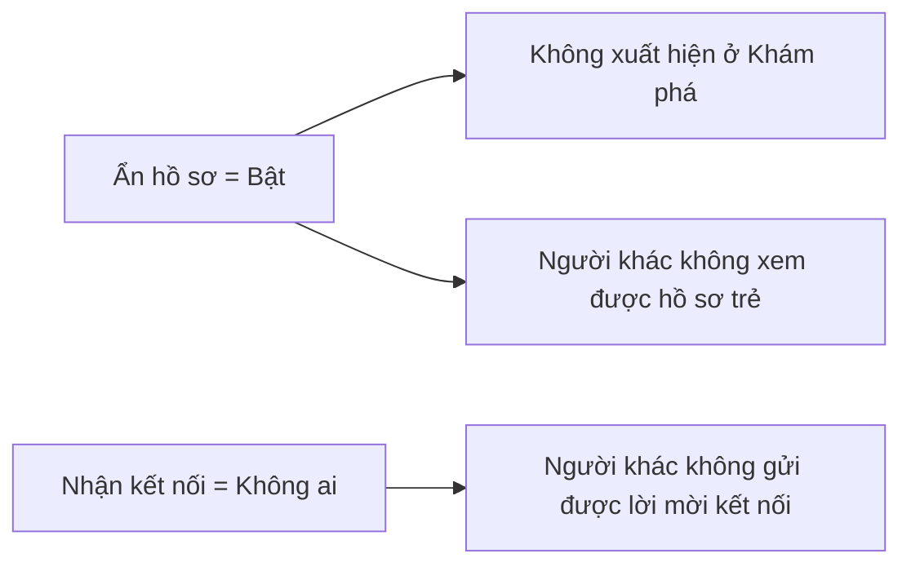

# 02. Hồ sơ Phụ huynh

## Mục đích
Lưu thông tin cá nhân, vị trí, sở thích tổ chức buổi chơi và cài đặt riêng tư của phụ huynh. Đây là dữ liệu đầu vào cho Khám phá, Kết nối và Playdate.

## Ai dùng

| Vai trò | Được làm gì |
|---|---|
| Phụ huynh | Xem/sửa hồ sơ, đổi ảnh đại diện, chỉnh sở thích & quyền riêng tư |
| Hệ thống | Đọc vị trí + sở thích để gợi ý bạn chơi; cập nhật chuỗi tuần (streak) |
| Admin | Xem hồ sơ trong trang quản lý người dùng |

## Chức năng

| Chức năng | Mô tả ngắn | Màn hình | Xử lý |
|---|---|---|---|
| Xem hồ sơ | Thông tin, xác minh, sở thích, riêng tư | [ParentProfilePage](../src/modules/parent/pages/ParentProfilePage.jsx) | [parent.service.js](../../Back-End/src/modules/parent/parent.service.js) – `getMyProfile` |
| Sửa thông tin | Họ tên, giới thiệu, khu vực/thành phố | [ProfileInfoTab](../src/modules/parent/components/ProfileInfoTab.jsx) | `updateProfile` |
| Thiết lập sở thích lần đầu | Vị trí + sở thích khi onboarding | [OnboardingChildPage](../src/modules/child/pages/OnboardingChildPage.jsx) | `updateOnboardingPreferences` |
| Sửa sở thích | Ngày, khung giờ, loại địa điểm, bán kính, độ tuổi | [ProfilePreferencesTab](../src/modules/parent/components/ProfilePreferencesTab.jsx) | `updateProfile` |
| Cài đặt riêng tư | Ẩn hồ sơ, ai được gửi kết nối | [ProfileSecurityTab](../src/modules/parent/components/ProfileSecurityTab.jsx) | `updateProfile` |
| Đổi ảnh đại diện | Tải ảnh, tự cắt vuông 400×400 theo khuôn mặt | [ProfileHeaderCard](../src/modules/parent/components/ProfileHeaderCard.jsx) | `updateAvatar` |
| Đổi mật khẩu | Xem [01-xac-thuc-tai-khoan.md](01-xac-thuc-tai-khoan.md) | [ChangePasswordModal](../src/modules/parent/components/ChangePasswordModal.jsx) | [user.service.js](../../Back-End/src/modules/user/user.service.js) |

## Luồng chính

### Cập nhật vị trí

### Ảnh hưởng của cài đặt riêng tư

## Quy tắc nghiệp vụ

| Mã | Quy tắc | Ghi chú |
|---|---|---|
| BR-PAR-01 | Mỗi tài khoản phụ huynh có đúng 1 hồ sơ | Tạo tự động khi đăng ký |
| BR-PAR-02 | Họ tên 2–100 ký tự; giới thiệu tối đa 500 ký tự | [parent.validation.js](../../Back-End/src/modules/parent/parent.validation.js) |
| BR-PAR-03 | Bán kính tìm kiếm 1–100 km (mặc định 15 km) | [parent.constants.js](../../Back-End/src/modules/parent/parent.constants.js) |
| BR-PAR-04 | Độ tuổi mong muốn 0–18, tối thiểu ≤ tối đa (mặc định 1–12) | `assertValidPreferences` |
| BR-PAR-05 | Nếu không nhập địa chỉ cụ thể, địa chỉ = "khu vực, thành phố" | `_buildLocation` |
| BR-PAR-06 | Onboarding luôn tra toạ độ; khi sửa hồ sơ chỉ tra lại khi địa điểm đổi hoặc chưa có toạ độ | `_buildLocation` |
| BR-PAR-07 | Ảnh: JPEG/PNG/WEBP/GIF, tối đa 5MB, kiểm tra đúng định dạng thật của file; ảnh cũ bị xoá sau khi thay | [upload.middleware.js](../../Back-End/src/middlewares/upload.middleware.js) |
| BR-PAR-08 | Hồ sơ bị ẩn → không hiện ở Khám phá và hồ sơ trẻ trở thành "không tìm thấy" với người khác | [child.service.js](../../Back-End/src/modules/child/child.service.js) |
| BR-PAR-09 | "Nhận kết nối = Không ai" → chặn mọi lời mời kết nối mới | [connection.service.js](../../Back-End/src/modules/connection/connection.service.js) |
| BR-PAR-10 | Nhắn tin chỉ với người đã kết nối (giá trị duy nhất) | Xem [06-nhan-tin.md](06-nhan-tin.md) |

## Dữ liệu chính

| Nhóm | Trường | Giá trị |
|---|---|---|
| Cơ bản | Họ tên, ảnh, giới thiệu | — |
| Vị trí | Địa chỉ, khu vực, thành phố, toạ độ | Toạ độ dùng tìm theo khoảng cách |
| Sở thích | Ngày chơi | Ngày thường, Cuối tuần |
| | Khung giờ | Sáng, Chiều, Tối |
| | Loại địa điểm | Trong nhà, Ngoài trời, Công viên, Kids cafe, Tại nhà, Thư viện, Bảo tàng, TTTM, Trung tâm thể thao, Hồ bơi |
| | Bán kính | 1–100 km |
| | Độ tuổi trẻ | 0–18 |
| Riêng tư | Ẩn hồ sơ | Bật / Tắt |
| | Ai được gửi kết nối | Mọi người / Không ai |
| | Ai được nhắn tin | Chỉ người đã kết nối |
| Xác minh | Email, SĐT | Đã / Chưa |
| Chuỗi tuần | Chuỗi hiện tại, dài nhất | Cập nhật khi hoàn thành playdate ([13-thanh-tich-huy-hieu.md](13-thanh-tich-huy-hieu.md)) |

## Liên quan

| Module | Dùng gì |
|---|---|
| [04 Khám phá](04-kham-pha-ghep-doi.md) | Vị trí, bán kính, sở thích, trạng thái ẩn |
| [05 Kết nối](05-ket-noi.md) | Cài đặt "ai được gửi kết nối" |
| [03 Hồ sơ trẻ](03-ho-so-tre.md) | Trạng thái ẩn hồ sơ |
| [13 Thành tích](13-thanh-tich-huy-hieu.md) | Chuỗi tuần, trạng thái xác minh |

## File xử lý

| Lớp | File |
|---|---|
| Route | [parent.route.js](../../Back-End/src/modules/parent/parent.route.js) |
| Controller | [parent.controller.js](../../Back-End/src/modules/parent/parent.controller.js) |
| Service | [parent.service.js](../../Back-End/src/modules/parent/parent.service.js) |
| Kiểm tra dữ liệu | [parent.validation.js](../../Back-End/src/modules/parent/parent.validation.js) |
| Hằng số | [parent.constants.js](../../Back-End/src/modules/parent/parent.constants.js) |
| Model | [parent.model.js](../../Back-End/src/modules/parent/parent.model.js) |
| Tích hợp ngoài | [geocoding.adapter.js](../../Back-End/src/integrations/maps/geocoding.adapter.js), [storage.adapter.js](../../Back-End/src/integrations/storage/storage.adapter.js) |
| FE màn hình | [ParentProfilePage.jsx](../src/modules/parent/pages/ParentProfilePage.jsx) |
| FE thành phần | [ProfileInfoTab.jsx](../src/modules/parent/components/ProfileInfoTab.jsx), [ProfilePreferencesTab.jsx](../src/modules/parent/components/ProfilePreferencesTab.jsx), [ProfileSecurityTab.jsx](../src/modules/parent/components/ProfileSecurityTab.jsx), [ProfileHeaderCard.jsx](../src/modules/parent/components/ProfileHeaderCard.jsx) |
