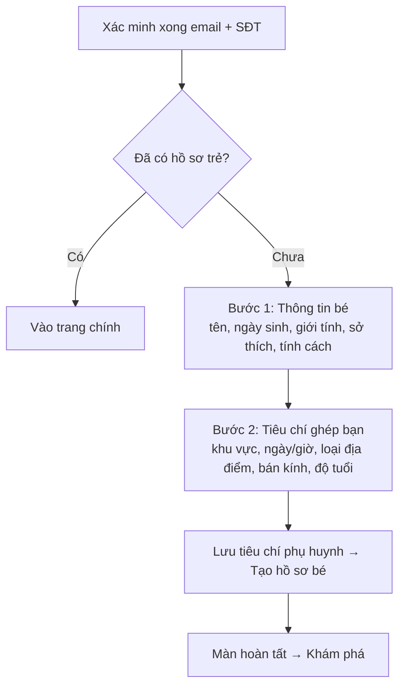
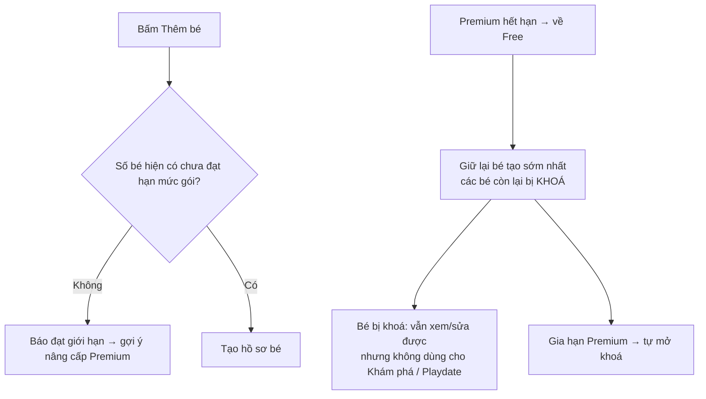

# 03. Hồ sơ Trẻ

## Mục đích
Phụ huynh tạo hồ sơ cho từng bé (tên, ngày sinh, giới tính, sở thích, tính cách). Hồ sơ trẻ là "đơn vị" được ghép đôi ở Khám phá và được mời tham gia Playdate.

## Ai dùng

| Vai trò | Được làm gì |
|---|---|
| Phụ huynh (chủ) | Thêm, xem, sửa, xoá hồ sơ trẻ của mình |
| Phụ huynh khác | Xem hồ sơ công khai của trẻ (nếu không bị ẩn/chặn) |
| Admin | Xem danh sách trẻ toàn hệ thống, thống kê độ tuổi |

## Chức năng

| Chức năng | Mô tả ngắn | Màn hình | Xử lý |
|---|---|---|---|
| Onboarding | 2 bước: thông tin bé → tiêu chí ghép bạn (vị trí, ngày/giờ, địa điểm, bán kính, tuổi). Xong chuyển sang Khám phá | [OnboardingChildPage](../src/modules/child/pages/OnboardingChildPage.jsx) | [child.service.js](../../Back-End/src/modules/child/child.service.js) – `createChild`; [parent.service.js](../../Back-End/src/modules/parent/parent.service.js) – `updateOnboardingPreferences` |
| Danh sách trẻ | Hiện các bé, đánh dấu bé bị khoá | [ChildrenManagementPage](../src/modules/child/pages/ChildrenManagementPage.jsx) | `getMyChildren` |
| Thêm trẻ | Kiểm tra hạn mức theo gói trước khi tạo | [ChildFormPage](../src/modules/child/pages/ChildFormPage.jsx) | `createChild` |
| Sửa trẻ | Sửa các trường cho phép | [ChildFormPage](../src/modules/child/pages/ChildFormPage.jsx) | `updateChild` |
| Xoá trẻ | Xoá mềm (ẩn đi, không mất dữ liệu) | [ChildCard](../src/modules/child/components/ChildCard.jsx) | `deleteChild` |
| Xem hồ sơ công khai | Kèm trạng thái kết nối với phụ huynh của bé | Khám phá / Kết nối | `getPublicProfile` |

## Luồng chính

### Sau xác minh → Onboarding

### Thêm trẻ & khoá theo gói

## Quy tắc nghiệp vụ

| Mã | Quy tắc | Ghi chú |
|---|---|---|
| BR-CHD-01 | Bắt buộc: tên (2–50 ký tự), ngày sinh (không ở tương lai), giới tính (trai/gái) | [child.validation.js](../../Back-End/src/modules/child/child.validation.js) |
| BR-CHD-02 | Sở thích, hoạt động yêu thích, tính cách: mỗi loại tối đa 20 mục, mỗi mục ≤ 50 ký tự | `tagList` |
| BR-CHD-03 | Phụ huynh chỉ được sửa: tên, ngày sinh, giới tính, sở thích, hoạt động yêu thích, tính cách | `CHILD_EDITABLE_FIELDS` |
| BR-CHD-04 | Số hồ sơ trẻ tối đa theo gói: Free = 1, Premium = không giới hạn | `checkChildProfileQuota` ([subscription.service.js](../../Back-End/src/modules/subscription/subscription.service.js)) |
| BR-CHD-05 | Khi về gói Free, chỉ bé tạo sớm nhất còn dùng được; các bé khác bị khoá (báo lỗi `CHILD_PROFILE_LOCKED` nếu dùng) | `getLockedChildIds`, `assertChildUsable` |
| BR-CHD-06 | Xoá là xoá mềm; bé đã xoá không còn xuất hiện ở đâu | `deleteChild` |
| BR-CHD-07 | Xem/sửa/xoá bé của người khác → báo "không tìm thấy" (không lộ thông tin) | `getChildById`, `updateChild` |
| BR-CHD-08 | Hồ sơ công khai bị ẩn khi: phụ huynh ẩn hồ sơ, hai bên chặn nhau, hoặc phụ huynh bị khoá | `getPublicProfile` |
| BR-CHD-09 | Hồ sơ công khai hiển thị trạng thái kết nối: Chưa kết nối / Đã gửi / Đã nhận / Đã kết nối | `_getViewerConnectionStatus` |

## Dữ liệu chính

| Trường | Giá trị |
|---|---|
| Tên hiển thị | 2–50 ký tự |
| Ngày sinh | Dùng tính tuổi khi ghép đôi |
| Giới tính | Bé trai / Bé gái |
| Sở thích, Tính cách | Danh sách nhãn tự do |
| Hoạt động yêu thích | Chọn từ 20 hoạt động có sẵn (dã ngoại, bơi lội, Lego, vẽ tranh, kids cafe…) – [child.constants.js](../../Back-End/src/modules/child/child.constants.js) |
| Đã lưu trữ | Đánh dấu xoá mềm |

**Nhóm tuổi (thống kê Admin):** 0–2, 3–5, 6–10, 11+ tuổi.

## Liên quan

| Module | Liên quan |
|---|---|
| [02 Hồ sơ phụ huynh](02-ho-so-phu-huynh.md) | Onboarding lưu tiêu chí ghép bạn; trạng thái ẩn hồ sơ |
| [04 Khám phá](04-kham-pha-ghep-doi.md) | Chỉ trẻ không bị khoá mới được ghép |
| [07 Playdate](07-buoi-choi-playdate.md) | Chọn bé tham gia (không được dùng bé bị khoá) |
| [12 Gói dịch vụ](12-goi-dich-vu-thanh-toan.md) | Hạn mức số bé, khoá/mở khoá bé |

## File xử lý

| Lớp | File |
|---|---|
| Route | [child.route.js](../../Back-End/src/modules/child/child.route.js) |
| Controller | [child.controller.js](../../Back-End/src/modules/child/child.controller.js) |
| Service | [child.service.js](../../Back-End/src/modules/child/child.service.js) |
| Kiểm tra dữ liệu | [child.validation.js](../../Back-End/src/modules/child/child.validation.js) |
| Hằng số | [child.constants.js](../../Back-End/src/modules/child/child.constants.js) |
| Model | [child.model.js](../../Back-End/src/modules/child/child.model.js) |
| FE màn hình | [OnboardingChildPage.jsx](../src/modules/child/pages/OnboardingChildPage.jsx), [ChildrenManagementPage.jsx](../src/modules/child/pages/ChildrenManagementPage.jsx), [ChildFormPage.jsx](../src/modules/child/pages/ChildFormPage.jsx) |
| FE xử lý | [useOnboardingChild.js](../src/modules/child/hooks/useOnboardingChild.js), [useVerifyOtp.js](../src/modules/auth/hooks/useVerifyOtp.js) (điều hướng sau xác minh) |
