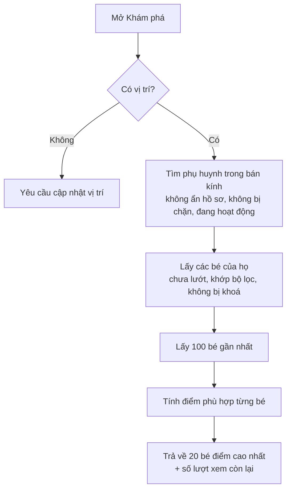
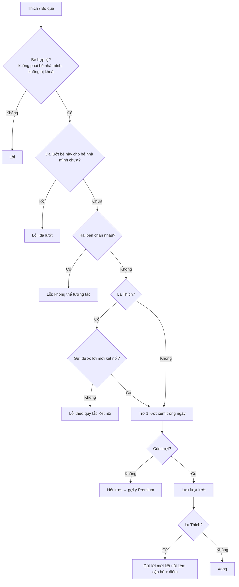
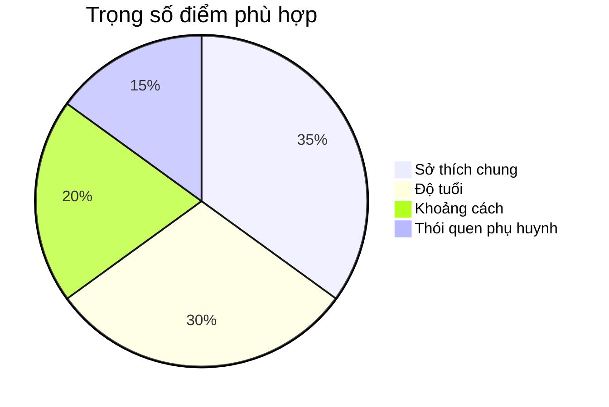

# 04. Khám phá & Ghép đôi (Discovery)

## Mục đích
Gợi ý các bé ở gần phù hợp với bé nhà mình, sắp xếp theo **điểm phù hợp (0–100)**. Phụ huynh lướt thẻ: **Thích** (gửi lời mời kết nối) hoặc **Bỏ qua**.

## Ai dùng

| Vai trò | Được làm gì |
|---|---|
| Phụ huynh | Xem gợi ý, lọc, xem chi tiết hồ sơ bé, Thích / Bỏ qua |
| Hệ thống | Tính điểm phù hợp, trừ lượt xem theo gói |

## Chức năng

| Chức năng | Mô tả ngắn | Màn hình | Xử lý |
|---|---|---|---|
| Xem gợi ý | Tối đa 20 thẻ/lần, điểm cao nhất trước | [DiscoveryPage](../src/modules/discovery/pages/DiscoveryPage.jsx) | [discovery.service.js](../../Back-End/src/modules/discovery/discovery.service.js) – `getDiscoveryProfiles` |
| Chọn bé để tìm bạn | Nhà có nhiều bé thì chọn bé đang tìm bạn | [DiscoveryFilterBar](../src/modules/discovery/components/DiscoveryFilterBar.jsx) | `getDiscoveryProfiles` |
| Lọc | Bán kính, độ tuổi, sở thích | [DiscoveryFilterModal](../src/modules/discovery/components/DiscoveryFilterModal.jsx) | `getDiscoveryProfiles` |
| Xem chi tiết | Hồ sơ công khai của bé + điểm phù hợp | [ChildProfileDetailModal](../src/modules/discovery/components/ChildProfileDetailModal.jsx) | [child.service.js](../../Back-End/src/modules/child/child.service.js) – `getPublicProfile` |
| Thích / Bỏ qua | Ghi nhận lượt lướt; Thích = gửi lời mời kết nối | [DiscoveryActionButtons](../src/modules/discovery/components/DiscoveryActionButtons.jsx) | `swipeProfile` |

## Luồng chính

### Lấy danh sách gợi ý

### Lướt thẻ

## Cách tính điểm phù hợp (tổng 100)

| Tiêu chí | Điểm tối đa | Cách tính |
|---|---|---|
| Độ tuổi | 30 | Tuổi bé nằm trong khoảng tuổi mong muốn → 30. Lệch mỗi 1 tuổi trừ 10 điểm |
| Sở thích chung | 35 | Tỉ lệ trùng sở thích + hoạt động yêu thích giữa 2 bé × 35 |
| Khoảng cách | 20 | Càng gần càng cao; ở mép bán kính tìm kiếm = 0 |
| Thói quen phụ huynh | 15 | Mức trùng ngày chơi, khung giờ, loại địa điểm × 15 |

> Thiếu dữ liệu thì cho điểm trung tính: tuổi 15, sở thích ~10, thói quen 8.
> Cùng công thức được dùng để chấm điểm cặp bé trong Playdate.

## Quy tắc nghiệp vụ

| Mã | Quy tắc | Ghi chú |
|---|---|---|
| BR-DIS-01 | Bắt buộc có vị trí (từ hồ sơ hoặc vị trí hiện tại) | Lỗi `LOCATION_REQUIRED` |
| BR-DIS-02 | Bán kính: theo bộ lọc, nếu không thì theo hồ sơ, mặc định 15 km (1–100 km) | [discovery.constants.js](../../Back-End/src/modules/discovery/discovery.constants.js) |
| BR-DIS-03 | Không hiện: chính mình, người bị chặn/chặn mình, hồ sơ ẩn, tài khoản bị khoá, bé bị khoá theo gói, bé đã lướt | `getDiscoveryProfiles` |
| BR-DIS-04 | Lượt lướt tính **theo từng bé nhà mình**: cùng 1 bé đối phương có thể được Thích lại cho bé khác | [discovery.model.js](../../Back-End/src/modules/discovery/discovery.model.js) |
| BR-DIS-05 | Nhà nhiều bé phải chọn bé khi lướt; nhà 1 bé thì tự lấy bé đó | `_resolveSwipeChild` |
| BR-DIS-06 | Lượt xem/ngày: Free = 5, Premium = không giới hạn. Chỉ trừ khi lướt hợp lệ, không trừ khi chỉ xem | `checkAndConsumeQuota` |
| BR-DIS-07 | Thích = gửi lời mời kết nối (trừ thêm hạn mức lời mời/tháng); kiểm tra trước để không mất lượt oan | `validateConnectionRequest` |
| BR-DIS-08 | Hai bên cùng Thích nhau → tự kết nối (match) | Xem [05-ket-noi.md](05-ket-noi.md) |

## Dữ liệu chính – Lượt lướt

| Trường | Ý nghĩa |
|---|---|
| Người lướt, Bé nhà mình | Ai lướt, cho bé nào |
| Bé đối phương, Phụ huynh đối phương | Đối tượng được lướt |
| Thích? | Có = Thích, Không = Bỏ qua |

## Liên quan

| Module | Liên quan |
|---|---|
| [02 Hồ sơ phụ huynh](02-ho-so-phu-huynh.md) | Vị trí, bán kính, sở thích, ẩn hồ sơ |
| [03 Hồ sơ trẻ](03-ho-so-tre.md) | Nguồn thẻ gợi ý, bé bị khoá |
| [05 Kết nối](05-ket-noi.md) | Thích → lời mời kết nối |
| [09 An toàn](09-an-toan-kiem-duyet.md) | Loại người bị chặn |
| [12 Gói dịch vụ](12-goi-dich-vu-thanh-toan.md) | Lượt xem/ngày |
| [10 Trợ lý AI](10-tro-ly-ai.md) | AI dùng lại công thức để tìm bạn |

## File xử lý

| Lớp | File |
|---|---|
| Route | [discovery.route.js](../../Back-End/src/modules/discovery/discovery.route.js) |
| Controller | [discovery.controller.js](../../Back-End/src/modules/discovery/discovery.controller.js) |
| Service | [discovery.service.js](../../Back-End/src/modules/discovery/discovery.service.js) |
| Quy tắc tính điểm | [matching.rules.js](../../Back-End/src/modules/discovery/matching.rules.js) |
| Hằng số | [discovery.constants.js](../../Back-End/src/modules/discovery/discovery.constants.js) |
| Kiểm tra dữ liệu | [discovery.validation.js](../../Back-End/src/modules/discovery/discovery.validation.js) |
| Model | [discovery.model.js](../../Back-End/src/modules/discovery/discovery.model.js) |
| FE màn hình | [DiscoveryPage.jsx](../src/modules/discovery/pages/DiscoveryPage.jsx) |
| FE xử lý | [useDiscovery.js](../src/modules/discovery/hooks/useDiscovery.js), [discoverySlice.js](../src/modules/discovery/redux/discoverySlice.js), [discoveryApi.js](../src/modules/discovery/api/discoveryApi.js) |
