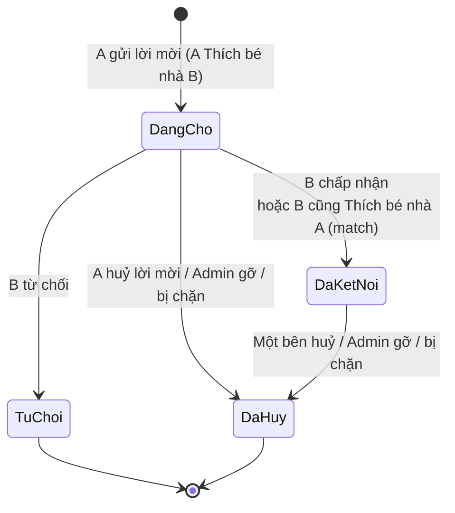
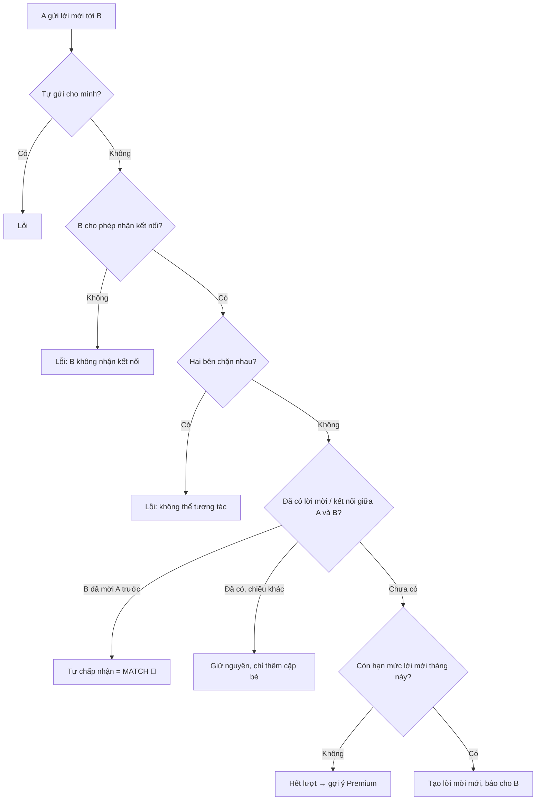

# 05. Kết nối giữa phụ huynh (Connection)

## Mục đích
Quản lý quan hệ "bạn bè" giữa hai phụ huynh. Đã kết nối thì mới nhắn tin được và mời nhau tham gia Playdate. Mỗi kết nối còn lưu **các cặp bé** đã được ghép với nhau.

## Ai dùng

| Vai trò | Được làm gì |
|---|---|
| Phụ huynh | Gửi lời mời, chấp nhận/từ chối lời mời đến, huỷ lời mời đã gửi, huỷ kết nối, xem danh sách |
| Hệ thống | Tự ghép khi 2 bên cùng Thích; tự huỷ khi bị chặn; thêm cặp bé sau Playdate |
| Admin | Xem, tìm kiếm, gỡ kết nối (kèm lý do) |

## Chức năng

| Chức năng | Mô tả ngắn | Màn hình | Xử lý |
|---|---|---|---|
| Gửi lời mời | Từ nút Thích ở Khám phá (hoặc gửi trực tiếp) | [DiscoveryPage](../src/modules/discovery/pages/DiscoveryPage.jsx) | [connection.service.js](../../Back-End/src/modules/connection/connection.service.js) – `sendConnectionRequest` |
| Danh sách | Lọc theo: đang chờ / đã kết nối, lời mời đến / đã gửi; tìm theo tên phụ huynh hoặc tên bé | [ConnectionsPage](../src/modules/connection/pages/ConnectionsPage.jsx) | `getConnections` |
| Chấp nhận | Chỉ người nhận | [ConnectionCard](../src/modules/connection/components/ConnectionCard.jsx) | `acceptConnectionRequest` |
| Từ chối | Chỉ người nhận | [ConnectionCard](../src/modules/connection/components/ConnectionCard.jsx) | `declineConnectionRequest` |
| Huỷ lời mời / Huỷ kết nối | Người gửi huỷ lời mời đang chờ, hoặc 1 trong 2 bên huỷ kết nối | [ConnectionCard](../src/modules/connection/components/ConnectionCard.jsx) | `removeConnection` |
| Xem cặp bé đã ghép | Các cặp bé ghép từ Khám phá / Playdate | [ChildPairList](../src/modules/connection/components/ChildPairList.jsx) | `populateChildPairs` |

## Luồng chính

### Vòng đời kết nối

### Gửi lời mời

## Quy tắc nghiệp vụ

| Mã | Quy tắc | Ghi chú |
|---|---|---|
| BR-CON-01 | Không tự kết nối với chính mình | `SELF_CONNECTION_NOT_ALLOWED` |
| BR-CON-02 | Người nhận đặt "Không ai được gửi kết nối" → không gửi được | `CONNECTION_NOT_ALLOWED` |
| BR-CON-03 | Hai bên có chặn nhau (bất kỳ chiều nào) → không gửi/không chấp nhận được | `BLOCKED_INTERACTION` |
| BR-CON-04 | Giữa 2 phụ huynh chỉ có tối đa 1 kết nối đang chờ hoặc đã kết nối | Khoá duy nhất theo cặp |
| BR-CON-05 | Nếu B đã mời A, khi A mời lại B → tự thành kết nối (match) | `sendConnectionRequest` |
| BR-CON-06 | Hạn mức lời mời mới/tháng: Free = 5, Premium = không giới hạn. Đã có kết nối thì không trừ lượt | `validateConnectionRequest` |
| BR-CON-07 | Chỉ người nhận được chấp nhận/từ chối; chỉ thao tác được khi đang ở trạng thái "đang chờ" | `_getOwnConnection`, `_transition` |
| BR-CON-08 | Người gửi chỉ huỷ được lời mời của mình khi đang chờ; kết nối đã thành thì 2 bên đều huỷ được | `removeConnection` |
| BR-CON-09 | Chặn ai đó → tự huỷ kết nối/lời mời giữa hai người | [connection.listener.js](../../Back-End/src/modules/connection/connection.listener.js) |
| BR-CON-10 | Playdate hoàn thành → thêm các cặp bé đã chơi cùng vào kết nối | [connection.listener.js](../../Back-End/src/modules/connection/connection.listener.js) |
| BR-CON-11 | Danh sách ẩn người bị chặn; hiện cặp bé chỉ khi cả 2 bé còn tồn tại | `getConnections`, `populateChildPairs` |
| BR-CON-12 | Admin chỉ gỡ được kết nối đang chờ/đã kết nối, có thể ghi lý do | `removeConnectionByAdmin` |

## Dữ liệu chính

| Trường | Ý nghĩa |
|---|---|
| Người gửi, Người nhận | 2 phụ huynh |
| Trạng thái | Đang chờ / Đã kết nối / Từ chối / Đã huỷ |
| Thời điểm | Kết nối lúc, Từ chối lúc, Huỷ lúc |
| Gỡ bởi Admin, Lý do gỡ | Khi Admin can thiệp |
| Cặp bé | 2 bé + nguồn (Khám phá / Playdate / Thủ công) + điểm phù hợp |

## Liên quan

| Sự kiện | Ai nhận | Kết quả |
|---|---|---|
| Có lời mời mới | Người nhận | Thông báo ([11-thong-bao.md](11-thong-bao.md)) |
| Kết nối thành công | 2 phụ huynh, Admin, Thành tích | Thông báo; cập nhật huy hiệu kết nối ([13](13-thanh-tich-huy-hieu.md)) |
| Kết nối bị gỡ | Admin | Thông báo admin |
| Đã kết nối | Nhắn tin, Playdate | Điều kiện để chat ([06](06-nhan-tin.md)) và mời Playdate ([07](07-buoi-choi-playdate.md)) |

## File xử lý

| Lớp | File |
|---|---|
| Route | [connection.route.js](../../Back-End/src/modules/connection/connection.route.js) |
| Controller | [connection.controller.js](../../Back-End/src/modules/connection/connection.controller.js) |
| Service | [connection.service.js](../../Back-End/src/modules/connection/connection.service.js) |
| Lắng nghe sự kiện | [connection.listener.js](../../Back-End/src/modules/connection/connection.listener.js), [connection.events.js](../../Back-End/src/modules/connection/connection.events.js) |
| Hằng số | [connection.constants.js](../../Back-End/src/modules/connection/connection.constants.js) |
| Kiểm tra dữ liệu | [connection.validation.js](../../Back-End/src/modules/connection/connection.validation.js) |
| Model | [connection.model.js](../../Back-End/src/modules/connection/connection.model.js) |
| FE màn hình | [ConnectionsPage.jsx](../src/modules/connection/pages/ConnectionsPage.jsx) |
| FE xử lý | [useConnections.js](../src/modules/connection/hooks/useConnections.js) |
