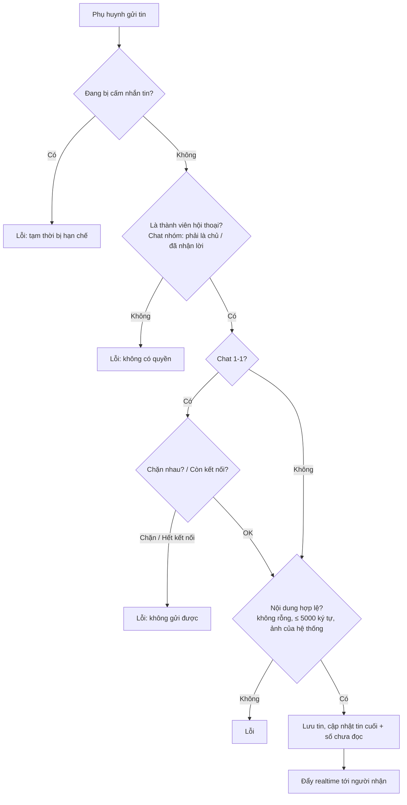
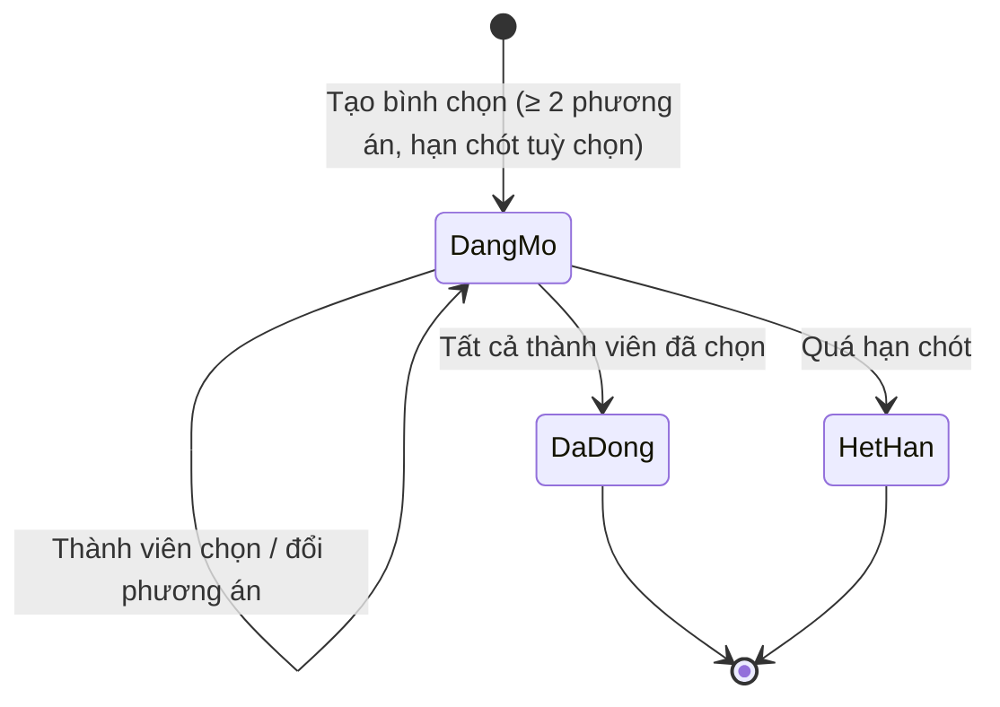

# 06. Nhắn tin (Chat)

## Mục đích
Cho phụ huynh trò chuyện realtime: **chat riêng 1-1** giữa 2 phụ huynh đã kết nối, và **chat nhóm** cho từng buổi Playdate (có bình chọn thời gian/lựa chọn và tin nhắn hệ thống).

## Ai dùng

| Vai trò | Được làm gì |
|---|---|
| Phụ huynh | Mở hội thoại, gửi chữ/ảnh/emoji, xem lịch sử, đánh dấu đã đọc, báo cáo tin nhắn |
| Chủ Playdate & thành viên đã nhận lời | Chat nhóm Playdate, tạo & bình chọn |
| Hệ thống | Gửi tin nhắn hệ thống (VD: nhắc lịch trước 24h) |
| Admin | Gỡ tin nhắn vi phạm (hiện dòng "đã bị gỡ") |

## Chức năng

| Chức năng | Mô tả ngắn | Màn hình | Xử lý |
|---|---|---|---|
| Danh sách hội thoại | Tin cuối, số tin chưa đọc, trạng thái chặn | [ConversationList](../src/modules/chat/components/ConversationList.jsx) | [chat.service.js](../../Back-End/src/modules/chat/chat.service.js) – `getUserConversations` |
| Mở chat 1-1 | Tạo mới hoặc mở lại hội thoại với phụ huynh đã kết nối | [DirectChatView](../src/modules/chat/components/DirectChatView.jsx) | `getOrCreateDirectConversation` |
| Mở chat nhóm Playdate | Thành viên = chủ + người đã nhận lời, tự cập nhật khi đổi thành viên | [PlaydateChatView](../src/modules/chat/components/PlaydateChatView.jsx) | `getOrCreatePlaydateConversation`, `syncPlaydateConversation` |
| Gửi tin | Chữ, emoji, ảnh (tải lên trước) | [ChatPage](../src/modules/chat/pages/ChatPage.jsx) | `sendMessage`, `uploadAttachment` |
| Đang gõ / Đã đọc | Hiển thị realtime | [ChatPage](../src/modules/chat/pages/ChatPage.jsx) | [chat.socket.js](../../Back-End/src/sockets/chat.socket.js), `markAsRead` |
| Tạo bình chọn | Chỉ trong chat nhóm Playdate | [CreatePollModal](../src/modules/chat/components/CreatePollModal.jsx) | `createPollMessage` |
| Bình chọn | Chọn 1 phương án, có thể đổi | [PollMessageCard](../src/modules/chat/components/PollMessageCard.jsx) | `votePoll` |
| Tin nhắn hệ thống | Nhắc lịch, sự kiện Playdate | [SystemMessage](../src/modules/chat/components/SystemMessage.jsx) | `postSystemMessage` |
| Admin gỡ tin | Thay nội dung bằng dòng thông báo | (Admin) | `adminDeleteMessage` |

## Luồng chính

### Gửi tin nhắn

### Bình chọn trong chat nhóm

## Quy tắc nghiệp vụ

| Mã | Quy tắc | Ghi chú |
|---|---|---|
| BR-CHAT-01 | Chat 1-1 chỉ với phụ huynh **đã kết nối**; không chat với chính mình | `CONNECTION_REQUIRED`, `SELF_CHAT_NOT_ALLOWED` |
| BR-CHAT-02 | Mỗi cặp phụ huynh chỉ có 1 hội thoại 1-1 | [conversation.model.js](../../Back-End/src/modules/chat/conversation.model.js) |
| BR-CHAT-03 | Chặn nhau (bất kỳ chiều) → không mở / không gửi được chat 1-1 | `USER_BLOCKED` |
| BR-CHAT-04 | Huỷ kết nối → không gửi tiếp được trong chat 1-1 cũ | `_assertDirectMessagingAllowed` |
| BR-CHAT-05 | Chat nhóm Playdate: chỉ chủ + người đã nhận lời được đọc/gửi. Chặn trong nhóm không cấm gửi (người dùng tự chọn ở lại hay rời buổi) | `_assertConversationAccess` |
| BR-CHAT-06 | Người dùng chỉ gửi được loại: chữ, ảnh, emoji (hệ thống & bình chọn do hệ thống/luồng riêng tạo) | `sendMessage` |
| BR-CHAT-07 | Tin tối đa 5000 ký tự, không được rỗng; ảnh phải tải qua hệ thống (JPEG/PNG/WEBP/GIF ≤ 5MB) | `sendMessage`, [upload.middleware.js](../../Back-End/src/middlewares/upload.middleware.js) |
| BR-CHAT-08 | Bị xử phạt "cấm nhắn tin" → không gửi được đến khi hết hạn | `MESSAGING_RESTRICTED` – xem [09](09-an-toan-kiem-duyet.md) |
| BR-CHAT-09 | Bình chọn chỉ có ở chat nhóm Playdate, ≥ 2 phương án; mỗi người 1 phiếu (đổi được) | `createPollMessage`, `votePoll` |
| BR-CHAT-10 | Bình chọn tự đóng khi mọi thành viên đã bầu; quá hạn chót thì không bầu được | `votePoll` |
| BR-CHAT-11 | Tin bị Admin gỡ hiển thị: "Tin nhắn này đã bị Quản trị viên gỡ do vi phạm quy tắc cộng đồng." | [chat.constants.js](../../Back-End/src/modules/chat/chat.constants.js) |

## Dữ liệu chính

| Đối tượng | Trường | Giá trị |
|---|---|---|
| Hội thoại | Loại | 1-1 / Playdate |
| | Thành viên, Playdate liên quan | — |
| | Tin cuối, Số chưa đọc theo người | — |
| Tin nhắn | Loại | Chữ, Ảnh, Emoji, Hệ thống, Bình chọn |
| | Nội dung, Ảnh, Người đã đọc | — |
| | Bình chọn | Câu hỏi, phương án (ngày/giờ/nhãn), hạn chót, đã đóng |
| | Đã gỡ | Có / Không |

## Liên quan

| Module | Liên quan |
|---|---|
| [05 Kết nối](05-ket-noi.md) | Điều kiện chat 1-1 |
| [07 Playdate](07-buoi-choi-playdate.md) | Thành viên chat nhóm thay đổi theo người nhận lời / rời buổi |
| [09 An toàn](09-an-toan-kiem-duyet.md) | Chặn, báo cáo tin nhắn, cấm nhắn tin, gỡ tin |
| [11 Thông báo](11-thong-bao.md) | Nhắc lịch 24h gửi kèm tin hệ thống vào nhóm |

## File xử lý

| Lớp | File |
|---|---|
| Route | [chat.route.js](../../Back-End/src/modules/chat/chat.route.js) |
| Controller | [chat.controller.js](../../Back-End/src/modules/chat/chat.controller.js) |
| Service | [chat.service.js](../../Back-End/src/modules/chat/chat.service.js) |
| Realtime | [chat.socket.js](../../Back-End/src/sockets/chat.socket.js), [chat.broadcast.js](../../Back-End/src/sockets/chat.broadcast.js) |
| Sự kiện | [chat.events.js](../../Back-End/src/modules/chat/chat.events.js), [chat.listener.js](../../Back-End/src/modules/chat/chat.listener.js) |
| Hằng số | [chat.constants.js](../../Back-End/src/modules/chat/chat.constants.js) |
| Kiểm tra dữ liệu | [chat.validation.js](../../Back-End/src/modules/chat/chat.validation.js) |
| Model | [conversation.model.js](../../Back-End/src/modules/chat/conversation.model.js), [message.model.js](../../Back-End/src/modules/chat/message.model.js) |
| FE màn hình | [ChatPage.jsx](../src/modules/chat/pages/ChatPage.jsx) |
| FE thành phần | [DirectChatView.jsx](../src/modules/chat/components/DirectChatView.jsx), [PlaydateChatView.jsx](../src/modules/chat/components/PlaydateChatView.jsx), [PollMessageCard.jsx](../src/modules/chat/components/PollMessageCard.jsx), [MessageItem.jsx](../src/modules/chat/components/MessageItem.jsx) |
