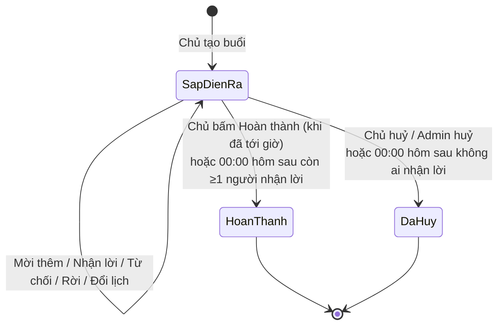
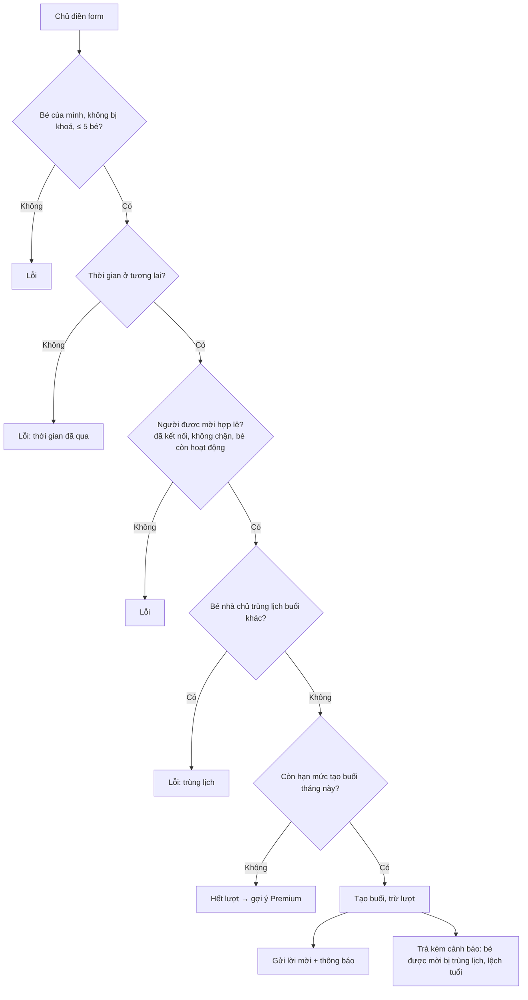
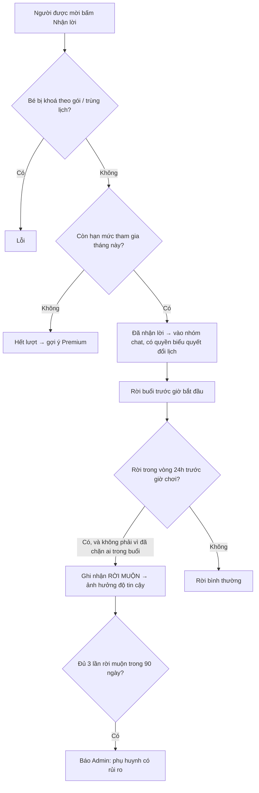
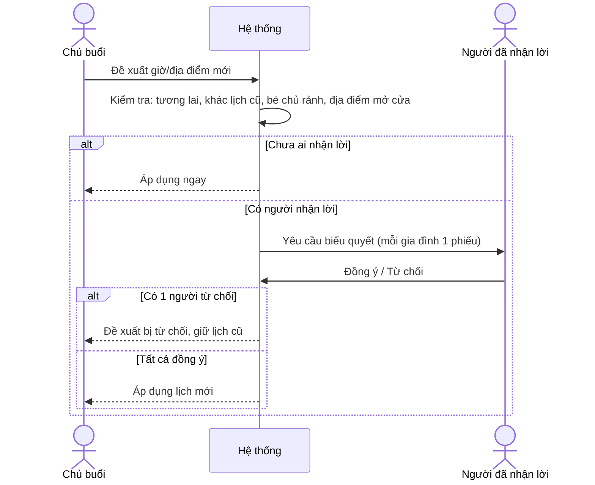

# 07. Buổi chơi (Playdate) & Địa điểm

## Mục đích
Phụ huynh (chủ buổi) lên lịch một buổi chơi cho các bé: chọn bé nhà mình, mời bạn bè đã kết nối, chọn thời gian, địa điểm, hoạt động. Hệ thống hỗ trợ gợi ý, cảnh báo giờ giấc theo độ tuổi, nhắc lịch, đổi lịch theo biểu quyết và tự đóng buổi khi qua ngày.

## Ai dùng

| Vai trò | Được làm gì |
|---|---|
| Chủ buổi (host) | Tạo, mời thêm, đề xuất đổi lịch / rút đề xuất, huỷ, đánh dấu hoàn thành, đăng ký đi kèm |
| Người được mời | Nhận lời / từ chối, rời buổi, bình chọn đổi lịch, đăng ký đi kèm |
| Hệ thống | Gợi ý giờ/địa điểm/hoạt động, nhắc lịch 24h & 1h, tự đóng buổi quá hạn |
| Admin | Xem, lọc, huỷ buổi (kèm lý do) |

## Chức năng

| Chức năng | Mô tả ngắn | Màn hình | Xử lý |
|---|---|---|---|
| Danh sách buổi chơi | Lọc theo trạng thái, xem dạng lịch | [PlaydateListPage](../src/modules/playdate/pages/PlaydateListPage.jsx), [PlaydateCalendarView](../src/modules/playdate/components/PlaydateCalendarView.jsx) | [playdate.service.js](../../Back-End/src/modules/playdate/playdate.service.js) – `getPlaydates` |
| Tạo buổi chơi | Chọn bé, bạn chơi, ngày giờ, thời lượng, địa điểm, hoạt động | [PlaydateFormPage](../src/modules/playdate/pages/PlaydateFormPage.jsx) | `createPlaydate` |
| Chọn bạn chơi | Bạn đã kết nối, xếp theo điểm phù hợp với bé, cảnh báo lệch tuổi | [PlaymateSelector](../src/modules/playdate/components/PlaymateSelector.jsx) | `getInvitableFriends` |
| Gợi ý giờ | Các khung giờ hợp với tất cả bé + lịch bận | [PlanningSuggestions](../src/modules/playdate/components/PlanningSuggestions.jsx), [ScheduleAvailability](../src/modules/playdate/components/ScheduleAvailability.jsx) | [playdate-suggestion.service.js](../../Back-End/src/modules/playdate/playdate-suggestion.service.js) – `getTimeSlotSuggestions`, `getBusyTimes` |
| Kiểm tra giờ | Cảnh báo giờ ngủ trưa, giờ học, giờ ăn, quá muộn… | [TimeRuleNotices](../src/modules/playdate/components/TimeRuleNotices.jsx) | `getTimeCheck`, [playdate-time.rules.js](../../Back-End/src/modules/playdate/playdate-time.rules.js) |
| Gợi ý / tìm địa điểm | Địa điểm gần các gia đình, hợp tuổi & sở thích, kiểm tra giờ mở cửa | [PlaceSearchModal](../src/modules/playdate/components/PlaceSearchModal.jsx) | `getPlaceSuggestions`; [places.service.js](../../Back-End/src/modules/places/places.service.js) |
| Gợi ý hoạt động | Theo sở thích chung của các bé | [PlanningSuggestions](../src/modules/playdate/components/PlanningSuggestions.jsx) | `getActivitySuggestions` |
| Mời thêm bạn | Chủ buổi mời thêm khi buổi chưa bắt đầu | [InvitePlaymatesModal](../src/modules/playdate/components/InvitePlaymatesModal.jsx) | `inviteParticipants` |
| Trả lời lời mời | Nhận lời / Từ chối (1 lần cho cả gia đình) | [PlaydateFormPage](../src/modules/playdate/pages/PlaydateFormPage.jsx) | `respondToPlaydate` |
| Rời buổi | Người đã nhận lời rút lui trước giờ bắt đầu | [PlaydateDetailParts](../src/modules/playdate/components/PlaydateDetailParts.jsx) | `leavePlaydate` |
| Độ tin cậy | Số lần rời muộn trong 90 ngày | [ReliabilityCard](../src/modules/playdate/components/ReliabilityCard.jsx) | `getMyReliability` |
| Đổi lịch | Chủ đề xuất, người tham gia biểu quyết | [RescheduleModal](../src/modules/playdate/components/RescheduleModal.jsx) | `createRescheduleRequest`, `voteRescheduleRequest`, `cancelRescheduleRequest` |
| Đăng ký đi kèm | Người lớn xác nhận đi trông các bé | [PlaydateChatView](../src/modules/chat/components/PlaydateChatView.jsx) | `toggleChaperone` |
| Hoàn thành / Huỷ | Chỉ chủ buổi | [PlaydateDetailParts](../src/modules/playdate/components/PlaydateDetailParts.jsx) | `completePlaydate`, `cancelPlaydate` |

## Luồng chính

### Vòng đời buổi chơi

**Trạng thái hiển thị cho từng người xem** (khi buổi còn "Sắp diễn ra"):

| Hiển thị | Ý nghĩa |
|---|---|
| Chờ phản hồi | Còn người chưa trả lời (hoặc chính mình chưa trả lời) |
| Đã xác nhận | Có ít nhất 1 gia đình nhận lời |
| Đã từ chối | Mình đã từ chối lời mời |
| Chờ bạn chơi | (Chủ) Chưa ai tham gia: tất cả từ chối hoặc chưa mời ai |

### Tạo buổi chơi

### Nhận lời / Rời buổi

### Đổi lịch

## Quy tắc nghiệp vụ

### Tạo & mời

| Mã | Quy tắc | Ghi chú |
|---|---|---|
| BR-PD-01 | Chủ mang tối đa 5 bé của mình; bé phải thuộc chủ và không bị khoá theo gói | `MAX_HOST_CHILDREN` |
| BR-PD-02 | Thời lượng 30–480 phút, mặc định 120 phút | [playdate.constants.js](../../Back-End/src/modules/playdate/playdate.constants.js) |
| BR-PD-03 | Buổi chơi phải bắt đầu trong tương lai | `PLAYDATE_IN_PAST` |
| BR-PD-04 | Chỉ mời bạn **đã kết nối**, không chặn nhau, không mời chính mình, bé được mời phải thuộc phụ huynh đó | `_validateInvitees` |
| BR-PD-05 | Bé nhà chủ không được ở 2 buổi cùng lúc (chặn). Bé được mời trùng lịch chỉ cảnh báo, kiểm tra lại khi nhận lời | `_assertNoConflict`, `_inviteeWarnings` |
| BR-PD-06 | Hai bé lệch nhau > 3 tuổi → cảnh báo (không chặn) | `MAX_AGE_GAP_YEARS` |
| BR-PD-07 | Hạn mức tạo buổi/tháng: Free = 3, Premium = không giới hạn. Huỷ buổi không hoàn lượt tạo | `checkAndConsumeQuota('playdateCreate')` |
| BR-PD-08 | Chỉ chủ mời thêm, khi buổi sắp diễn ra & chưa bắt đầu; không mời trùng gia đình | `inviteParticipants` |
| BR-PD-09 | Địa điểm đã biết giờ mở cửa mà đang đóng → không tạo/đổi lịch được | `_assertPlaceOpen` |

### Trả lời, rời buổi, đi kèm

| Mã | Quy tắc | Ghi chú |
|---|---|---|
| BR-PD-10 | Mỗi gia đình trả lời 1 lần cho tất cả bé được mời; chủ không cần trả lời | `respondToPlaydate` |
| BR-PD-11 | Hạn mức tham gia/tháng: Free = 3, Premium = không giới hạn. Được mời lại sau khi rời thì không trừ lần nữa | `playdateParticipate` |
| BR-PD-12 | Chủ huỷ buổi → hoàn lượt tham gia cho các gia đình còn đang tham gia (người đã tự rời thì không hoàn) | `_refundJoinedParticipants` |
| BR-PD-13 | Chỉ người **đã nhận lời** mới rời được (chưa nhận thì từ chối); chủ không rời được, chỉ huỷ | `leavePlaydate` |
| BR-PD-14 | Rời trong vòng 24h trước giờ chơi = rời muộn; lý do tối đa 300 ký tự | `LEAVE_RULES` |
| BR-PD-15 | Rời vì đã chặn một thành viên trong buổi → miễn tính rời muộn | `safetyExempt` |
| BR-PD-16 | Độ tin cậy (90 ngày): Tốt = 0 lần rời muộn; Khá = 1–2; Rủi ro ≥ 3 (báo Admin khi chạm mốc 3) | `RELIABILITY_RULES` |
| BR-PD-17 | Số người lớn đi kèm cần: 1 người/2 bé dưới 5 tuổi, 1 người/3 bé lớn hơn, hoạt động dưới nước 1 người/1 bé | [playdate.rules.js](../../Back-End/src/modules/playdate/playdate.rules.js) |
| BR-PD-18 | Chỉ chủ hoặc người đã nhận lời được đăng ký đi kèm, khi buổi còn sắp diễn ra | `toggleChaperone` |

### Đổi lịch, hoàn thành, huỷ

| Mã | Quy tắc | Ghi chú |
|---|---|---|
| BR-PD-19 | Chỉ chủ đề xuất/rút đề xuất đổi lịch; lịch mới phải ở tương lai và khác lịch cũ | `createRescheduleRequest` |
| BR-PD-20 | Đề xuất mới thay thế đề xuất đang chờ; chưa ai nhận lời thì áp dụng ngay | — |
| BR-PD-21 | Mọi gia đình đã nhận lời đều phải đồng ý; 1 người từ chối là huỷ đề xuất. Người đồng ý phải rảnh ở giờ mới | `voteRescheduleRequest` |
| BR-PD-22 | Người nhận lời sau khi có đề xuất → được thêm vào danh sách biểu quyết; người rời → bị bỏ khỏi danh sách | — |
| BR-PD-23 | Chỉ chủ đánh dấu hoàn thành, và chỉ khi đã tới giờ bắt đầu | `CANNOT_COMPLETE_YET` |
| BR-PD-24 | 00:00 mỗi ngày: buổi của ngày đã qua còn "sắp diễn ra" → có người nhận lời thì Hoàn thành, không thì Huỷ | `closeExpiredPlaydates` |
| BR-PD-25 | Hoàn thành/Huỷ → huỷ mọi đề xuất đổi lịch đang chờ | — |

### Kiểm tra giờ chơi (theo độ tuổi bé nhỏ nhất)

| Mức | Cảnh báo | Điều kiện |
|---|---|---|
| Chặn | Đã qua | Giờ bắt đầu ≤ hiện tại |
| Chặn | Địa điểm đóng cửa | Biết giờ mở cửa và đang đóng |
| Cảnh báo | Giờ bất thường | Trước 07:00, hoặc kết thúc sau 21:00 (bé < 5 tuổi: sau 20:00) |
| Cảnh báo | Giờ ngủ trưa | Bé ≤ 4 tuổi, 12:00–14:00 |
| Cảnh báo | Giờ học | Bé ≥ 6 tuổi, ngày thường 07:30–11:30, 13:30–16:30 |
| Cảnh báo | Quá dài | Bé < 3 tuổi > 90 phút; bé < 6 tuổi > 180 phút |
| Cảnh báo | Sắp đóng cửa / Ngoài trời sau 18:00 | Theo giờ mở cửa / loại địa điểm |
| Lưu ý | Giờ ăn | 11:30–13:00, 18:00–19:30 |
| Lưu ý | Báo gấp | Còn < 4 giờ |
| Lưu ý | Ngày lễ | 01/01, 30/04, 01/05, 02/09 |
| Lưu ý | Chưa rõ giờ mở cửa | Địa điểm thường có giờ mở cửa nhưng chưa có dữ liệu |

### Gợi ý & địa điểm

| Mã | Quy tắc | Ghi chú |
|---|---|---|
| BR-PD-26 | Gợi ý giờ trong khoảng tối đa 14 ngày (mặc định từ mai + 7 ngày); bỏ giờ bị chặn/cảnh báo | `SUGGESTION_LIMITS` |
| BR-PD-27 | Giờ bắt đầu gợi ý theo khung ưa thích: sáng 09:00, chiều 15:00, tối 18:00 | `TIME_SLOT_START` |
| BR-PD-28 | Tìm địa điểm quanh điểm giữa các gia đình, bán kính 5–20 km (= nhà xa nhất + 2 km) | `PLACE_SUGGESTION_RADIUS` |
| BR-PD-29 | Không gợi ý trung tâm thể thao / workshop khi bé nhỏ nhất < 4 tuổi | `PLACE_TYPE_MIN_AGE` |
| BR-PD-30 | Dữ liệu địa điểm lấy từ bản đồ mở (OpenStreetMap), lưu đệm theo ô lưới và đồng bộ định kỳ | [places.service.js](../../Back-End/src/modules/places/places.service.js), [overpass.adapter.js](../../Back-End/src/integrations/maps/overpass.adapter.js) |

## Dữ liệu chính

| Đối tượng | Trường chính |
|---|---|
| Buổi chơi | Chủ buổi, các bé nhà chủ, hoạt động, ngày, giờ, thời lượng, địa điểm, trạng thái, người tham gia (phụ huynh + bé + trạng thái), người đi kèm, hội thoại nhóm, mốc nhắc lịch, thông tin huỷ |
| Người tham gia | Đang chờ / Đã nhận lời / Đã từ chối (rời buổi = chuyển sang từ chối) |
| Đề xuất đổi lịch | Ngày/giờ/thời lượng/địa điểm mới, lý do, trạng thái (Chờ / Chấp nhận / Từ chối / Đã rút), phiếu của từng gia đình |
| Lịch sử rời buổi | Buổi, phụ huynh, thời điểm rời, số giờ trước giờ chơi, rời muộn?, miễn trừ?, lý do |

## Liên quan

| Sự kiện | Ai nhận | Kết quả |
|---|---|---|
| Được mời | Người được mời | Thông báo ([11](11-thong-bao.md)) |
| Thay đổi thành viên | Chat | Cập nhật thành viên nhóm chat ([06](06-nhan-tin.md)) |
| Hoàn thành | Kết nối, Đánh giá, Thành tích | Thêm cặp bé ([05](05-ket-noi.md)); mở đánh giá ([08](08-danh-gia-phan-hoi.md)); cập nhật huy hiệu/streak ([13](13-thanh-tich-huy-hieu.md)) |
| Huỷ | Admin | Thông báo admin (thành viên thấy trạng thái "Đã huỷ" trên buổi) |
| Có người rời | Chủ buổi | Thông báo |
| Rủi ro độ tin cậy | Admin | Thông báo admin ([14](14-quan-tri-admin.md)) |
| Đến giờ nhắc (24h, 1h) | Chủ + người nhận lời | Thông báo; nhắc 24h kèm tin hệ thống trong nhóm chat |

## File xử lý

| Lớp | File |
|---|---|
| Route | [playdate.route.js](../../Back-End/src/modules/playdate/playdate.route.js), [places.route.js](../../Back-End/src/modules/places/places.route.js) |
| Controller | [playdate.controller.js](../../Back-End/src/modules/playdate/playdate.controller.js), [places.controller.js](../../Back-End/src/modules/places/places.controller.js) |
| Service | [playdate.service.js](../../Back-End/src/modules/playdate/playdate.service.js), [playdate-suggestion.service.js](../../Back-End/src/modules/playdate/playdate-suggestion.service.js), [places.service.js](../../Back-End/src/modules/places/places.service.js), [place-attractions.service.js](../../Back-End/src/modules/places/place-attractions.service.js) |
| Quy tắc | [playdate.rules.js](../../Back-End/src/modules/playdate/playdate.rules.js), [playdate-time.rules.js](../../Back-End/src/modules/playdate/playdate-time.rules.js), [playdate-suggestion.rules.js](../../Back-End/src/modules/playdate/playdate-suggestion.rules.js) |
| Hoạt động gợi ý | [playdate.activities.js](../../Back-End/src/modules/playdate/playdate.activities.js), [playdate-activity-games.js](../../Back-End/src/modules/playdate/playdate-activity-games.js) |
| Hằng số | [playdate.constants.js](../../Back-End/src/modules/playdate/playdate.constants.js), [places.constants.js](../../Back-End/src/modules/places/places.constants.js) |
| Sự kiện | [playdate.events.js](../../Back-End/src/modules/playdate/playdate.events.js) |
| Model | [playdate.model.js](../../Back-End/src/modules/playdate/playdate.model.js), [reschedule-request.model.js](../../Back-End/src/modules/playdate/reschedule-request.model.js), [playdate-leave.model.js](../../Back-End/src/modules/playdate/playdate-leave.model.js), [places-cache.model.js](../../Back-End/src/modules/places/places-cache.model.js) |
| Job | [playdate-reminder.job.js](../../Back-End/src/jobs/playdate-reminder.job.js), [playdate-auto-close.job.js](../../Back-End/src/jobs/playdate-auto-close.job.js) |
| FE màn hình | [PlaydateListPage.jsx](../src/modules/playdate/pages/PlaydateListPage.jsx), [PlaydateFormPage.jsx](../src/modules/playdate/pages/PlaydateFormPage.jsx) |
| FE thành phần | [PlaymateSelector.jsx](../src/modules/playdate/components/PlaymateSelector.jsx), [PlanningSuggestions.jsx](../src/modules/playdate/components/PlanningSuggestions.jsx), [RescheduleModal.jsx](../src/modules/playdate/components/RescheduleModal.jsx), [TimeRuleNotices.jsx](../src/modules/playdate/components/TimeRuleNotices.jsx) |
