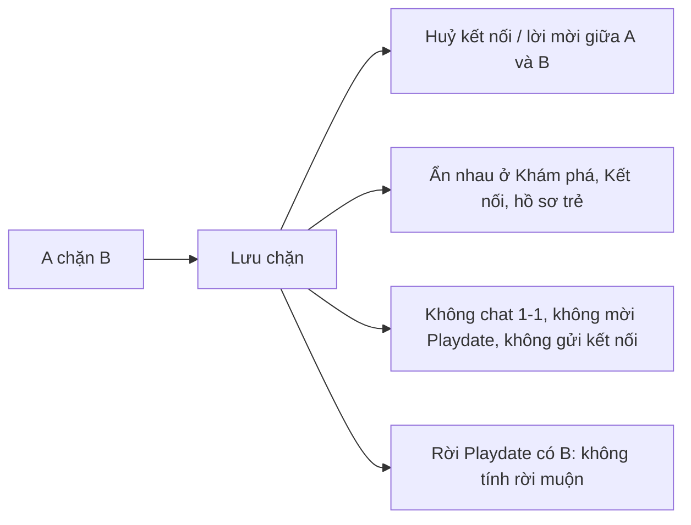
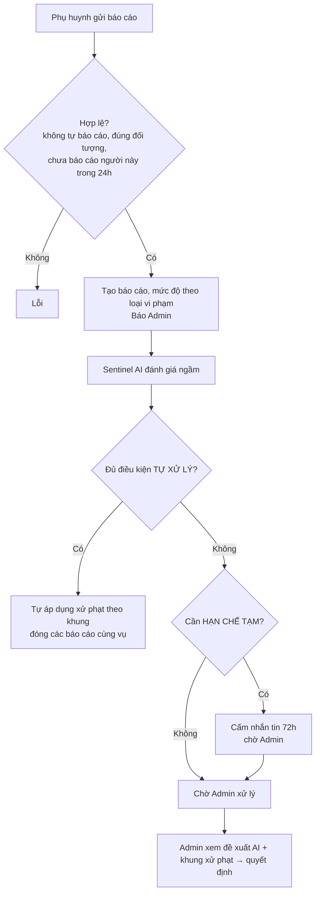
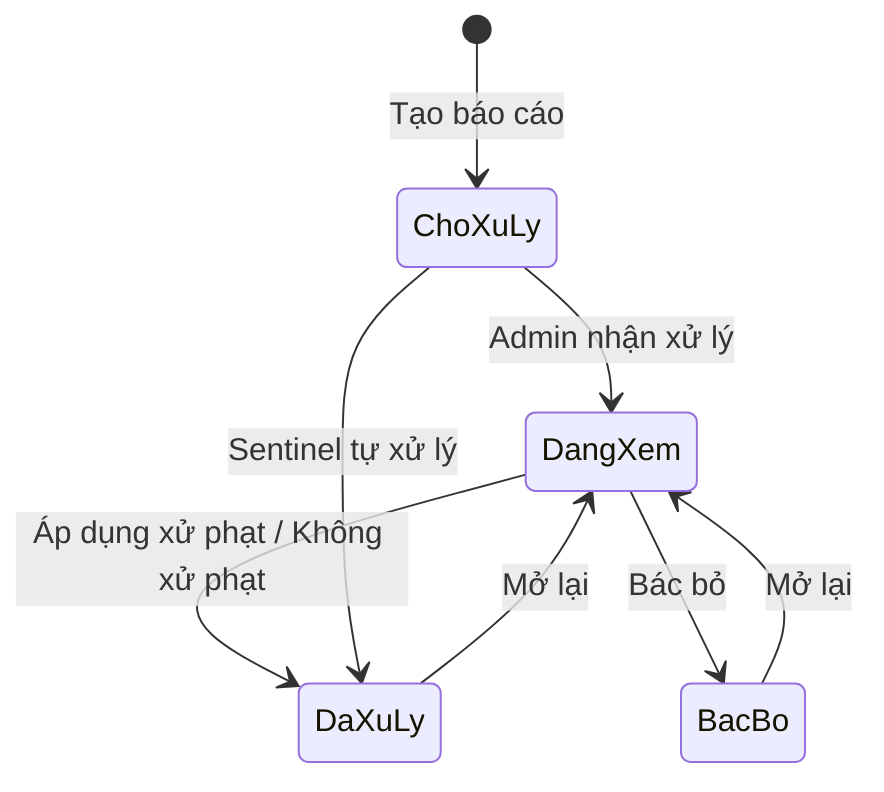

# 09. An toàn & Kiểm duyệt (Safety & Moderation)

## Mục đích
Bảo vệ cộng đồng phụ huynh và trẻ em: **chặn** người khác, **báo cáo** vi phạm, AI **Sentinel** tự phân loại & đánh giá báo cáo, áp dụng **khung xử phạt** thống nhất (cảnh cáo → tạm khoá → khoá vĩnh viễn) cho cả AI và Admin.

## Ai dùng

| Vai trò | Được làm gì |
|---|---|
| Phụ huynh | Chặn / bỏ chặn, xem danh sách đã chặn, báo cáo người dùng / tin nhắn / buổi chơi kèm ảnh bằng chứng |
| Sentinel AI | Đánh giá báo cáo, đề xuất xử phạt, tự hạn chế nhắn tin tạm thời hoặc tự xử lý ca đủ điều kiện |
| Admin | Xử lý hàng đợi báo cáo, áp dụng xử phạt, mở khoá sớm (xem [14-quan-tri-admin.md](14-quan-tri-admin.md)) |

## Chức năng

| Chức năng | Mô tả ngắn | Màn hình | Xử lý |
|---|---|---|---|
| Chặn | Chặn 1 phụ huynh (lý do tuỳ chọn) | Khám phá, Kết nối, Chat, Playdate | [safety.service.js](../../Back-End/src/modules/safety/safety.service.js) – `blockUser` |
| Bỏ chặn | Gỡ chặn | [BlockedUsersSettingsPage](../src/modules/safety/pages/BlockedUsersSettingsPage.jsx) | `unblockUser` |
| Danh sách đã chặn | Phân trang, tìm kiếm | [BlockedUsersSettingsPage](../src/modules/safety/pages/BlockedUsersSettingsPage.jsx) | `getBlockedUsers` |
| Tải ảnh bằng chứng | Ảnh lưu trên hệ thống | [ReportModal](../src/modules/safety/components/ReportModal.jsx) | `uploadEvidence` |
| Báo cáo | Chọn đối tượng, loại vi phạm, mô tả, tối đa 5 ảnh | [ReportModal](../src/modules/safety/components/ReportModal.jsx) | `createReport` |
| Sentinel đánh giá | Chạy ngầm ngay sau khi có báo cáo | (tự động) | [sentinel.service.js](../../Back-End/src/modules/safety/sentinel.service.js) – `assessReport` |
| Thi hành xử phạt | Dùng chung cho AI và Admin | (tự động / Admin) | [sanction-executor.service.js](../../Back-End/src/modules/safety/sanction-executor.service.js) |
| Báo lý do bị khoá | Khi đăng nhập bị từ chối: tạm khoá đến ngày nào / khoá vĩnh viễn | Đăng nhập | [account-lock.service.js](../../Back-End/src/modules/safety/account-lock.service.js) |

## Luồng chính

### Chặn người dùng

### Báo cáo → Sentinel → Xử lý

### Trạng thái báo cáo

## Khung xử phạt (theo số lần vi phạm trước đó)

| Loại vi phạm | Mức độ mặc định | Lần 1 | Lần 2 | Lần 3+ |
|---|---|---|---|---|
| An toàn trẻ em | Nghiêm trọng | Xoá tin + Khoá vĩnh viễn | Xoá tin + Khoá vĩnh viễn | Xoá tin + Khoá vĩnh viễn |
| Quấy rối | Cao | Xoá tin + Cảnh cáo | Xoá tin + Tạm khoá 7 ngày | Xoá tin + Khoá vĩnh viễn |
| Nội dung không phù hợp | Cao | Xoá tin + Cảnh cáo | Xoá tin + Tạm khoá 14 ngày | Xoá tin + Khoá vĩnh viễn |
| Hồ sơ giả | Trung bình | Cảnh cáo | Tạm khoá 7 ngày | Khoá vĩnh viễn |
| Spam | Thấp | Xoá tin + Cảnh cáo | Xoá tin + Cảnh cáo | Xoá tin + Tạm khoá 3 ngày |
| Không đến buổi hẹn | Thấp | Cảnh cáo + Huỷ buổi | Cảnh cáo + Huỷ buổi | Tạm khoá 3 ngày + Huỷ buổi |
| Khác | Trung bình | Cảnh cáo | Tạm khoá 7 ngày | Tạm khoá 30 ngày |

- Mức độ bị nâng lên **Nghiêm trọng** (bất kỳ loại nào) → Xoá tin + Khoá vĩnh viễn.
- "Xoá tin" chỉ áp dụng khi báo cáo tin nhắn; "Huỷ buổi" chỉ khi báo cáo buổi chơi. Không còn hành động phù hợp → Cảnh cáo.
- Admin chọn khác khung (hoặc số ngày tạm khoá khác chuẩn) → **bắt buộc ghi lý do**.
- Nguồn: [moderation-policy.rules.js](../../Back-End/src/modules/safety/moderation-policy.rules.js)

## Điều kiện Sentinel tự động

| Hành động | Điều kiện (phải thoả **tất cả**) |
|---|---|
| **Tự xử lý** | AI chạy thành công và kết luận **có vi phạm**; độ tự tin ≥ 80%; người báo cáo đáng tin, không nghi bị "hội đồng" báo cáo; **≥ 3 phụ huynh khác nhau** báo cáo cùng loại vi phạm có bằng chứng trong ±7 ngày; có bằng chứng cứng (tin nhắn/buổi chơi/ảnh); không phải ca nghiêm trọng / an toàn trẻ em; xử phạt chuẩn không có khoá vĩnh viễn hay tạm khoá > 7 ngày |
| **Hạn chế nhắn tin 72h** | AI chạy thành công, không kết luận "không vi phạm", không nghi "hội đồng"; VÀ (≥ 3 người báo cáo trong 30 phút, hoặc ca nghiêm trọng ≥ 2 báo cáo trong 30 phút, hoặc ca nghiêm trọng với độ tự tin ≥ 80%) |
| Chỉ đánh giá lần đầu | Tự động chỉ chạy ở lần đánh giá đầu tiên khi báo cáo còn mở |

Nguồn: [sentinel.service.js](../../Back-End/src/modules/safety/sentinel.service.js), [enforcement-metrics.rules.js](../../Back-End/src/modules/safety/enforcement-metrics.rules.js)

## Quy tắc nghiệp vụ

| Mã | Quy tắc | Ghi chú |
|---|---|---|
| BR-SAF-01 | Không tự chặn / tự báo cáo chính mình | `SELF_BLOCK_NOT_ALLOWED`, `SELF_REPORT_NOT_ALLOWED` |
| BR-SAF-02 | Chặn có hiệu lực **2 chiều** cho mọi tương tác | `isBlocked` |
| BR-SAF-03 | Không ghi lý do chặn → lưu "Không muốn tiếp tục liên lạc" | `DEFAULT_BLOCK_REASON` |
| BR-SAF-04 | Đối tượng báo cáo: Người dùng / Tin nhắn (phải là tin của người bị báo cáo) / Buổi chơi (người bị báo cáo phải là chủ buổi) | `_assertReportTarget` |
| BR-SAF-05 | Mỗi người chỉ báo cáo cùng 1 phụ huynh tối đa 1 lần / 24h | `REPORT_LIMITS` |
| BR-SAF-06 | Bằng chứng: tối đa 5 ảnh, phải tải qua hệ thống | `INVALID_EVIDENCE_URL` |
| BR-SAF-07 | Mức độ tự gán theo loại: An toàn trẻ em = Nghiêm trọng; Quấy rối, Nội dung xấu = Cao; Hồ sơ giả, Khác = Trung bình; Spam, Không đến = Thấp | `CATEGORY_TO_SEVERITY` |
| BR-SAF-08 | Hạn xử lý: Nghiêm trọng 2 giờ, còn lại 24 giờ (quá hạn được đánh dấu) | `OVERDUE_THRESHOLDS_HOURS` |
| BR-SAF-09 | Hàng đợi: mức độ cao trước, cũ trước | `REPORT_SORTS.QUEUE` |
| BR-SAF-10 | Người bị xử phạt chỉ nhận lý do chung chung, không lộ lời người báo cáo | `REPORT_CATEGORY_NOTICES` |
| BR-SAF-11 | Cảnh cáo = +1 lần vi phạm (strike). Tạm khoá tối thiểu 1 ngày | [sanction-executor.service.js](../../Back-End/src/modules/safety/sanction-executor.service.js) |
| BR-SAF-12 | Tạm khoá / Khoá vĩnh viễn → đăng xuất mọi thiết bị, đẩy thông báo khoá realtime, báo Admin | `afterAccountLocked` |
| BR-SAF-13 | Tạm khoá tự hết hạn; Admin có thể mở khoá sớm (ghi vào lịch sử báo cáo) | [account-lock.service.js](../../Back-End/src/modules/safety/account-lock.service.js) |
| BR-SAF-14 | Tin nhắn bị xoá được thay ngay trên màn hình mọi người (realtime) | [moderation-realtime.service.js](../../Back-End/src/modules/safety/moderation-realtime.service.js) |
| BR-SAF-15 | Người báo cáo được thông báo kết quả xử lý | `notifyReporter` |

## Dữ liệu chính

| Đối tượng | Trường chính |
|---|---|
| Chặn | Người chặn, Người bị chặn, Lý do |
| Báo cáo | Người báo cáo, Người bị báo cáo, Đối tượng (người/tin/buổi), Loại vi phạm, Mô tả, Ảnh bằng chứng, Mức độ, Trạng thái, Người xử lý, Hành động đã áp dụng, Kết luận, Đánh giá Sentinel (kết luận, độ tự tin, đề xuất), Lịch sử |

**Loại vi phạm:** Quấy rối · Nội dung không phù hợp · Spam · Hồ sơ giả · An toàn trẻ em · Không đến buổi hẹn · Khác
**Hành động:** Cảnh cáo · Xoá tin nhắn · Huỷ buổi hẹn · Tạm khoá · Khoá vĩnh viễn · Bác bỏ · Không xử lý

## Liên quan

| Sự kiện | Ai nhận | Kết quả |
|---|---|---|
| Chặn | Kết nối | Huỷ kết nối giữa 2 người ([05](05-ket-noi.md)) |
| Báo cáo mới | Admin, Sentinel | Thông báo admin; AI đánh giá |
| Khoá / mở khoá tài khoản | Người dùng, Admin | Đăng xuất realtime; thông báo admin ([01](01-xac-thuc-tai-khoan.md)) |
| Cấm nhắn tin | Chat | Không gửi được tin ([06](06-nhan-tin.md)) |

## File xử lý

| Lớp | File |
|---|---|
| Route | [safety.route.js](../../Back-End/src/modules/safety/safety.route.js) |
| Controller | [safety.controller.js](../../Back-End/src/modules/safety/safety.controller.js) |
| Service | [safety.service.js](../../Back-End/src/modules/safety/safety.service.js), [sentinel.service.js](../../Back-End/src/modules/safety/sentinel.service.js), [sanction-executor.service.js](../../Back-End/src/modules/safety/sanction-executor.service.js), [account-lock.service.js](../../Back-End/src/modules/safety/account-lock.service.js), [moderation-realtime.service.js](../../Back-End/src/modules/safety/moderation-realtime.service.js) |
| Quy tắc | [moderation-policy.rules.js](../../Back-End/src/modules/safety/moderation-policy.rules.js), [enforcement-metrics.rules.js](../../Back-End/src/modules/safety/enforcement-metrics.rules.js) |
| Hằng số | [safety.constants.js](../../Back-End/src/modules/safety/safety.constants.js) |
| Sự kiện | [safety.events.js](../../Back-End/src/modules/safety/safety.events.js) |
| Model | [block.model.js](../../Back-End/src/modules/safety/block.model.js), [report.model.js](../../Back-End/src/modules/safety/report.model.js) |
| Tích hợp AI | [gemini.adapter.js](../../Back-End/src/integrations/ai/gemini.adapter.js) |
| Job | [suspension-expiry.job.js](../../Back-End/src/jobs/suspension-expiry.job.js) |
| FE | [BlockedUsersSettingsPage.jsx](../src/modules/safety/pages/BlockedUsersSettingsPage.jsx), [ReportModal.jsx](../src/modules/safety/components/ReportModal.jsx), [useAccountLockSocket.js](../src/modules/auth/hooks/useAccountLockSocket.js) |
