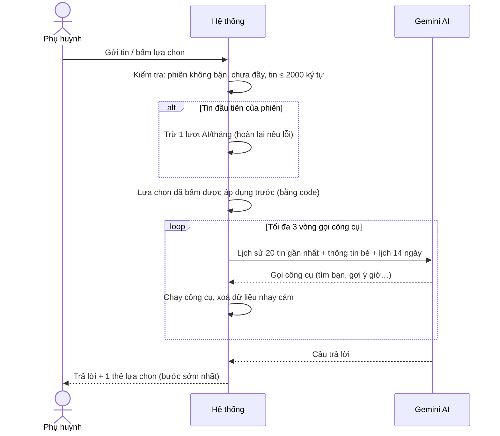
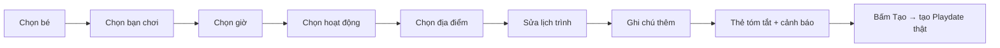

# 10. Trợ lý AI (BuddyLink AI)

## Mục đích
Trợ lý trò chuyện giúp phụ huynh **tìm bạn chơi**, **lên kế hoạch Playdate từng bước** (bé → bạn chơi → giờ → hoạt động → địa điểm → lịch trình → ghi chú) và **quản lý buổi hẹn** (xem, đổi lịch, huỷ, trả lời lời mời) bằng ngôn ngữ tự nhiên. AI trả lời kèm **thẻ lựa chọn** để phụ huynh bấm thay vì gõ.

## Ai dùng

| Vai trò | Được làm gì |
|---|---|
| Phụ huynh | Tạo / xem / xoá phiên chat, nhắn tin hoặc bấm lựa chọn |
| Hệ thống | Tạo sẵn phiên "hẹn lại" sau khi đánh giá buổi chơi ≥ 4 sao |
| Admin | Xem thống kê sử dụng AI ở Dashboard |

## Chức năng

| Chức năng | Mô tả ngắn | Màn hình | Xử lý |
|---|---|---|---|
| Phiên chat | Tạo, liệt kê (mới nhất trước), xem, xoá | [AIAssistantPage](../src/modules/ai-assistant/pages/AIAssistantPage.jsx), [SessionList](../src/modules/ai-assistant/components/SessionList.jsx) | [ai-assistant.service.js](../../Back-End/src/modules/ai-assistant/ai-assistant.service.js) |
| Gửi tin / bấm lựa chọn | Trả lời dần dần (stream) kèm thẻ | [AIChatPanel](../src/modules/ai-assistant/components/AIChatPanel.jsx), [ChoiceCard](../src/modules/ai-assistant/components/ChoiceCard.jsx) | `sendMessage` |
| Mở nhanh | Nút nổi / ngăn kéo ở mọi trang | [AIAssistantFab](../src/modules/ai-assistant/components/AIAssistantFab.jsx), [AIAssistantDrawer](../src/modules/ai-assistant/components/AIAssistantDrawer.jsx) | — |
| Báo hạn mức | Hiển thị số phiên còn lại / bị chặn bởi hạn mức khác | [QuotaBanner](../src/modules/ai-assistant/components/QuotaBanner.jsx), [QuotaNoticeCard](../src/modules/ai-assistant/components/QuotaNoticeCard.jsx) | — |

### Những việc AI làm được (công cụ)

| Việc | Kết quả hiển thị | Xử lý |
|---|---|---|
| Xem các bé của tôi | — | [get-my-children.tool.js](../../Back-End/src/modules/ai-assistant/tools/get-my-children.tool.js) |
| Tìm bạn chơi mới (dùng công thức Khám phá) | Thẻ gợi ý bạn chơi | [find-matches.tool.js](../../Back-End/src/modules/ai-assistant/tools/find-matches.tool.js) |
| Gửi lời mời kết bạn cho các bé vừa gợi ý | Thẻ xác nhận → gửi như "Thích" ở Khám phá | [send-connection-requests.tool.js](../../Back-End/src/modules/ai-assistant/tools/send-connection-requests.tool.js) |
| Tìm địa điểm gần | Thẻ địa điểm | [find-nearby-places.tool.js](../../Back-End/src/modules/ai-assistant/tools/find-nearby-places.tool.js) |
| Gợi ý giờ / bạn chơi rảnh / hoạt động / địa điểm | Thẻ lựa chọn | [suggestion-tools.js](../../Back-End/src/modules/ai-assistant/tools/suggestion-tools.js) |
| Lập kế hoạch & tạo Playdate | Thẻ từng bước → Thẻ tóm tắt → nút Tạo | [propose-playdate.tool.js](../../Back-End/src/modules/ai-assistant/tools/propose-playdate.tool.js), [plan-steps.js](../../Back-End/src/modules/ai-assistant/tools/plan-steps.js) |
| Xem / đổi lịch / huỷ / trả lời lời mời | Thẻ xác nhận trước khi thực hiện | [manage-playdates.tools.js](../../Back-End/src/modules/ai-assistant/tools/manage-playdates.tools.js) |

## Luồng chính

### Một lượt hỏi – đáp

### Lập kế hoạch Playdate với AI

## Quy tắc nghiệp vụ

| Mã | Quy tắc | Ghi chú |
|---|---|---|
| BR-AI-01 | Mỗi **phiên** tốn 1 lượt/tháng (Free = 5 phiên, Premium = không giới hạn), trừ ở tin đầu tiên; lượt bị hoàn nếu lượt đó lỗi | `_runTurn` |
| BR-AI-02 | Số tin tối đa/phiên: Free 30, Premium 100; đầy thì phải mở phiên mới | `AI_SESSION_MESSAGE_CAP` |
| BR-AI-03 | Tối đa 10 tin/phút/người; 1 tin ≤ 2000 ký tự | `AI_MESSAGE_RATE_LIMIT`, `AI_LIMITS` |
| BR-AI-04 | Một phiên chỉ xử lý 1 tin tại 1 thời điểm (đang trả lời thì báo bận) | `AI_SESSION_BUSY` |
| BR-AI-05 | Gửi lại cùng 1 tin (mạng chập chờn) → trả lại kết quả cũ, không chạy lại hành động | `_replayTurn` |
| BR-AI-06 | Mỗi lượt: tối đa 3 vòng gọi công cụ, hạn 70 giây | `AI_LIMITS` |
| BR-AI-07 | Không gửi cho AI / không trả về: SĐT, email, ngày sinh, mã người dùng, mật khẩu | `AI_SENSITIVE_KEYS`, [tool-sanitizer.js](../../Back-End/src/modules/ai-assistant/tools/tool-sanitizer.js) |
| BR-AI-08 | Mọi hành động thật (tạo buổi, gửi kết bạn, đổi lịch, huỷ, trả lời) chỉ chạy khi phụ huynh **bấm xác nhận**, và vẫn qua đủ quy tắc + hạn mức của module gốc | [choice-handler.js](../../Back-End/src/modules/ai-assistant/tools/choice-handler.js) |
| BR-AI-09 | Mỗi câu trả lời chỉ kèm 1 thẻ lựa chọn đang mở (bước sớm nhất) | [conversation.rules.js](../../Back-End/src/modules/ai-assistant/conversation.rules.js) |
| BR-AI-10 | Giới hạn gợi ý: ≤ 5 khung giờ, ≤ 8 bạn chơi, ≤ 5 bạn mới, ≤ 8 địa điểm, ≤ 5 mục lịch trình | `AI_LIMITS` |
| BR-AI-11 | Bản nháp được kiểm tra và cảnh báo trước khi tạo (xem bảng dưới) | [plan-draft.rules.js](../../Back-End/src/modules/ai-assistant/plan-draft.rules.js), [safety-rules.js](../../Back-End/src/modules/ai-assistant/safety-rules.js) |
| BR-AI-12 | Hoạt động dưới nước được coi là rủi ro cao → thêm lưu ý an toàn, cần 1 người lớn/1 bé | `HIGH_RISK_WATER_REGEX` |

### Cảnh báo trên bản nháp kế hoạch

| Nhóm | Cảnh báo |
|---|---|
| Thời gian | Đã qua, giờ bất thường, giờ ngủ trưa, giờ học, quá dài so với tuổi, giờ ăn, báo gấp, ngày lễ (giống [07 Playdate](07-buoi-choi-playdate.md)) |
| Địa điểm | Đóng cửa, sắp đóng, ngoài trời sau 18:00, không hợp tuổi, hoạt động không hợp địa điểm, xa > 15 km, chưa rõ giờ mở cửa |
| Lịch trình & an toàn | Lịch trình vượt thời lượng, mục không hợp tuổi, mục không có ở địa điểm, hoạt động rủi ro cao, lịch trình quá sơ sài |
| Người tham gia | Trùng lịch, chưa phải bạn, lệch tuổi, nhóm quá đông, không đúng giờ ưa thích, không có sở thích chung |
| Thời tiết | Trời mưa / khả năng mưa cao (với địa điểm ngoài trời) |

## Dữ liệu chính

| Đối tượng | Trường chính |
|---|---|
| Phiên chat | Phụ huynh, tiêu đề (lấy từ tin đầu, ≤ 60 ký tự), bản nháp kế hoạch, đã tính lượt chưa |
| Tin nhắn | Vai trò (người dùng / AI / công cụ), nội dung, thẻ kèm theo (lựa chọn, gợi ý địa điểm, gợi ý bạn chơi, bản nháp, báo hạn mức) |

## Liên quan

| Module | Liên quan |
|---|---|
| [04 Khám phá](04-kham-pha-ghep-doi.md) | Công thức tìm bạn, gửi kết bạn = Thích |
| [07 Playdate](07-buoi-choi-playdate.md) | Gợi ý, tạo, đổi lịch, huỷ, trả lời buổi hẹn |
| [08 Đánh giá](08-danh-gia-phan-hoi.md) | Đánh giá ≥ 4 sao → phiên hẹn lại |
| [12 Gói dịch vụ](12-goi-dich-vu-thanh-toan.md) | Hạn mức phiên AI |

## File xử lý

| Lớp | File |
|---|---|
| Route | [ai-assistant.route.js](../../Back-End/src/modules/ai-assistant/ai-assistant.route.js) |
| Controller | [ai-assistant.controller.js](../../Back-End/src/modules/ai-assistant/ai-assistant.controller.js) |
| Service | [ai-assistant.service.js](../../Back-End/src/modules/ai-assistant/ai-assistant.service.js) |
| Lời nhắc cho AI | [ai-assistant.prompt.js](../../Back-End/src/modules/ai-assistant/ai-assistant.prompt.js) |
| Quy tắc | [plan-draft.rules.js](../../Back-End/src/modules/ai-assistant/plan-draft.rules.js), [safety-rules.js](../../Back-End/src/modules/ai-assistant/safety-rules.js), [conversation.rules.js](../../Back-End/src/modules/ai-assistant/conversation.rules.js) |
| Công cụ | [tools/index.js](../../Back-End/src/modules/ai-assistant/tools/index.js), [choice-handler.js](../../Back-End/src/modules/ai-assistant/tools/choice-handler.js) |
| Hằng số | [ai-assistant.constants.js](../../Back-End/src/modules/ai-assistant/ai-assistant.constants.js) |
| Model | [ai-assistant.model.js](../../Back-End/src/modules/ai-assistant/ai-assistant.model.js) |
| Tích hợp ngoài | [gemini.adapter.js](../../Back-End/src/integrations/ai/gemini.adapter.js), [open-meteo.adapter.js](../../Back-End/src/integrations/weather/open-meteo.adapter.js), [tavily.adapter.js](../../Back-End/src/integrations/search/tavily.adapter.js) |
| FE màn hình | [AIAssistantPage.jsx](../src/modules/ai-assistant/pages/AIAssistantPage.jsx) |
| FE thành phần | [AIChatPanel.jsx](../src/modules/ai-assistant/components/AIChatPanel.jsx), [ChoiceCard.jsx](../src/modules/ai-assistant/components/ChoiceCard.jsx), [PlaydateDraftCard.jsx](../src/modules/ai-assistant/components/PlaydateDraftCard.jsx), [MatchSuggestionCard.jsx](../src/modules/ai-assistant/components/MatchSuggestionCard.jsx) |
