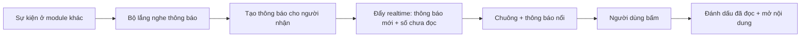

# 11. Thông báo (Notification)

## Mục đích
Báo cho phụ huynh các sự kiện quan trọng (lời mời kết nối, lời mời Playdate, nhắc lịch, huy hiệu, kết quả xử lý vi phạm, gợi ý từ AI) **ngay lập tức** qua chuông thông báo và trang Thông báo.

> Thông báo cho **Admin** là hệ thống riêng – xem [14-quan-tri-admin.md](14-quan-tri-admin.md).

## Ai dùng

| Vai trò | Được làm gì |
|---|---|
| Phụ huynh | Xem danh sách (lọc theo loại, đã/chưa đọc), xem số chưa đọc, đánh dấu đã đọc 1 / tất cả, bấm để mở nội dung liên quan |
| Hệ thống | Tự tạo thông báo khi có sự kiện, đẩy realtime |

## Chức năng

| Chức năng | Mô tả ngắn | Màn hình | Xử lý |
|---|---|---|---|
| Chuông + số chưa đọc | Cập nhật realtime | [NotificationCountBadge](../src/modules/notification/components/NotificationCountBadge.jsx), [NotificationDropdown](../src/modules/notification/components/NotificationDropdown.jsx) | [notification.service.js](../../Back-End/src/modules/notification/notification.service.js) – `getUnreadCount` |
| Hiện thông báo nổi | Khi có thông báo mới | [NotificationToast](../src/modules/notification/components/NotificationToast.jsx) | `_emitCreated` |
| Danh sách | Phân trang, lọc theo loại / đã đọc | [NotificationPage](../src/modules/notification/pages/NotificationPage.jsx) | `getUserNotifications` |
| Đánh dấu đã đọc | 1 cái hoặc tất cả | [NotificationPage](../src/modules/notification/pages/NotificationPage.jsx) | `markNotificationAsRead`, `markAllAsRead` |
| Mở nội dung liên quan | Chuyển tới kết nối / playdate / chat AI… | [useOpenNotification](../src/modules/notification/hooks/useOpenNotification.js) | — |

## Luồng chính

## Bảng sự kiện → thông báo

| Sự kiện | Người nhận | Loại | Nội dung |
|---|---|---|---|
| Có lời mời kết nối | Người được mời | Lời mời kết nối | "Lời mời kết nối mới" |
| Lời mời được chấp nhận | Người đã gửi lời mời | Kết nối thành công | "... đã đồng ý kết nối với bạn. Giờ hai bạn đã có thể trò chuyện!" |
| Được mời Playdate | Từng người được mời | Lời mời Playdate | "Lời mời tham gia Playdate" |
| Còn 24h / 1h tới giờ chơi | Chủ + người đã nhận lời | Nhắc lịch | Giờ, địa điểm, lưu ý an toàn, đồ mang theo, số người lớn đi kèm còn thiếu. Nhắc 24h còn gửi tin hệ thống vào nhóm chat |
| Có gia đình rời buổi | Chủ buổi | Rời buổi | "Một gia đình đã rời buổi hẹn" (kèm rời muộn, lý do) |
| Chủ buổi huỷ Playdate | Các gia đình đã nhận lời hoặc chưa trả lời | Huỷ buổi | "Buổi hẹn chơi đã bị huỷ" – tên chủ buổi + lý do của chủ |
| Admin huỷ Playdate | Chủ buổi + các gia đình đã nhận lời hoặc chưa trả lời | Huỷ buổi | "Quản trị viên đã huỷ buổi ..." (không hiện lý do nội bộ của Admin) |
| 09:00 thứ Bảy, đang có chuỗi tuần nhưng tuần này chưa hoàn thành buổi nào | Phụ huynh | Nhắc chuỗi tuần | "Giữ chuỗi N tuần nhé!" – nhắc hoàn thành 1 buổi trước hết Chủ nhật |
| Đạt huy hiệu mới | Phụ huynh | Huy hiệu | Tên huy hiệu |
| Đánh giá buổi chơi ≥ 4 sao | Người đánh giá | Gợi ý AI | "Hẹn lại với ... nhé?" (+ nhắc giữ chuỗi tuần) |
| Bị xử phạt / Báo cáo được xử lý | Người bị xử phạt / Người báo cáo | Hệ thống | Kết quả xử lý (lý do chung chung) |

## Quy tắc nghiệp vụ

| Mã | Quy tắc | Ghi chú |
|---|---|---|
| BR-NOT-01 | Người dùng chỉ xem / đánh dấu thông báo của chính mình | `markNotificationAsRead` |
| BR-NOT-02 | Tạo thông báo chạy ngầm; lỗi tạo thông báo không làm hỏng hành động gốc | [notification.listener.js](../../Back-End/src/modules/notification/notification.listener.js) |
| BR-NOT-03 | Mỗi mốc nhắc lịch (24h, 1h) chỉ gửi đúng 1 lần; đã tới mốc 1h thì bỏ mốc 24h | `sendDueReminders` – [07](07-buoi-choi-playdate.md) |
| BR-NOT-04 | Gợi ý hẹn lại chỉ khi đánh giá ≥ 4 sao và AI chuẩn bị được phiên | `REBOOKING_MIN_RATING` |
| BR-NOT-05 | Số chưa đọc được đồng bộ realtime khi có mới / đọc 1 / đọc tất cả | `NOTIFICATION_SOCKET_EVENTS` |
| BR-NOT-06 | Thông báo huỷ buổi không gửi cho gia đình đã từ chối / đã rời, và không gửi cho người tự huỷ (chủ buổi) | `notifyPlaydateCancelled` |
| BR-NOT-07 | Nhắc chuỗi tuần mỗi tuần tối đa 1 lần, chỉ khi chuỗi hiện tại > 0 và tuần này chưa có buổi hoàn thành | `sendStreakReminders` – [13](13-thanh-tich-huy-hieu.md) |

## Dữ liệu chính

| Trường | Ý nghĩa |
|---|---|
| Người nhận | Tài khoản phụ huynh |
| Loại | Lời mời kết nối, Kết nối thành công, Lời mời Playdate, Nhắc lịch, Rời buổi, Huỷ buổi, Huy hiệu, Nhắc chuỗi tuần, Gợi ý AI, Hệ thống |
| Tiêu đề, Nội dung | Văn bản hiển thị |
| Dữ liệu kèm | Mã playdate / người gửi / phiên AI… để mở đúng màn hình |
| Đã đọc | Có / Không |

## File xử lý

| Lớp | File |
|---|---|
| Route | [notification.route.js](../../Back-End/src/modules/notification/notification.route.js) |
| Controller | [notification.controller.js](../../Back-End/src/modules/notification/notification.controller.js) |
| Service | [notification.service.js](../../Back-End/src/modules/notification/notification.service.js) |
| Lắng nghe sự kiện | [notification.listener.js](../../Back-End/src/modules/notification/notification.listener.js) |
| Hằng số | [notification.constants.js](../../Back-End/src/modules/notification/notification.constants.js) |
| Model | [notification.model.js](../../Back-End/src/modules/notification/notification.model.js) |
| FE màn hình | [NotificationPage.jsx](../src/modules/notification/pages/NotificationPage.jsx) |
| FE xử lý | [useNotificationSocket.js](../src/modules/notification/hooks/useNotificationSocket.js), [useNotifications.js](../src/modules/notification/hooks/useNotifications.js), [notificationSlice.js](../src/modules/notification/redux/notificationSlice.js) |
