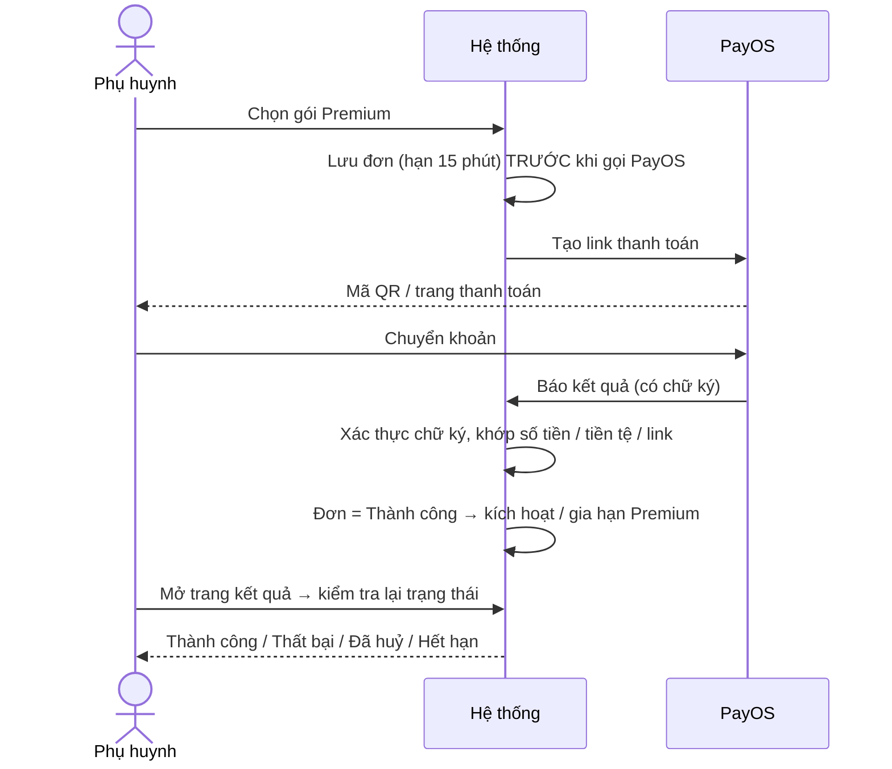
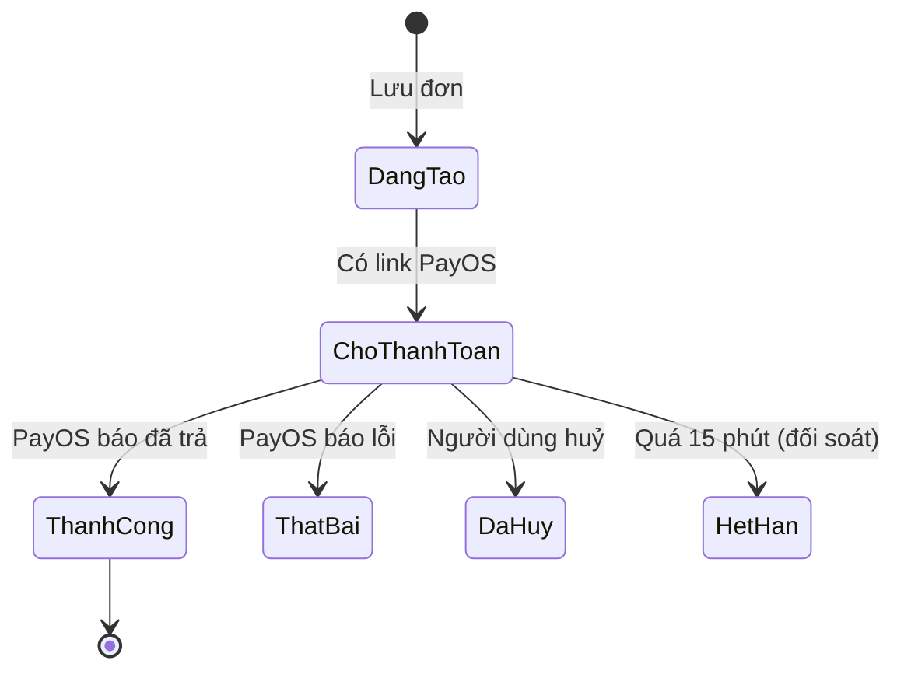
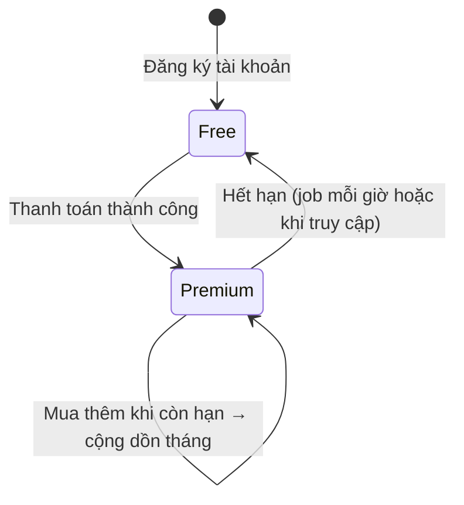
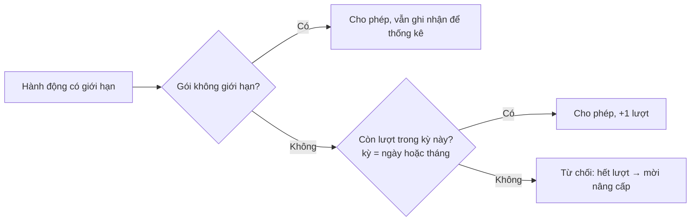

# 12. Gói dịch vụ & Thanh toán (Subscription)

## Mục đích
Quản lý gói **Free / Premium**, giới hạn sử dụng (hạn mức) theo gói, và thanh toán nâng cấp qua **PayOS** (quét mã QR ngân hàng).

## Ai dùng

| Vai trò | Được làm gì |
|---|---|
| Khách / Phụ huynh | Xem bảng giá các gói |
| Phụ huynh | Xem gói hiện tại + hạn mức đã dùng, mua / gia hạn Premium, xem lịch sử giao dịch |
| PayOS | Báo kết quả thanh toán về hệ thống |
| Hệ thống | Kiểm tra & trừ hạn mức, hạ gói khi hết hạn, đối soát giao dịch treo |
| Admin | Sửa gói (tên, giá, hạn mức, bật/tắt), xem gói & giao dịch, báo cáo doanh thu |

## Các gói (mặc định)

| Quyền lợi | Free | Premium 1 tháng | Premium 1 năm |
|---|---|---|---|
| Giá | 0đ | 99.000đ | 990.000đ |
| Số hồ sơ trẻ | 1 | Không giới hạn | Không giới hạn |
| Lượt lướt Khám phá | 5 / ngày | Không giới hạn | Không giới hạn |
| Lời mời kết nối | 5 / tháng | Không giới hạn | Không giới hạn |
| Tạo Playdate | 3 / tháng | Không giới hạn | Không giới hạn |
| Tham gia Playdate | 3 / tháng | Không giới hạn | Không giới hạn |
| Phiên Trợ lý AI | 5 / tháng | Không giới hạn | Không giới hạn |
| Tin nhắn / phiên AI | 30 | 100 | 100 |

Nguồn: [subscription.constants.js](../../Back-End/src/modules/subscription/subscription.constants.js) (Admin có thể thay đổi giá & hạn mức).

## Chức năng

| Chức năng | Mô tả ngắn | Màn hình | Xử lý |
|---|---|---|---|
| Xem bảng giá | So sánh các gói | [SubscriptionPage](../src/modules/subscription/pages/SubscriptionPage.jsx), [ComparisonMatrix](../src/modules/subscription/components/ComparisonMatrix.jsx) | [subscription.service.js](../../Back-End/src/modules/subscription/subscription.service.js) – `getActivePlans` |
| Gói của tôi & hạn mức | Gói, ngày hết hạn, đã dùng / còn lại | [SubscriptionPage](../src/modules/subscription/pages/SubscriptionPage.jsx) | `getMySubscriptionQuota` |
| Thông báo hết lượt | Hiện khi bị chặn bởi hạn mức → mời nâng cấp | [PaywallModal](../src/modules/subscription/components/PaywallModal.jsx) | `checkAndConsumeQuota` |
| Thanh toán | Tạo đơn, hiện mã QR / link PayOS | [CheckoutPage](../src/modules/subscription/pages/CheckoutPage.jsx), [CheckoutQrPanel](../src/modules/subscription/components/CheckoutQrPanel.jsx) | `createCheckoutSession` |
| Nhận kết quả từ PayOS | PayOS gọi về hệ thống | (tự động) | `handlePayOSWebhook` |
| Kiểm tra kết quả | Trang thành công / huỷ tự hỏi lại trạng thái | [PaymentSuccessPage](../src/modules/subscription/pages/PaymentSuccessPage.jsx), [PaymentCancelPage](../src/modules/subscription/pages/PaymentCancelPage.jsx) | `verifyPayment` |
| Lịch sử giao dịch | Phân trang | [PaymentHistoryList](../src/modules/subscription/components/PaymentHistoryList.jsx) | `getPaymentHistory` |

## Luồng chính

### Thanh toán nâng cấp

### Trạng thái đơn thanh toán

### Vòng đời gói

### Kiểm tra hạn mức (dùng chung mọi module)

## Quy tắc nghiệp vụ

| Mã | Quy tắc | Ghi chú |
|---|---|---|
| BR-SUB-01 | Mỗi phụ huynh luôn có 1 gói; tạo Free khi đăng ký (thiếu thì tự tạo) | `createFreeSubscription`, `getSubscriptionByParentId` |
| BR-SUB-02 | Chỉ mua được gói Premium đang bật | `INVALID_PLAN`, `PLAN_NOT_AVAILABLE` |
| BR-SUB-03 | Đơn được lưu trước khi gọi PayOS; bấm lại (cùng khoá chống trùng) trả về đơn cũ còn hiệu lực | `createCheckoutSession` |
| BR-SUB-04 | Link thanh toán có hạn 15 phút | — |
| BR-SUB-05 | Kết quả từ PayOS phải đúng chữ ký, đúng số tiền, tiền tệ và link của đơn | `fulfillPaymentSession` |
| BR-SUB-06 | Đơn đã Thành công không bao giờ bị hạ xuống trạng thái khác; mỗi đơn chỉ kích hoạt gói 1 lần | — |
| BR-SUB-07 | Thời hạn tính theo **tháng dương lịch** từ ngày bắt đầu. Mua thêm khi còn hạn → giữ ngày bắt đầu, cộng thêm số tháng | `calculateCalendarEndDate` |
| BR-SUB-08 | Hết hạn → tự về Free (job chạy phút thứ 5 mỗi giờ, hoặc ngay khi truy cập) | [subscription-expiry.job.js](../../Back-End/src/jobs/subscription-expiry.job.js) |
| BR-SUB-09 | Về Free mà có > 1 bé → khoá các bé tạo sau (xem [03](03-ho-so-tre.md)) | — |
| BR-SUB-10 | Kỳ hạn mức theo múi giờ kinh doanh: Khám phá theo ngày, còn lại theo tháng | `QUOTA_ACTIONS` |
| BR-SUB-11 | Trừ lượt là thao tác nguyên tử: bấm đồng thời cũng không vượt giới hạn | `checkAndConsumeQuota` |
| BR-SUB-12 | Hoàn lượt khi: chủ huỷ Playdate (lượt tham gia của khách), lượt AI bị lỗi | `refundQuota` |
| BR-SUB-13 | Gói Free: giá luôn 0, không được tắt. Premium: giá > 0 | `updatePlanByAdmin` |
| BR-SUB-14 | Giao dịch treo được đối soát lại với PayOS (thành công thì kích hoạt, quá hạn thì đóng) | `reconcileStalePayments` |

## Dữ liệu chính

| Đối tượng | Trường chính |
|---|---|
| Gói (Plan) | Mã gói, tên, giá, tiền tệ, số tháng, chu kỳ, các hạn mức, đang bật |
| Đăng ký (Subscription) | Phụ huynh, mã gói, trạng thái (Hoạt động / Hết hạn), ngày bắt đầu, ngày hết hạn, tổng tháng đã mua |
| Thanh toán (Payment) | Mã đơn, phụ huynh, gói (bản chụp lúc mua), số tiền, trạng thái, link/QR, hạn, thời điểm trả |
| Hạn mức đã dùng (Usage) | Phụ huynh, kỳ (ngày/tháng), số lượt: khám phá, lời mời, tạo buổi, tham gia buổi, AI |

## Liên quan

| Sự kiện | Ai nhận | Kết quả |
|---|---|---|
| Thanh toán thành công / thất bại | Admin | Thông báo admin |
| Gói mới được kích hoạt / hết hạn | Admin | Thông báo admin |
| Hạn mức | [03](03-ho-so-tre.md), [04](04-kham-pha-ghep-doi.md), [05](05-ket-noi.md), [07](07-buoi-choi-playdate.md), [10](10-tro-ly-ai.md) | Chặn hành động khi hết lượt |

## File xử lý

| Lớp | File |
|---|---|
| Route | [subscription.route.js](../../Back-End/src/modules/subscription/subscription.route.js) |
| Controller | [subscription.controller.js](../../Back-End/src/modules/subscription/subscription.controller.js) |
| Service | [subscription.service.js](../../Back-End/src/modules/subscription/subscription.service.js) |
| Hằng số | [subscription.constants.js](../../Back-End/src/modules/subscription/subscription.constants.js) |
| Sự kiện | [subscription.events.js](../../Back-End/src/modules/subscription/subscription.events.js) |
| Model | [subscription-plan.model.js](../../Back-End/src/modules/subscription/subscription-plan.model.js), [subscription.model.js](../../Back-End/src/modules/subscription/subscription.model.js), [payment.model.js](../../Back-End/src/modules/subscription/payment.model.js), [usage-quota.model.js](../../Back-End/src/modules/subscription/usage-quota.model.js) |
| Tích hợp ngoài | [payos.adapter.js](../../Back-End/src/integrations/payos/payos.adapter.js) |
| Job | [subscription-expiry.job.js](../../Back-End/src/jobs/subscription-expiry.job.js) |
| FE màn hình | [SubscriptionPage.jsx](../src/modules/subscription/pages/SubscriptionPage.jsx), [CheckoutPage.jsx](../src/modules/subscription/pages/CheckoutPage.jsx), [PaymentSuccessPage.jsx](../src/modules/subscription/pages/PaymentSuccessPage.jsx), [PaymentCancelPage.jsx](../src/modules/subscription/pages/PaymentCancelPage.jsx) |
| FE thành phần | [PaywallModal.jsx](../src/modules/subscription/components/PaywallModal.jsx), [PricingCard.jsx](../src/modules/subscription/components/PricingCard.jsx) |
