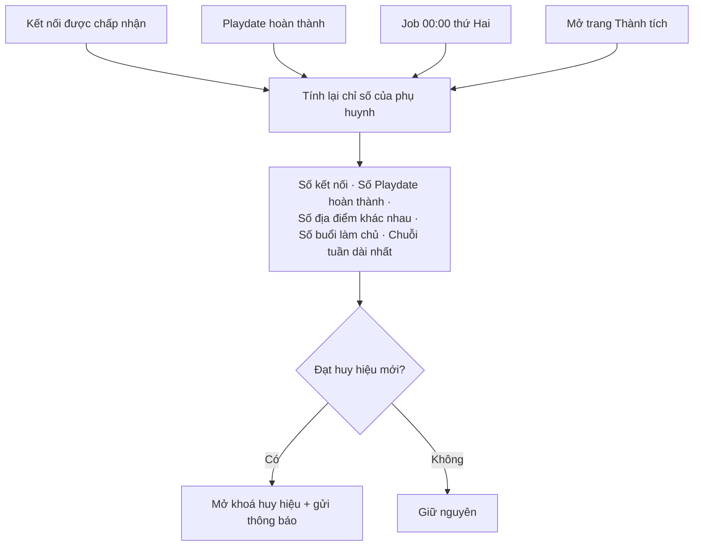
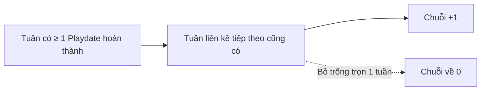

# 13. Thành tích, Huy hiệu & Chuỗi tuần (Gamification)

## Mục đích
Khuyến khích phụ huynh duy trì kết nối và tổ chức Playdate đều đặn bằng **chuỗi tuần (streak)** và **huy hiệu**.

## Ai dùng

| Vai trò | Được làm gì |
|---|---|
| Phụ huynh | Xem chuỗi tuần hiện tại / dài nhất, huy hiệu đã đạt và tiến độ các huy hiệu còn lại |
| Hệ thống | Tính lại khi có kết nối mới hoặc Playdate hoàn thành; rà soát mỗi thứ Hai |

## Chức năng

| Chức năng | Mô tả ngắn | Màn hình | Xử lý |
|---|---|---|---|
| Xem thành tích | Chuỗi tuần + lưới huy hiệu (tính lại mỗi lần mở) | [GamificationPage](../src/modules/gamification/pages/GamificationPage.jsx), [StreakBanner](../src/modules/gamification/components/StreakBanner.jsx), [BadgeGrid](../src/modules/gamification/components/BadgeGrid.jsx) | [gamification.service.js](../../Back-End/src/modules/gamification/gamification.service.js) – `getMyAchievements` |
| Mừng đạt huy hiệu | Hiệu ứng chúc mừng + thông báo | [AchievementCelebration](../src/modules/gamification/components/AchievementCelebration.jsx) | `_notifyBadgesUnlocked` |
| Cập nhật tự động | Sau sự kiện kết nối / Playdate | (tự động) | [gamification.events.js](../../Back-End/src/modules/gamification/gamification.events.js) – `syncParentAchievements` |
| Rà soát hàng tuần | Đặt lại chuỗi bị đứt | (job) | [gamification.job.js](../../Back-End/src/jobs/gamification.job.js) – `reconcileAchievements` |

## Luồng chính

### Cách tính chuỗi tuần

## Danh sách huy hiệu

| Huy hiệu | Điều kiện |
|---|---|
| Kết nối đầu tiên | ≥ 1 kết nối được chấp nhận |
| Gia đình kết nối | ≥ 10 kết nối |
| Cầu nối cộng đồng | ≥ 25 kết nối |
| Playdate đầu tiên | Hoàn thành ≥ 1 Playdate |
| 10 Playdates | Hoàn thành ≥ 10 Playdates |
| 25 Playdates | Hoàn thành ≥ 25 Playdates |
| Chủ nhà đầu tiên | Làm chủ và hoàn thành ≥ 1 Playdate |
| Chủ nhà hiếu khách | Làm chủ và hoàn thành ≥ 5 Playdates |
| Nhà khám phá | Playdate tại ≥ 5 địa điểm khác nhau |
| Nhà thám hiểm | Playdate tại ≥ 10 địa điểm khác nhau |
| Chuỗi 4 tuần | Chuỗi dài nhất ≥ 4 tuần liên tiếp |
| Chuỗi 8 tuần | Chuỗi dài nhất ≥ 8 tuần |
| Chuỗi 12 tuần | Chuỗi dài nhất ≥ 12 tuần |

Nguồn: [gamification.constants.js](../../Back-End/src/modules/gamification/gamification.constants.js)

## Quy tắc nghiệp vụ

| Mã | Quy tắc | Ghi chú |
|---|---|---|
| BR-GAM-01 | Tuần tính từ thứ Hai, theo giờ Việt Nam | [gamification.rules.js](../../Back-End/src/modules/gamification/gamification.rules.js) |
| BR-GAM-02 | Tuần hiện tại chưa có Playdate thì chưa làm đứt chuỗi – chỉ đứt khi qua hết 1 tuần trống | `calculateStreak` |
| BR-GAM-03 | Chỉ tính Playdate đã **hoàn thành** (chủ hoặc người đã nhận lời) | `buildMetrics` |
| BR-GAM-04 | Địa điểm khác nhau: so theo mã địa điểm, nếu không có thì theo địa chỉ, cuối cùng theo tên | `locationKey` |
| BR-GAM-05 | Huy hiệu là **vĩnh viễn**: chỉ số giảm sau đó (huỷ kết nối…) cũng không bị thu hồi | `syncParentAchievements` |
| BR-GAM-06 | Mỗi huy hiệu chỉ mở khoá 1 lần, kể cả khi job và người dùng tính cùng lúc | — |
| BR-GAM-07 | Chuỗi dài nhất luôn giữ giá trị cao nhất từng đạt | — |
| BR-GAM-08 | Lỗi khi tính chỉ ghi log; job tuần sau / lần mở trang sau sẽ tính lại | [gamification.events.js](../../Back-End/src/modules/gamification/gamification.events.js) |

## Dữ liệu chính

| Đối tượng | Trường chính |
|---|---|
| Huy hiệu | Mã, tên, mô tả, chỉ số đo, mức yêu cầu, hình |
| Huy hiệu của phụ huynh | Phụ huynh, huy hiệu, ngày đạt |
| Chuỗi tuần (trên hồ sơ phụ huynh) | Chuỗi hiện tại, dài nhất, tuần Playdate gần nhất |

## Liên quan

| Module | Liên quan |
|---|---|
| [05 Kết nối](05-ket-noi.md) | Kết nối thành công → tính lại |
| [07 Playdate](07-buoi-choi-playdate.md) | Hoàn thành → tính lại |
| [11 Thông báo](11-thong-bao.md) | Thông báo huy hiệu mới |
| [08 Đánh giá](08-danh-gia-phan-hoi.md) | Gợi ý hẹn lại có nhắc giữ chuỗi |

## File xử lý

| Lớp | File |
|---|---|
| Route | [gamification.route.js](../../Back-End/src/modules/gamification/gamification.route.js) |
| Controller | [gamification.controller.js](../../Back-End/src/modules/gamification/gamification.controller.js) |
| Service | [gamification.service.js](../../Back-End/src/modules/gamification/gamification.service.js) |
| Quy tắc | [gamification.rules.js](../../Back-End/src/modules/gamification/gamification.rules.js) |
| Sự kiện | [gamification.events.js](../../Back-End/src/modules/gamification/gamification.events.js) |
| Hằng số | [gamification.constants.js](../../Back-End/src/modules/gamification/gamification.constants.js) |
| Model | [badge.model.js](../../Back-End/src/modules/gamification/badge.model.js), [user-badge.model.js](../../Back-End/src/modules/gamification/user-badge.model.js) |
| Job | [gamification.job.js](../../Back-End/src/jobs/gamification.job.js) |
| FE | [GamificationPage.jsx](../src/modules/gamification/pages/GamificationPage.jsx), [BadgeGrid.jsx](../src/modules/gamification/components/BadgeGrid.jsx), [StreakBanner.jsx](../src/modules/gamification/components/StreakBanner.jsx) |
