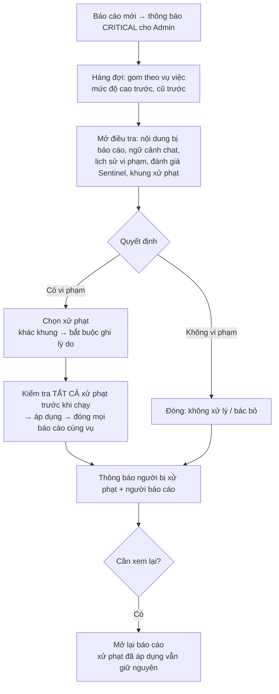
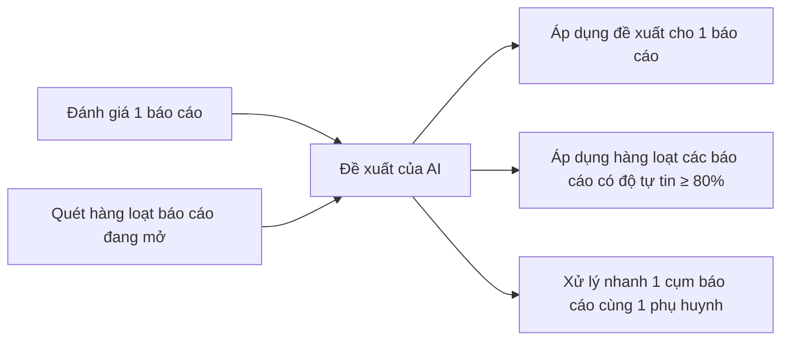
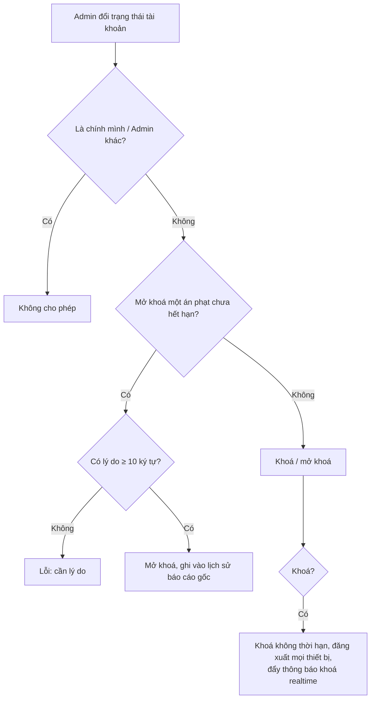

# 14. Quản trị (Admin Portal)

## Mục đích
Cổng quản trị **tách riêng** (cổng/dịch vụ riêng, phiên đăng nhập riêng) để Admin theo dõi số liệu, giám sát người dùng – trẻ – kết nối – buổi chơi, quản lý gói & doanh thu, xử lý báo cáo vi phạm cùng Sentinel AI, và nhận thông báo hệ thống realtime.

> Hệ thống chỉ có **1 tài khoản Admin**.

## Ai dùng

| Vai trò | Được làm gì |
|---|---|
| Admin | Toàn bộ chức năng trong trang này |
| Hệ thống | Gửi thông báo admin khi có sự kiện |

## Chức năng

| Nhóm | Chức năng | Màn hình | Xử lý |
|---|---|---|---|
| Đăng nhập | Đăng nhập cổng Admin (giới hạn số lần thử) | [AdminLoginPage](../src/modules/admin/pages/AdminLoginPage.jsx) | [auth.service.js](../../Back-End/src/modules/auth/auth.service.js) – `loginAdmin` |
| Dashboard | Tổng quan theo khoảng thời gian: người dùng mới, trẻ, kết nối, buổi chơi, gói Premium, doanh thu, tỉ lệ chuyển đổi, sử dụng AI | [AdminDashboardPage](../src/modules/admin/pages/AdminDashboardPage.jsx) | [admin.service.js](../../Back-End/src/modules/admin/admin.service.js) – `getAnalytics` |
| Người dùng | Danh sách, thống kê, chi tiết (hồ sơ, bé, gói, giao dịch, báo cáo, độ tin cậy), khoá / mở khoá | [AdminUserManagementPage](../src/modules/admin/pages/AdminUserManagementPage.jsx), [AdminUserDetailDrawer](../src/modules/admin/components/AdminUserDetailDrawer.jsx) | `getUsers`, `getUserDetail`, `updateUserStatus` |
| Trẻ | Chỉ xem: danh sách, thống kê độ tuổi, chi tiết, trạng thái hiển thị ở Khám phá | [AdminChildManagementPage](../src/modules/admin/pages/AdminChildManagementPage.jsx), [AdminChildDetailDrawer](../src/modules/admin/components/AdminChildDetailDrawer.jsx) | `getChildren`, `getChildStats`, `getChildDetail` |
| Kết nối | Danh sách, thống kê, chi tiết, gỡ kết nối (kèm lý do) | [AdminConnectionManagementPage](../src/modules/admin/pages/AdminConnectionManagementPage.jsx), [AdminConnectionDetailModal](../src/modules/admin/components/AdminConnectionDetailModal.jsx) | `getConnections`, `removeConnection` |
| Buổi chơi | Danh sách (lọc trạng thái, ngày), thống kê, chi tiết, huỷ (kèm lý do) | [AdminPlaydateManagementPage](../src/modules/admin/pages/AdminPlaydateManagementPage.jsx), [AdminPlaydateDetailModal](../src/modules/admin/components/AdminPlaydateDetailModal.jsx) | `getPlaydates`, `cancelPlaydate` |
| Gói & Doanh thu | Sửa gói, xem đăng ký, giao dịch, tổng hợp doanh thu | [AdminSubscriptionManagementPage](../src/modules/admin/pages/AdminSubscriptionManagementPage.jsx) | `updatePlan`, `getSubscriptions`, `getTransactions`, `getRevenueSummary` |
| Báo cáo vi phạm | Hàng đợi theo vụ việc, điều tra chi tiết, đổi mức độ, quyết định, áp dụng xử phạt, đóng / mở lại, dùng Sentinel | [AdminReportsPage](../src/modules/admin/pages/AdminReportsPage.jsx), [AdminReportInvestigationDrawer](../src/modules/admin/components/AdminReportInvestigationDrawer.jsx) | [admin-report.service.js](../../Back-End/src/modules/admin/admin-report.service.js) |
| Thông báo admin | Danh sách lọc theo nhóm / mức độ, số chưa đọc, đánh dấu đã đọc | [AdminNotificationBoard](../src/modules/admin/components/AdminNotificationBoard.jsx) | [admin-notification.service.js](../../Back-End/src/modules/admin/admin-notification.service.js) |

## Luồng chính

### Xử lý báo cáo vi phạm

### Dùng Sentinel AI

### Khoá / mở khoá tài khoản thủ công

## Quy tắc nghiệp vụ

| Mã | Quy tắc | Ghi chú |
|---|---|---|
| BR-ADM-01 | Chỉ tài khoản Admin đăng nhập được cổng Admin; phiên Admin không dùng được ở app phụ huynh và ngược lại | [admin-app.js](../../Back-End/src/admin-app.js) |
| BR-ADM-02 | Admin không tự khoá mình, không khoá Admin khác | `CANNOT_LOCK_SELF`, `CANNOT_LOCK_ADMIN` |
| BR-ADM-03 | Khoá thủ công không có ngày hết hạn; mở khoá thủ công xoá mọi án phạt đang có | `updateUserStatus` |
| BR-ADM-04 | Mở khoá sớm một án phạt từ báo cáo → cần lý do ≥ 10 ký tự | `UNLOCK_REASON_MIN_LENGTH` |
| BR-ADM-05 | Lý do huỷ buổi chơi / gỡ kết nối tối đa 500 ký tự; từ khoá tìm kiếm tối đa 100 ký tự | [admin.constants.js](../../Back-End/src/modules/admin/admin.constants.js) |
| BR-ADM-06 | Trẻ chỉ được xem. Trạng thái hiển thị ở Khám phá (xét theo thứ tự): Đã xoá → Phụ huynh bị khoá → Bị khoá theo gói → Phụ huynh ẩn hồ sơ → Hiển thị | `CHILD_VISIBILITY` |
| BR-ADM-07 | Dashboard: mặc định 30 ngày gần nhất, tối đa 366 ngày; nhóm theo ngày / tuần / tháng; so sánh với kỳ trước cùng độ dài | `getAnalytics` |
| BR-ADM-08 | Doanh thu mặc định 6 tháng gần nhất (tính cả tháng hiện tại) | `REVENUE_DEFAULT_MONTHS` |
| BR-ADM-09 | Báo cáo đang chờ chỉ được **bác bỏ**; muốn kết luận khác phải nhận xử lý trước | `resolveReport` |
| BR-ADM-10 | Quyết định 1 vụ đóng mọi báo cáo về cùng nội dung; có thể đóng kèm các vụ khác cùng người như một | `decideReport` |
| BR-ADM-11 | Xử phạt được kiểm tra hết trước khi chạy: 1 cái không chạy được thì không cái nào chạy | `_planDecisionSanctions` |
| BR-ADM-12 | Tạm khoá bắt buộc nhập số ngày; không áp dụng trùng 1 xử phạt | `DURATION_DAYS_REQUIRED`, `ACTION_ALREADY_APPLIED` |
| BR-ADM-13 | Đã có xử phạt chính thức thì kết luận chỉ có thể là "đã xử lý" | `RESOLUTION_CONFLICTS_WITH_ACTIONS` |
| BR-ADM-14 | Mở lại báo cáo không gỡ xử phạt đã áp dụng | `reopenReport` |
| BR-ADM-15 | Không còn báo cáo mở nào giữ lệnh cấm nhắn tin → tự gỡ cấm nhắn tin | `_liftRestrictionIfNoneLeft` |
| BR-ADM-16 | Thông báo admin tự xoá sau 90 ngày; lỗi cổng thanh toán chỉ báo 1 lần / 5 phút | `ADMIN_NOTIFICATION_TTL_SECONDS` |
| BR-ADM-17 | Sửa gói: Free giữ giá 0 và luôn bật; Premium giá > 0 | Xem [12](12-goi-dich-vu-thanh-toan.md) |

## Thông báo Admin

| Nhóm | Sự kiện | Mức độ |
|---|---|---|
| Người dùng | Đăng ký mới | Thông tin |
| | Tài khoản bị khoá / được mở khoá | Cảnh báo / Thông tin |
| Thanh toán | Thanh toán thành công, Gói mới kích hoạt, Gói hết hạn | Thông tin |
| | Thanh toán thất bại | Cảnh báo |
| Buổi chơi | Buổi mới được tạo, Buổi bị huỷ | Thông tin |
| | Buổi bị Admin huỷ, Phụ huynh hay rời buổi sát giờ (3 lần/90 ngày) | Cảnh báo |
| Kết nối | Kết nối mới, Kết nối bị huỷ | Thông tin |
| An toàn | Báo cáo vi phạm mới | Nghiêm trọng |
| Hệ thống | Lỗi tác vụ định kỳ, Lỗi cổng thanh toán PayOS | Nghiêm trọng |

## File xử lý

| Lớp | File |
|---|---|
| Ứng dụng Admin | [admin-app.js](../../Back-End/src/admin-app.js), [admin-server.js](../../Back-End/src/admin-server.js) |
| Route | [admin.route.js](../../Back-End/src/modules/admin/admin.route.js) |
| Controller | [admin.controller.js](../../Back-End/src/modules/admin/admin.controller.js) |
| Service | [admin.service.js](../../Back-End/src/modules/admin/admin.service.js), [admin-report.service.js](../../Back-End/src/modules/admin/admin-report.service.js), [admin-notification.service.js](../../Back-End/src/modules/admin/admin-notification.service.js) |
| Lắng nghe sự kiện | [admin-notification.listener.js](../../Back-End/src/modules/admin/admin-notification.listener.js) |
| Hằng số | [admin.constants.js](../../Back-End/src/modules/admin/admin.constants.js) |
| Kiểm tra dữ liệu | [admin.validation.js](../../Back-End/src/modules/admin/admin.validation.js) |
| Model | [admin-notification.model.js](../../Back-End/src/modules/admin/admin-notification.model.js) |
| Realtime | [admin-notification.broadcast.js](../../Back-End/src/sockets/admin-notification.broadcast.js) |
| FE điều hướng | [AdminAppRoutes.jsx](../src/routes/AdminAppRoutes.jsx), [AdminRoutes.jsx](../src/routes/AdminRoutes.jsx) |
| FE màn hình | [AdminDashboardPage.jsx](../src/modules/admin/pages/AdminDashboardPage.jsx), [AdminUserManagementPage.jsx](../src/modules/admin/pages/AdminUserManagementPage.jsx), [AdminChildManagementPage.jsx](../src/modules/admin/pages/AdminChildManagementPage.jsx), [AdminConnectionManagementPage.jsx](../src/modules/admin/pages/AdminConnectionManagementPage.jsx), [AdminPlaydateManagementPage.jsx](../src/modules/admin/pages/AdminPlaydateManagementPage.jsx), [AdminSubscriptionManagementPage.jsx](../src/modules/admin/pages/AdminSubscriptionManagementPage.jsx), [AdminReportsPage.jsx](../src/modules/admin/pages/AdminReportsPage.jsx) |
