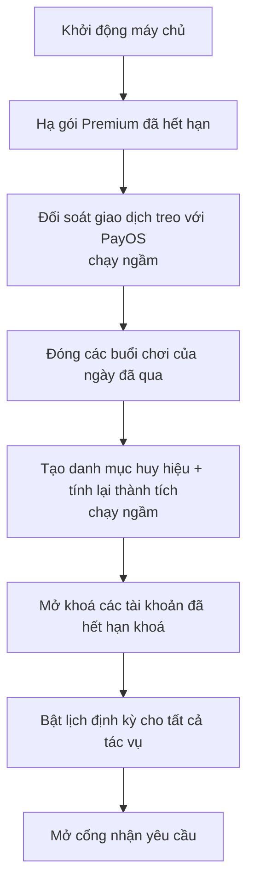

# 15. Tác vụ tự động (Jobs)

## Mục đích
Các tác vụ chạy định kỳ phía máy chủ (theo giờ Việt Nam) để giữ dữ liệu đúng theo thời gian: hết hạn gói, đóng buổi chơi quá hạn, nhắc lịch, mở khoá tài khoản, tính lại thành tích.

## Danh sách tác vụ

| Tác vụ | Chạy khi nào | Làm gì | Module | File |
|---|---|---|---|---|
| Hết hạn gói & đối soát thanh toán | Phút thứ 5 mỗi giờ | Gói Premium quá hạn → về Free; hỏi lại PayOS các giao dịch treo (đã trả thì kích hoạt, quá hạn thì đóng) | [12](12-goi-dich-vu-thanh-toan.md) | [subscription-expiry.job.js](../../Back-End/src/jobs/subscription-expiry.job.js) |
| Tự đóng buổi chơi | 00:00 mỗi ngày | Buổi của ngày đã qua còn "sắp diễn ra": có người nhận lời → Hoàn thành; không ai → Huỷ | [07](07-buoi-choi-playdate.md) | [playdate-auto-close.job.js](../../Back-End/src/jobs/playdate-auto-close.job.js) |
| Nhắc lịch buổi chơi | Mỗi 15 phút | Gửi nhắc trước 24h và 1h cho chủ + người đã nhận lời (mỗi mốc 1 lần) | [07](07-buoi-choi-playdate.md), [11](11-thong-bao.md) | [playdate-reminder.job.js](../../Back-End/src/jobs/playdate-reminder.job.js) |
| Mở khoá tài khoản hết hạn | Mỗi 15 phút | Tài khoản tạm khoá đã hết hạn → hoạt động lại | [09](09-an-toan-kiem-duyet.md) | [suspension-expiry.job.js](../../Back-End/src/jobs/suspension-expiry.job.js) |
| Tính lại thành tích | 00:00 thứ Hai | Tính lại chuỗi tuần + huy hiệu mọi phụ huynh, đặt lại chuỗi bị đứt | [13](13-thanh-tich-huy-hieu.md) | [gamification.job.js](../../Back-End/src/jobs/gamification.job.js) |

## Khi máy chủ khởi động
Để bù cho thời gian máy chủ tắt, một số tác vụ chạy ngay 1 lần trước khi bật lịch định kỳ.

## Quy tắc chung

| Mã | Quy tắc | Ghi chú |
|---|---|---|
| BR-JOB-01 | Mọi lịch chạy theo múi giờ kinh doanh (Việt Nam) | `APP_TIMEZONE` |
| BR-JOB-02 | Tác vụ lỗi → gửi thông báo **Nghiêm trọng** cho Admin "Lỗi tác vụ định kỳ hệ thống" | [admin-notification.listener.js](../../Back-End/src/modules/admin/admin-notification.listener.js) |
| BR-JOB-03 | Mỗi thao tác chỉ áp dụng khi dữ liệu còn đúng trạng thái (VD: chủ vừa tự hoàn thành buổi thì job bỏ qua), nên chạy trùng không gây sai | `updateIfUpcoming`, `claimReminder` |
| BR-JOB-04 | Ngoài job, hệ thống còn tự kiểm tra lúc truy cập: gói hết hạn hạ ngay khi đọc, tài khoản hết hạn khoá mở ngay khi đăng nhập | [12](12-goi-dich-vu-thanh-toan.md), [01](01-xac-thuc-tai-khoan.md) |

## File xử lý

| Lớp | File |
|---|---|
| Khởi động | [server.js](../../Back-End/src/server.js) |
| Job | [subscription-expiry.job.js](../../Back-End/src/jobs/subscription-expiry.job.js), [playdate-auto-close.job.js](../../Back-End/src/jobs/playdate-auto-close.job.js), [playdate-reminder.job.js](../../Back-End/src/jobs/playdate-reminder.job.js), [suspension-expiry.job.js](../../Back-End/src/jobs/suspension-expiry.job.js), [gamification.job.js](../../Back-End/src/jobs/gamification.job.js) |
| Sự kiện hệ thống | [system.events.js](../../Back-End/src/shared/events/system.events.js) |
