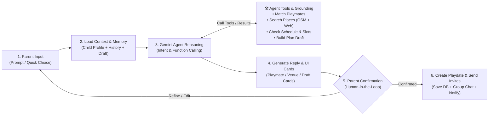
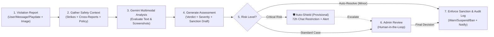

# 18. Luồng AI Agent (AI Family Assistant & Sentinel AI) — Giải thích & Kịch bản Thuyết trình

> **File sơ đồ gốc:** [`Doc/diagram/AI_AGENT_FLOWS.drawio`](../../Doc/diagram/AI_AGENT_FLOWS.drawio)

---

## 1. Tổng quan Kiến trúc AI trong BuddyLink (ACPM)

Thay vì chỉ tích hợp một khung chat LLM trả lời văn bản đơn thuần (dễ gặp hiện tượng ảo giác - *hallucination* và không gắn với dữ liệu thực), dự án **BuddyLink** triển khai **2 AI Agents chuyên biệt** sử dụng **Google Gemini API (`@google/genai`)**:

1. **AI Family Assistant (Dành cho Phụ huynh):** Trợ lý ảo lập kế hoạch buổi hẹn chơi (*Agentic Playdate Planning*) thông qua cơ chế **Function Calling (Tools)**, **Interactive Generative UI Cards** và **Human-in-the-Loop Confirmation**.
2. **Sentinel AI (Dành cho Admin & An toàn Trẻ em):** Kiểm duyệt viên AI đa phương thức (*Multimodal Safety Moderation*) tự động phân tích báo cáo vi phạm (văn bản + ảnh chụp màn hình bằng chứng), đối chiếu lịch sử tái phạm và kích hoạt **Auto-Shield** bảo vệ tức thời.

*(Ngoài ra, Gemini còn kết hợp với **Web Search Grounding / Tavily** để tự động làm giàu danh sách trò chơi `attractions` và độ tuổi phù hợp cho các địa điểm trong `places_cache`).*

---

## 2. Luồng 1: AI Family Assistant — Agent Workflow (6 Basic Steps)

### Giải thích 6 Bước Cơ bản:
1. **Bước 1 – Parent Input:** Phụ huynh nhập yêu cầu bằng ngôn ngữ tự nhiên (ví dụ: *"Cuối tuần này tìm bạn chơi công viên gần nhà cho bé An"*) hoặc bấm chọn nhanh trên các chip gợi ý (`choice`).
2. **Bước 2 – Load Context & Memory:** Hệ thống kiểm tra hạn mức tháng (`usage_quotas`) và nạp ngữ cảnh từ `ai_chat_sessions`, bao gồm: hồ sơ bé (tuổi, sở thích, tính cách), tọa độ gia đình (`2dsphere`), lịch sử hội thoại và bản nháp lịch hẹn (`planDraft`) đang lên dở.
3. **Bước 3 – Gemini Agent Reasoning & Tool Calling:** Gemini phân tích ý định và chủ động gọi các **System Tools** để truy vấn dữ liệu thật:
   - `Match Playmates`: Chấm điểm độ tương thích với con của các gia đình đã kết nối.
   - `Search Places`: Tìm khu vui chơi gần nhà từ `places_cache` (OpenStreetMap) kết hợp thông tin trò chơi từ Web Search Grounding.
   - `Check Schedule & Free Slots`: Kiểm tra xung đột lịch hẹn và quy tắc an toàn tỷ lệ người lớn đi kèm (`chaperones`).
   - `Build Playdate Plan Draft`: Cập nhật từng bước vào đối tượng `planDraft` (chưa ghi vào bảng `playdates`).
4. **Bước 4 – Generate Reply & UI Cards:** Từ dữ liệu của Tools, Agent tổng hợp câu trả lời tự nhiên kèm theo các **Thẻ giao diện tương tác (UI Cards)**: thẻ gợi ý bạn chơi (`match_suggestions`), thẻ địa điểm (`place_suggestions`), thẻ lựa chọn nhanh (`choices`) và thẻ xem trước bản nháp (`playdate_draft`).
5. **Bước 5 – Parent Confirmation (Human-in-the-Loop):** Phụ huynh xem lại thẻ bản nháp `playdate_draft`. Nếu muốn đổi giờ/địa điểm thì nhắn tiếp để AI cập nhật bản nháp; nếu đồng ý thì bấm nút **"Confirm & Create"**.
6. **Bước 6 – Create Playdate & Send Invites:** Chỉ sau khi có xác nhận của phụ huynh, hệ thống mới trừ quota tạo Playdate, lưu bản ghi vào `playdates`, tự động tạo phòng chat nhóm trong `conversations` và bắn thông báo `playdate_invite` thời gian thực cho các gia đình được mời.

> **Điểm cộng nghiệp vụ (Proactive AI):** Khi một buổi hẹn hoàn thành và được phụ huynh đánh giá cao (**4–5 sao** trong `ratings_feedbacks`), hệ thống tự động khởi tạo một phiên AI gợi ý hẹn lại lần sau và gửi thông báo `ai_suggestion` cho phụ huynh.

---

## 3. Luồng 2: Sentinel AI — Safety Moderation Agent Workflow (7 Basic Steps)

### Giải thích 7 Bước Cơ bản:
1. **Bước 1 – Violation Report:** Phụ huynh gửi báo cáo vi phạm (`reports`) nhắm vào một Người dùng, Tin nhắn hoặc Playdate, chọn danh mục (`child_safety`, `harassment`, `fake_profile`, `no_show`...) kèm theo **hình ảnh chụp màn hình bằng chứng (`evidenceUrls[]`)**.
2. **Bước 2 – Gather Safety Context:** Trước khi đánh giá, hệ thống thu thập toàn bộ hồ sơ an toàn của người bị báo cáo: số lần bị cảnh cáo trước đó (`strikeCount`), **Xác thực chéo (`corroboration` - có bao nhiêu phụ huynh khác nhau cùng báo cáo người này trong khoảng thời gian gần đây)**, nội dung tin nhắn/buổi hẹn gốc và bộ điều khoản chính sách.
3. **Bước 3 – Gemini Multimodal Analysis:** Sử dụng khả năng đa phương thức của Gemini để đọc hiểu đồng thời mô tả văn bản, ngữ cảnh lịch sử và **phân tích trực tiếp hình ảnh bằng chứng**. (Có cơ chế *Deterministic Fallback* nếu mạng hoặc API gặp sự cố).
4. **Bước 4 – Generate Assessment:** AI xuất ra kết quả đánh giá chuẩn hóa (`sentinelAssessment`) lưu vào báo cáo:
   - `verdict`: `violation` | `no_violation` | `unclear`
   - `severityRecommendation`: `low` | `medium` | `high` | `critical`
   - `confidenceScore`: Độ tự tin từ `0.0` đến `1.0`
   - `recommendedSanctions[]` & `draftNotes`: Đề xuất hình phạt (`warn`, `suspend`, `ban`) và soạn sẵn văn bản thông báo cho cả người báo cáo lẫn người vi phạm.
5. **Bước 5 – Risk Level Routing Gate (Phân luồng 3 nhánh theo mức độ rủi ro):**
   - **Nhánh Critical Risk (Nguy cơ cao / An toàn trẻ em):** Kích hoạt ngay lập tức **Auto-Shield (Lá chắn tạm thời)** — tự động hạn chế quyền nhắn tin của tài khoản bị tố cáo tối đa **72 giờ** (`messagingRestrictedUntil`), bắn cảnh báo đỏ (`critical`) lên bảng `admin_notifications` và đẩy lên Admin xử lý khẩn.
   - **Nhánh Standard Case (Vụ việc tiêu chuẩn):** Đưa vào hàng đợi của Admin kèm theo toàn bộ hồ sơ phân tích của AI (AI đóng vai trò *Admin Co-Pilot*).
   - **Nhánh Auto-Resolve (Vi phạm nhỏ, rõ ràng, đủ điều kiện):** Tự động giải quyết khi đạt ngưỡng tin cậy quy định, nhưng vẫn cho phép Admin kiểm tra và mở lại (`reopen`).
6. **Bước 6 – Admin Review (Human-in-the-Loop):** Admin tiếp nhận báo cáo (`claim`), xem xét tóm tắt bằng chứng của Sentinel AI, sau đó bấm **Duyệt đề xuất của AI** hoặc **Ghi đè quyết định (`Policy Override` kèm lý do)**.
7. **Bước 7 – Enforce Sanction & Audit Log:** Hệ thống thực thi chế tài chính thức (Cảnh cáo cộng `strikeCount`, Xóa tin nhắn, Hủy Playdate, Đình chỉ có thời hạn `suspensionUntil`, hoặc Khóa vĩnh viễn `ban`), đồng bộ sang các báo cáo trùng lặp, ghi nhận vào nhật ký kiểm duyệt bất biến (`reports.history[]`) và gửi thông báo kết quả cho phụ huynh.

---

## 4. 🎤 Kịch bản Thuyết trình Slide AI Workflows (Dùng khi bảo vệ đồ án)

### Khi chiếu hình 1 (AI Family Assistant):
> *"Ở luồng thứ nhất — **AI Family Assistant**, quy trình gồm 6 bước cơ bản:*
> *- **Bước 1 & 2:** Khi phụ huynh nhập yêu cầu, Agent tự động nạp hồ sơ của bé, vị trí gia đình, lịch sử trò chuyện và bản nháp lịch hẹn đang làm dở.*
> *- **Bước 3:** **Gemini Agent** phân tích ý định và gọi các **System Tools** để tìm bạn chơi hợp tuổi và sở thích, tìm địa điểm từ OpenStreetMap kết hợp Web Grounding, kiểm tra lịch trống và tạo bản nháp Playdate.*
> *- **Bước 4:** Kết quả trả về được hiển thị dưới dạng các **Interactive UI Cards** trực quan.*
> *- **Bước 5 & 6 (Human-in-the-Loop):** AI không tự ý tạo lịch hẹn mà dừng ở bản nháp. Chỉ khi phụ huynh bấm **Confirm**, hệ thống mới lưu Playdate vào Database, mở nhóm chat và gửi lời mời."*

### Khi chiếu hình 2 (Sentinel AI Moderation):
> *"Ở luồng thứ hai — **Sentinel AI** bảo vệ an toàn trẻ em gồm 7 bước:*
> *- **Bước 1 & 2:** Khi có báo cáo vi phạm kèm ảnh bằng chứng, hệ thống thu thập lịch sử vi phạm (`strikeCount`), đối chiếu chéo từ nhiều người báo cáo và quy tắc chính sách.*
> *- **Bước 3 & 4:** **Gemini Multimodal** phân tích cả chữ lẫn ảnh chụp màn hình để đưa ra kết luận, mức độ nghiêm trọng, điểm tự tin và soạn sẵn đề xuất chế tài.*
> *- **Bước 5:** Tại cổng phân luồng rủi ro: nếu là vi phạm nghiêm trọng đe dọa an toàn trẻ em, hệ thống lập tức bật **Auto-Shield** khóa nhắn tin tạm thời 72 giờ và báo động đỏ cho Admin; các vụ việc thông thường được đính kèm phân tích AI đưa vào hàng đợi Admin.*
> *- **Bước 6 & 7:** Admin duyệt hoặc ghi đè quyết định của AI, hệ thống thực thi chế tài (`Warn`, `Suspend`, `Ban`) và lưu vết vào Audit Log."*

