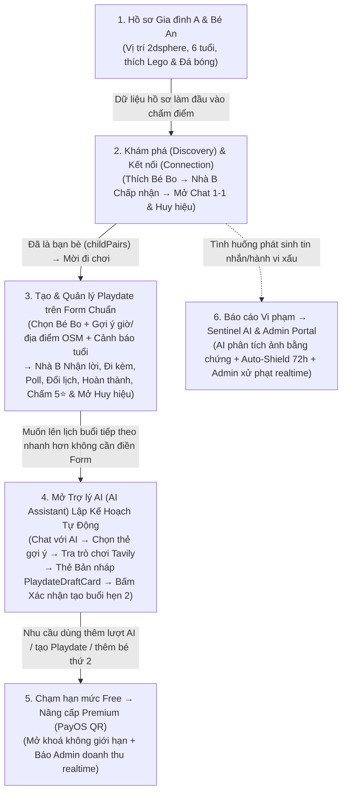

# 19. Kịch bản Live Demo Liên Kết Xuyên Suốt (15–20 Phút) & Bộ Data Input Mẫu Copy-Paste Sẵn

> **Điểm mấu chốt của kịch bản này:**
> 1. Đưa toàn bộ **Core Flow** lên đầu: **Hồ sơ $\rightarrow$ Discovery $\rightarrow$ Connection $\rightarrow$ Tạo Playdate trên Form chuẩn $\rightarrow$ Chủ động mở Trợ lý AI (AI Assistant)**.
> 2. **Tại sao tạo Playdate bằng Form trước rồi mới sang AI?**
>    - Demo **Playdate Form trước** để hội đồng thấy rõ bộ **Rule Engine gốc** của hệ thống (Gợi ý giờ rảnh, Cảnh báo giờ ngủ/giờ học theo tuổi, Tìm địa điểm OpenStreetMap, Bình chọn Poll, Đổi lịch, Chấm 5 sao & Mở huy hiệu).
>    - Sau khi đã thấy việc điền form thủ công gồm nhiều bước kiểm tra như vậy, phụ huynh **chủ động mở Trợ lý AI (AI Assistant)** để demo cách AI tự động hóa toàn bộ quy trình tìm bạn, tra trò chơi thực tế (Tavily) và lên kế hoạch buổi hẹn tiếp theo chỉ bằng vài cú click!

---

## 1. Sơ đồ Mắt Xích Liên Kết Toàn Bộ Buổi Demo (End-to-End Connected Chain)



---

## 2. Chuẩn bị 3 Cửa Sổ Trình Duyệt (Đã Login Sẵn — Không Demo Đăng Nhập)

| Cửa sổ | Nhân vật | Trạng thái chuẩn bị sẵn trước khi lên bục |
| :--- | :--- | :--- |
| **Window 1 (Trái - 50%)** | **Gia đình A (Chị Lan - Chủ buổi)**<br>Có **Bé An (6 tuổi)**: thích `Lego`, `Đá bóng`, `Vẽ tranh` | Mở sẵn trang **Hồ sơ Phụ huynh & Hồ sơ Trẻ** ([02](02-ho-so-phu-huynh.md), [03](03-ho-so-tre.md)). |
| **Window 2 (Phải - 50%)** | **Gia đình B (Anh Minh - Bạn chơi)**<br>Có **Bé Bo (6 tuổi)**: thích `Lego`, `Đá bóng` | Đặt cạnh Window 1 để hội đồng nhìn thấy **Socket.IO nhảy thông báo, lời mời và tin nhắn tức thời** giữa 2 gia đình. |
| **Window 3 (Tab riêng)** | **Admin Portal (`Port 5174`)** | Mở sẵn ở tab bên cạnh để cuối buổi chốt hạ bằng **Sentinel AI Moderation & Dashboard Doanh thu** ([14](14-quan-tri-admin.md)). |

---

## 3. Kịch Bản Demo Liên Kết 6 Mắt Xích (18 Phút)

---

### 🔗 Mắt xích 1: Hồ sơ Phụ huynh & Hồ sơ Trẻ $\rightarrow$ Đầu vào cho Smart Matching (1.5 phút)
*(Modules: [02 Hồ sơ phụ huynh](02-ho-so-phu-huynh.md) $\rightarrow$ [03 Hồ sơ trẻ](03-ho-so-tre.md))*

1. **[Window 1 - Nhà A]:** Mở **Hồ sơ Phụ huynh & Hồ sơ Trẻ**:
   - Chỉ nhanh vị trí địa lý gia đình (đã geocode tọa độ `2dsphere`), tiêu chí tìm bạn: bán kính `10 km`, độ tuổi mong muốn `5–7 tuổi`, khung giờ rảnh `Cuối tuần (Buổi sáng)`.
   - Chỉ vào hồ sơ **Bé An (6 tuổi)**: Sở thích (`Lego`, `Đá bóng`, `Vẽ tranh`), Hoạt động yêu thích (`Đi công viên`, `Đạp xe`), Tính cách (`Năng động`, `Hòa đồng`).
2. **Câu dẫn sang Mắt xích 2:** *"Toàn bộ thông tin độ tuổi, sở thích của Bé An và vị trí, lịch rảnh của Phụ huynh A sẽ làm đầu vào cho thuật toán **Khám phá & Ghép đôi (Discovery)**."*

---

### 🔗 Mắt xích 2: Khám phá (Discovery) $\rightarrow$ Kết nối (Connection) $\rightarrow$ Tự mở Chat 1-1 (3 phút)
*(Liên kết: [03 Hồ sơ trẻ](03-ho-so-tre.md) $\rightarrow$ [04 Khám phá](04-kham-pha-ghep-doi.md) $\rightarrow$ [05 Kết nối](05-ket-noi.md) $\rightarrow$ [11 Thông báo](11-thong-bao.md) $\rightarrow$ [06 Nhắn tin](06-nhan-tin.md))*

1. **[Window 1 - Nhà A]:** Vào **Khám phá (Discovery)**:
   - Chọn tìm bạn chơi cho **Bé An**.
   - Chỉ vào thẻ gợi ý **Bé Bo (6 tuổi - con Nhà B)**: giải thích **Điểm phù hợp (Match Score %)** cao vì cùng 6 tuổi, trùng sở thích `Lego, Đá bóng`, gần nhà và cùng rảnh sáng cuối tuần.
   - Bấm **Thích (Like)** thẻ của Bé Bo.
2. **[Window 2 - Nhà B (Realtime)]:**
   - Bên màn hình **Nhà B** nổ thông báo **"Lời mời kết nối từ Gia đình A"** $\rightarrow$ Nhà B bấm **Chấp nhận (Accept)**.
3. **[Kết quả liên kết 3 trong 1]:**
   - Hai gia đình thành bạn bè, lưu cặp bé **An – Bo (`childPairs`)** và mở khóa huy hiệu **`Kết nối đầu tiên (first_connection)`**.
   - Hệ thống **tự động mở khóa phòng Chat 1-1**.
   - Nhà A bấm vào phòng Chat 1-1 vừa mở, dán tin nhắn rủ đi chơi (**Mẫu 1 bên dưới**) $\rightarrow$ Nhà B nhận tin nhắn realtime và đồng ý đi chơi!

---

### 🔗 Mắt xích 3: Tạo Buổi chơi trên Playdate Form Chuẩn $\rightarrow$ Nhận lời, Đi kèm, Poll, Đổi lịch & Đánh giá 5⭐ (5 phút)
*(Liên kết: [05 Kết nối](05-ket-noi.md) $\rightarrow$ [07 Playdate & Địa điểm](07-buoi-choi-playdate.md) $\rightarrow$ [06 Nhóm Chat](06-nhan-tin.md) $\rightarrow$ [08 Đánh giá](08-danh-gia-phan-hoi.md) $\rightarrow$ [13 Thành tích](13-thanh-tich-huy-hieu.md))*

1. **Câu dẫn chuyển cảnh:** *"Sau khi hai nhà đã kết nối thành bạn bè và thống nhất trong Chat 1-1, Nhà A vào mục **Buổi chơi (Playdate)** để tạo lịch hẹn đầu tiên."*
2. **[Window 1 - Nhà A (Demo Playdate Form & Rule Engine)]:** Mở trang **Tạo Buổi chơi (`PlaydateFormPage`)**:
   - **Chọn Bé & Bạn chơi (`PlaymateSelector`):** Chọn **Bé An** $\rightarrow$ Danh sách bạn bè đã kết nối hiện ra **Bé Bo** (xếp theo điểm phù hợp).
   - **Gợi ý khung giờ & Kiểm tra quy tắc tuổi (`PlanningSuggestions` & `TimeRuleNotices`):**
     - Bấm xem các khung giờ gợi ý hợp với lịch rảnh của cả hai nhà.
     - Thử chọn một giờ trưa (12:30) hoặc giờ học ngày thường để hội đồng thấy hệ thống lập tức hiện **Cảnh báo giờ ngủ trưa / giờ học / thời lượng theo tuổi**! Sau đó chọn lại giờ chuẩn **09:00 Sáng Thứ Bảy (120 phút)**.
   - **Tìm Địa điểm & Gợi ý Hoạt động (`PlaceSearchModal`):**
     - Mở modal tìm địa điểm quanh điểm giữa của hai gia đình (lấy từ **OpenStreetMap `places_cache`**, có kiểm tra giờ mở cửa).
     - Chọn địa điểm (ví dụ Công viên Gia Định / Khu vui chơi) và dán Hoạt động + Ghi chú (**Mẫu 2 bên dưới**) $\rightarrow$ Bấm **Tạo buổi chơi**.
3. **[Window 2 - Nhà B (Nhận lời, Đi kèm, Poll & Đổi lịch)]:**
   - Bên **Nhà B** nổ thông báo lời mời Playdate $\rightarrow$ Bấm **Nhận lời (Accept)**.
   - Nhà B tự động vào **Nhóm Chat Playdate** và bấm **Đăng ký người lớn đi kèm (Chaperone)** ([BR-PD-17](07-buoi-choi-playdate.md)).
   - Trong **Nhóm Chat Playdate**, Nhà A tạo nhanh 1 **Bình chọn (Poll)** (**Mẫu 3**) $\rightarrow$ Nhà B bấm vote realtime.
   - Chủ buổi bấm **Đề xuất đổi lịch (Reschedule)** (**Mẫu 4**) $\rightarrow$ Nhà B bấm **Đồng ý biểu quyết** $\rightarrow$ Lịch hẹn tự động cập nhật!
4. **[Window 1 - Nhà A (Hoàn thành, Đánh giá 5 Sao ⭐ & Mở Huy hiệu)]:**
   - Mở buổi chơi đã đến giờ bắt đầu $\rightarrow$ Chủ buổi bấm **Hoàn thành (Complete)** $\rightarrow$ Hộp nhắc đánh giá (`RatingPrompt`) hiện ra.
   - Gửi **Đánh giá 5 sao ⭐** kèm nhận xét (**Mẫu 5 bên dưới**).
   - Mở trang **Thành tích & Huy hiệu**: Chuỗi tuần (**Weekly Streak**) tăng lên và mở khóa huy hiệu **`Buổi hẹn đầu tiên (first_playdate)`**.

---

### 🔗 Mắt xích 4: Chủ động mở Trợ lý AI (AI Assistant) $\rightarrow$ Lập Kế Hoạch Buổi Chơi Tự Động (4 phút)
*(Liên kết: [05 Kết nối](05-ket-noi.md) & [07 Playdate](07-buoi-choi-playdate.md) $\rightarrow$ [10 Trợ lý AI](10-tro-ly-ai.md))*

1. **Câu dẫn chuyển cảnh sang AI:** *"Ở Mắt xích 3 vừa rồi, phụ huynh tự tạo buổi chơi trên Form chuẩn qua các bước chọn bé, chọn bạn, kiểm tra giờ và tìm địa điểm. Bây giờ để chuẩn bị cho buổi đi chơi tuần tiếp theo nhanh hơn, phụ huynh chỉ cần bấm mở **Trợ lý AI (BuddyLink AI)** ngay trên thanh điều hướng / nút nổi góc màn hình để nhờ AI lên kế hoạch từ A đến Z!"*
2. **[Window 1 - Nhà A (Tương tác với BuddyLink AI)]:**
   - Mở trang **Trợ lý AI (`AIAssistantPage` / `AIAssistantDrawer`)**, tạo phiên mới và dán **Prompt AI (Mẫu 6 bên dưới)**.
   - Chỉ cho hội đồng thấy AI gọi **Tools (Function Calling)** và trả về các **Thẻ lựa chọn tương tác (`ChoiceCard`)** từng bước:
     - Gợi ý bạn chơi (**Bé Bo** vừa kết nối hoặc tìm thêm bạn mới qua `find-matches.tool.js`).
     - Gợi ý khung giờ trống tuần tới (đã lọc lịch bận 14 ngày).
     - Gợi ý địa điểm **Kids Cafe / Khu giải trí** gần hai nhà.
   - **Điểm nhấn Tavily Search + Gemini Grounding:** Khi chọn địa điểm khu vui chơi, AI tự động tra cứu trên mạng (**Tavily**) để lấy **danh sách trò chơi có thật tại đúng địa điểm đó**, lọc trò hợp tuổi và được cả hai bé thích để xếp vào **Thẻ Lịch trình (`AgendaCard`)** kèm link **"Nguồn trên mạng"**.
3. **[Window 1 - Nhà A (Human-in-the-Loop Confirmation)]:**
   - AI xuất ra **Thẻ Tóm tắt Bản nháp (`PlaydateDraftCard`)** kèm dự báo thời tiết (**Open-Meteo**) và cảnh báo an toàn.
   - Nhấn mạnh: *"Mọi hành động của AI đều phải qua bước xác nhận của con người (**Human-in-the-Loop**) và kiểm tra lại toàn bộ quy tắc của module Playdate gốc."*
   - Phụ huynh bấm nút **"Tạo buổi hẹn"** ngay trên thẻ bản nháp $\rightarrow$ Buổi hẹn thứ 2 được tạo thành công và gửi lời mời sang **Nhà B**!

---

### 🔗 Mắt xích 5: Chạm Hạn Mức Gói Free $\rightarrow$ Nâng Cấp Premium qua PayOS QR (2 phút)
*(Liên kết: [07 Playdate](07-buoi-choi-playdate.md) & [10 Trợ lý AI](10-tro-ly-ai.md) $\rightarrow$ [12 Gói & Thanh toán](12-goi-dich-vu-thanh-toan.md) $\rightarrow$ [14 Admin](14-quan-tri-admin.md))*

1. **Câu dẫn chuyển cảnh:** *"Mỗi lần tạo Playdate hoặc mở phiên Trợ lý AI như vừa rồi đều được kiểm soát bởi bộ đếm hạn mức (`usage_quotas`). Với gói **Free**, phụ huynh chỉ tạo được 1 hồ sơ bé, 3 Playdate/tháng và 5 phiên AI/tháng. Khi chạm hạn mức, hệ thống gợi ý nâng cấp lên **Premium**."*
2. **[Window 1 - Nhà A]:** Mở trang **Gói dịch vụ (Subscription)**:
   - Chọn gói **Premium 1 Tháng (`99.000đ`)** $\rightarrow$ Hệ thống gọi **PayOS** sinh mã **VietQR** động.
   - Quét thanh toán (hoặc xác nhận giao dịch).
3. **[Kết quả liên kết]:**
   - Tài khoản Nhà A chuyển sang **Premium Active** (mở khóa không giới hạn mọi tính năng).
   - Bên **Window 3 (Admin Portal)** nổ thông báo realtime **`payment_succeeded`**!

---

### 🔗 Mắt xích 6: Bảo Vệ An Toàn Trẻ Em $\rightarrow$ Báo cáo Vi phạm, Sentinel AI & Admin Portal (2.5 phút)
*(Liên kết: [06 Nhắn tin](06-nhan-tin.md) / [07 Playdate](07-buoi-choi-playdate.md) $\rightarrow$ [09 An toàn & Kiểm duyệt](09-an-toan-kiem-duyet.md) $\rightarrow$ [14 Quản trị Admin](14-quan-tri-admin.md))*

1. **Câu dẫn chuyển cảnh:** *"Mắt xích cuối cùng để bảo vệ toàn bộ hành trình trên là **An toàn & Kiểm duyệt**. Giả sử trong quá trình nhắn tin hoặc hẹn chơi, phụ huynh phát hiện một tài khoản có hành vi quấy rối hoặc đe dọa an toàn trẻ em."*
2. **[Window 1 - Nhà A]:** Bấm **Báo cáo (Report)** một tin nhắn/người dùng:
   - Chọn loại vi phạm: **`An toàn trẻ em` (`child_safety`)** hoặc **`Quấy rối` (`harassment`)**.
   - Dán mô tả chi tiết (**Mẫu 7 bên dưới**) + Đính kèm **1 ảnh chụp màn hình bằng chứng** $\rightarrow$ Bấm **Gửi báo cáo**.
3. **[Window 3 - Admin Portal (Sentinel AI & Xử phạt)]:**
   - Chuyển sang cửa sổ **Admin Portal**:
   - Mở chi tiết báo cáo vừa gửi $\rightarrow$ Chỉ vào khung **Đánh giá của Sentinel AI**:
     - AI đã đọc hiểu cả nội dung chữ lẫn **ảnh chụp màn hình bằng chứng**, đưa ra kết luận `Có vi phạm (violation)`, độ tự tin `Confidence Score`, và đối chiếu khung xử phạt chuẩn.
     - Với ca nghiêm trọng, **Auto-Shield** đã tự động **hạn chế nhắn tin tạm thời 72 giờ** ngay lập tức trong lúc chờ Admin.
   - Admin bấm **Nhận xử lý (Claim)** $\rightarrow$ Chọn **Áp dụng xử phạt** theo đề xuất của AI (Cảnh cáo / Tạm khóa / Khóa vĩnh viễn + Xóa tin nhắn) $\rightarrow$ Bấm **Xác nhận**.
4. **[Kết quả liên kết khép lại bài Demo]:**
   - Tin nhắn vi phạm bị gỡ/thay thế realtime trên màn hình chat; tài khoản bị khóa bị đăng xuất tức thì qua Socket; người báo cáo nhận thông báo kết quả xử lý.
   - Mở tab **Admin Dashboard Tổng quan & Doanh thu** để kết thúc bài trình bày!

---

## 4. 📋 Bộ Data Input Mẫu Copy-Paste Sẵn (Theo Đúng Thứ Tự Mắt Xích 1 $\rightarrow$ 6)

### Mẫu 1 — Tin nhắn làm quen trong Chat 1-1 sau khi Kết nối (Mắt xích 2)
- **Nhà A gửi:**
  ```text
  Chào gia đình bé Bo nhé! Mình thấy hai bé An và Bo đều 6 tuổi và rất mê đá bóng với lắp Lego. Cuối tuần này gia đình mình rảnh sáng Thứ Bảy, mình tạo một buổi hẹn Playdate trên app mời nhà mình đi công viên chơi chung nhé!
  ```
- **Nhà B trả lời:**
  ```text
  Chào mẹ bé An! Tuyệt quá, sáng Thứ Bảy tuần này nhà mình cũng đang rảnh. Mẹ bé An tạo lịch hẹn Playdate rồi gửi lời mời qua cho nhà mình nhận lời nha!
  ```

---

### Mẫu 2 — Điền Form Tạo Buổi Chơi Đầu Tiên (Mắt xích 3 - Playdate Form)
- **Hoạt động (`activity`):**
  ```text
  Dã ngoại công viên, đá bóng mini và lắp ráp Lego ngoài trời
  ```
- **Ghi chú cho các gia đình (`note`):**
  ```text
  Các ba mẹ nhớ mang theo bình nước cá nhân, mũ rộng vành và áo thun dự phòng cho hai bé nhé. Mình tập trung ở cổng chính lúc 8h50 nha!
  ```

---

### Mẫu 3 — Tạo Bình chọn (Poll) trong Nhóm Chat Playdate (Mắt xích 3)
- **Câu hỏi bình chọn (`question`):**
  ```text
  Hai gia đình mình thống nhất khung giờ nào sáng Thứ Bảy để các bé chơi mát mẻ nhất ạ?
  ```
- **Lựa chọn 1:** `08:30 - 10:30 (Mát mẻ, vắng người)`
- **Lựa chọn 2:** `09:00 - 11:00 (Thong thả ăn sáng xong)`

---

### Mẫu 4 — Lý do Đề xuất Đổi lịch Playdate (Mắt xích 3)
```text
Theo kết quả bình chọn trong nhóm chat, mình đề xuất dời giờ bắt đầu sang 09:30 sáng để hai gia đình chuẩn bị ăn sáng cho các bé thong thả hơn nhé ạ.
```

---

### Mẫu 5 — Đánh giá 5 Sao sau khi Hoàn thành Buổi chơi (Mắt xích 3 $\rightarrow$ Kích hoạt AI ở Mắt xích 4)
- **Số sao:** `5` ⭐
- **Nhãn (`tags`):** `Thân thiện`, `Đúng giờ`, `Hòa đồng`, `An toàn`
- **Nhận xét (`feedback`):**
  ```text
  Buổi hẹn đầu tiên của hai bé diễn ra ngoài mong đợi! Bé Bo rất ngoan và hòa đồng, hai bạn chơi đá bóng và lắp Lego suốt 2 tiếng cực kỳ ăn ý. Gia đình anh Minh rất đúng giờ và chu đáo. Chắc chắn hai nhà sẽ hẹn nhau đi chơi tiếp vào tuần tới!
  ```

---

### Mẫu 6 — Câu lệnh cho Trợ lý AI lên lịch Buổi hẹn tiếp theo (Mắt xích 4 - AI Assistant)
- **Prompt gửi cho Trợ lý AI:**
  ```text
  Buổi chơi trước hai bé hợp nhau lắm! Lên kế hoạch giúp mình một buổi hẹn tiếp theo cho bé An và bé Bo vào sáng Chủ Nhật tuần tới lúc 09:00 trong 120 phút ở một khu vui chơi trong nhà hoặc kids cafe gần hai gia đình nhé!
  ```
- **Ghi chú thêm trên bản nháp AI (nếu cần):**
  ```text
  Lần này cho hai bé trải nghiệm khu vui chơi trong nhà, ba mẹ nhớ mang tất chống trượt cho các bé nhé!
  ```

---

### Mẫu 7 — Nội dung Báo cáo Vi phạm để Demo Sentinel AI (Mắt xích 6)
- **Loại vi phạm:** `An toàn trẻ em` (`child_safety`) hoặc `Quấy rối` (`harassment`)
- **Mô tả chi tiết (`description`):**
  ```text
  Tài khoản này liên tục gửi tin nhắn có lời lẽ quấy rối, đe dọa và gặng hỏi thông tin riêng tư về địa chỉ trường học cũng như giờ đón con của gia đình tôi dù tôi đã từ chối. Hành vi này có dấu hiệu bất thường và đe dọa trực tiếp đến sự an toàn của trẻ em. Tôi đính kèm ảnh chụp màn hình đoạn tin nhắn làm bằng chứng, đề nghị Admin xử lý nghiêm.
  ```
- **Ghi chú của Admin khi xử lý (`adminNotes`):**
  ```text
  Đã kiểm tra bằng chứng hình ảnh đính kèm và đối chiếu với phân tích từ Sentinel AI. Xác nhận hành vi vi phạm quy tắc an toàn trẻ em và tiêu chuẩn cộng đồng của BuddyLink. Áp dụng hình thức xử phạt theo đúng khung chính sách.
  ```
